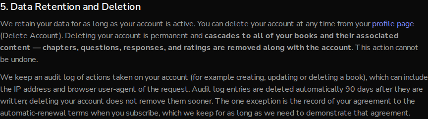

# Issue #787: audit_logs rows expire, carry no titles, and reads are not logged

*2026-10-11T02:09:40Z by Showboat 0.6.1*
<!-- showboat-id: 58e988cf-87fc-4e16-bab9-fec6bed060de -->

Setup, done before this document started: a local MongoDB 8 database `auto-author-demo-787` was seeded with two rows shaped like the ones written before this change (a `book_create` row holding a title, and a `billing.renewal_consent` row, both dated 2026-09-01, neither with `expires_at`). The collection had only the `_id_` index. The backend from this branch was then started against it on port 8787 with the auth bypass, so requests run as `test-auth-id` through the real `audit_request`.

## Criterion 1: audit_logs has a TTL index and an actor index

Startup created both indexes and backfilled the legacy row. The consent row was left without an expiry.

```bash
mongosh --quiet auto-author-demo-787 --eval '
db.audit_logs.getIndexes().forEach(i => print(i.name, JSON.stringify(i.key), i.expireAfterSeconds === undefined ? "" : "expireAfterSeconds=" + i.expireAfterSeconds));
print("--- legacy rows after startup");
db.audit_logs.find({actor_id: "legacy-user"}).forEach(r => print(r.action.padEnd(24), "timestamp", r.timestamp.toISOString().slice(0,10), "expires_at", r.expires_at ? r.expires_at.toISOString().slice(0,10) : "(none)"));'

```

```output
_id_ {"_id":1} 
audit_logs_ttl_idx {"expires_at":1} expireAfterSeconds=0
actor_timestamp_idx {"actor_id":1,"timestamp":-1} 
--- legacy rows after startup
book_create              timestamp 2026-09-01 expires_at 2026-11-30
billing.renewal_consent  timestamp 2026-09-01 expires_at (none)
```

2026-09-01 plus 90 days is 2026-11-30.

## Criteria 2 and 4: no titles, and no row per read

Create a book with a distinctive title, read it twice, read the profile, then delete it.

```bash
API=http://127.0.0.1:8787/api/v1
ID=$(curl -s -X POST $API/books/ -H 'Content-Type: application/json' -d '{"title":"Zebra Quokka Memoir 787","genre":"Memoir"}' | python3 -c 'import sys,json; print(json.load(sys.stdin)["id"])')
for path in books/$ID books/$ID users/me; do curl -s -o /dev/null -w "GET /$path -> %{http_code}\n" $API/$path | sed "s/$ID/<book>/"; done
curl -s -o /dev/null -w "DELETE /books/<book> -> %{http_code}\n" -X DELETE $API/books/$ID

```

```output
GET /books/<book> -> 200
GET /books/<book> -> 200
GET /users/me -> 200
DELETE /books/<book> -> 204
```

Every audit row those five requests wrote, with the keys of `details` and the gap between `timestamp` and `expires_at`:

```bash
mongosh --quiet auto-author-demo-787 --eval '
db.audit_logs.find({actor_id: "test-auth-id"}).sort({timestamp: 1}).forEach(r => print(r.action.padEnd(12), "expires in", (r.expires_at - r.timestamp) / 86400000, "days  details:", Object.keys(r.details).join(",")));
const mine = db.audit_logs.find({actor_id: "test-auth-id"}).toArray();
print("--- rows written:", mine.length);
print("rows containing the title:", mine.filter(r => JSON.stringify(r).includes("Zebra Quokka")).length);
print("book_view or profile_view rows:", db.audit_logs.countDocuments({action: {$in: ["book_view", "profile_view"]}}));
print("rows with a top-level ip_address field:", mine.filter(r => "ip_address" in r).length);'

```

```output
book_create  expires in 90 days  details: 
book_create  expires in 90 days  details: method,path,ip_address,user_agent,request_id
book_delete  expires in 90 days  details: cascade_deleted
book_delete  expires in 90 days  details: method,path,ip_address,user_agent,request_id
--- rows written: 4
rows containing the title: 0
book_view or profile_view rows: 0
rows with a top-level ip_address field: 0
```

Three GETs wrote nothing. The create and delete each wrote a DAO row and an endpoint row, none with a title. The endpoint rows still carry the request details (`ip_address`, `user_agent`), which is what the 90-day expiry is for.

## The TTL reaps for real, and spares consent rows

Insert one ordinary row and one consent row whose dates are already past, then wait for the TTL monitor (it runs once a minute).

```bash
mongosh --quiet auto-author-demo-787 --eval '
db.audit_logs.insertOne({action: "book_update", actor_id: "ttl-demo", timestamp: new Date(Date.now() - 91*86400000), expires_at: new Date(Date.now() - 86400000)});
db.audit_logs.insertOne({action: "billing.renewal_consent", actor_id: "ttl-demo", timestamp: new Date(Date.now() - 91*86400000)});
print("before: ", db.audit_logs.find({actor_id: "ttl-demo"}).map(r => r.action).toArray().join(", "));
let waited = 0;
while (db.audit_logs.countDocuments({actor_id: "ttl-demo", action: "book_update"}) > 0 && waited < 120) { sleep(5000); waited += 5; }
print("after:  ", db.audit_logs.find({actor_id: "ttl-demo"}).map(r => r.action).toArray().join(", "), waited < 120 ? "(expired row reaped by the TTL monitor)" : "(NOT reaped within 120s)");'

```

```output
before:  billing.renewal_consent, book_update
after:   billing.renewal_consent (expired row reaped by the TTL monitor)
```

## Criterion 4: the decision is recorded

```bash
grep -o 'Decision: reads are not audited.*' docs/CHANGELOG.md | fold -s -w 110

```

```output
Decision: reads are not audited.** The `book_view` and `profile_view` rows are removed, not sampled. Nothing 
reads `audit_logs`, a read changes no state, and `chapter_access_logs` already records reading activity with 
its own 90-day TTL. A sample of views would be evidence of nothing in particular, so the choice was all or 
none.
```

## Criterion 3: retention is stated in the Privacy Policy

The frontend from this branch on port 3787. The text below is the second paragraph of section 5 as the browser rendered it.

```bash
node /tmp/claude-1000/-home-frankbria-projects-auto-author/9609c301-bd84-4358-91b1-67a5431c63f6/scratchpad/privacy-shot.cjs "$PWD" docs/demos/issue787-privacy-retention.png | fold -s -w 110
```

```output
We keep an audit log of actions taken on your account (for example creating, updating or deleting a book), 
which can include the IP address and browser user-agent of the request. Audit log entries are deleted 
automatically 90 days after they are written; deleting your account does not remove them sooner. The one 
exception is the record of your agreement to the automatic-renewal terms when you subscribe, which we keep 
for as long as we need to demonstrate that agreement.
```

```bash {image}

```


