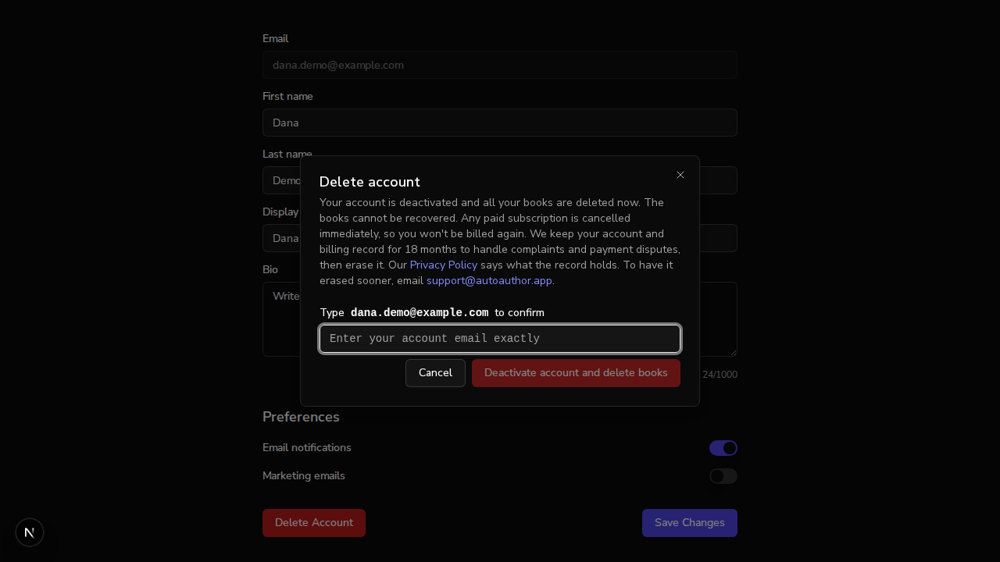

# Issue #954: deleting an account deactivates it and keeps the account and billing record for 18 months

*2026-10-11T05:20:35Z by Showboat 0.6.1*
<!-- showboat-id: f5ad8aa1-ac7e-43c8-bf28-fd1c81bb5c02 -->

Setup, done before this document started. The branch's backend (port 8100) and frontend (port 3102) run against a fresh local MongoDB database, `aa_demo_954`; nothing here reaches a real service. Sign-up and sign-in go through the real better-auth routes. The Stripe SDK points at a local stand-in for api.stripe.com that logs each request to `$D/stripe.log`. One record was inserted by hand to stand for an account erased before this change: `{auth_id: "erased-before-954", deleted_at: 2026-09-01}`. `$API`, `$WEB`, `$DB`, `$D` (a scratch directory) and `$DEMO_PW` are exported in the shell; `section.py` prints the visible text of one `<section>` of a page.

## An account worth deleting

Dana signs up, fills in a profile, writes two books and uploads a picture. The billing fields are set directly in the database, as the Stripe webhook would set them for a paying subscriber.

```bash
curl -s -c $D/dana.jar -X POST $WEB/api/auth/sign-up/email -H "Origin: $WEB" -H 'Content-Type: application/json' \
  -d "{\"email\":\"dana.demo@example.com\",\"password\":\"$DEMO_PW\",\"name\":\"Dana Demo\"}" -o /dev/null -w "sign up -> %{http_code}\n"
curl -s -b $D/dana.jar -o /dev/null -w "GET /users/me -> %{http_code}\n" $API/users/me
curl -s -b $D/dana.jar -X PATCH $API/users/me -H 'Content-Type: application/json' \
  -d '{"display_name":"Dana D.","bio":"Writes about lighthouses"}' -o /dev/null -w "PATCH /users/me -> %{http_code}\n"
for t in "Lighthouse Keeping" "Tides"; do
  curl -s -b $D/dana.jar -X POST $API/books/ -H 'Content-Type: application/json' -d "{\"title\":\"$t\"}" -o /dev/null -w "POST /books ($t) -> %{http_code}\n"
done
curl -s -b $D/dana.jar -X POST $API/users/me/avatar -F "file=@$D/avatar.png" -o /dev/null -w "POST /users/me/avatar -> %{http_code}\n"
mongosh --quiet $DB --eval '
db.users.updateOne({email: "dana.demo@example.com"}, {$set: {plan: "pro", stripe_customer_id: "cus_demo_954", stripe_subscription_id: "sub_demo_954", stripe_subscription_status: "active"}});
const u = db.users.findOne({email: "dana.demo@example.com"});
print("users record fields:", Object.keys(u).filter(k => k !== "_id").sort().join(", "));
print("books owned:", db.books.countDocuments({owner_id: u.auth_id}));
["user", "account", "session"].forEach(c => print("better-auth " + c + " rows:", db[c].countDocuments({})));'
echo "avatar files: $(ls $D/run/uploads/profile_pictures | wc -l)"

```

```output
sign up -> 200
GET /users/me -> 200
PATCH /users/me -> 200
POST /books (Lighthouse Keeping) -> 201
POST /books (Tides) -> 201
POST /users/me/avatar -> 200
users record fields: auth_id, avatar_url, bio, book_ids, created_at, display_name, email, first_name, is_active, last_name, metadata, plan, role, stripe_customer_id, stripe_subscription_id, stripe_subscription_status, updated_at
books owned: 2
better-auth user rows: 1
better-auth account rows: 1
better-auth session rows: 1
avatar files: 1
```

## Criterion 7: the profile page says what happens

Dana signs in at `/auth/sign-in` in a headless browser, opens `/profile` and clicks "Delete Account". The text of the dialog that opens:

```bash
agent-browser get text '[role="dialog"] p' | fold -s -w 100
echo "--- buttons: $(agent-browser snapshot -i | grep -o 'button "[^"]*"[^-]*' | tr '\n' ' ')"
echo "--- contains \"permanently\": $(agent-browser get text '[role="dialog"]' | grep -ci permanently)"

```

```output
Your account is deactivated and all your books are deleted now. The books cannot be recovered. Any 
paid subscription is cancelled immediately, so you won't be billed again. We keep your account and 
billing record for 18 months to handle complaints and payment disputes, then erase it. Our Privacy 
Policy says what the record holds. To have it erased sooner, email support@autoauthor.app.
--- buttons: button "Cancel" [ref=e4] button "Deactivate account and delete books" [ref=e5] [disabled] button "Close" [ref=e6] 
--- contains "permanently": 0
```

```bash {image}

```



She types her email and confirms.

```bash
agent-browser fill '#confirm-delete-account' 'dana.demo@example.com' >/dev/null
agent-browser click 'button[type="submit"][data-variant="destructive"], [role="dialog"] button[type="submit"]' >/dev/null
agent-browser wait 2000 >/dev/null
agent-browser get text 'body' | grep -o 'Account deactivated' | head -1
agent-browser wait 3000 >/dev/null
echo "now at: $(agent-browser get url)"

```

```output
Account deactivated
now at: http://localhost:3102/auth/sign-in?redirect=%2Fprofile
```

## Criterion 1: the account and billing record is kept, everything else is deleted

The whole users record after that click, then what is left of the rest.

```bash
mongosh --quiet $DB --eval '
const u = db.users.findOne({"retained.email": "dana.demo@example.com"});
print(EJSON.stringify(u, null, 2, {relaxed: true}).replace(/"_id": \{[^}]*\},\n/s, ""));
print("--- days from deleted_at to purge_at:", (u.purge_at - u.deleted_at) / 86400000);
print("books owned:", db.books.countDocuments({owner_id: u.auth_id}));
["user", "account", "session"].forEach(c => print("better-auth " + c + " rows:", db[c].countDocuments({})));'
echo "avatar files: $(ls $D/run/uploads/profile_pictures | wc -l)"
echo "--- requests the Stripe stand-in received:"; cat $D/stripe.log

```

```output
{
    "auth_id": "6acb1cb376dd2bf47063c1d7",
  "deleted_at": {
    "$date": "2026-10-11T05:22:37.129Z"
  },
  "purge_at": {
    "$date": "2028-04-11T05:22:37.129Z"
  },
  "retained": {
    "email": "dana.demo@example.com",
    "first_name": "Dana",
    "last_name": "Demo",
    "display_name": "Dana D.",
    "created_at": {
      "$date": "2026-10-11T05:20:53.179Z"
    },
    "plan": "free",
    "stripe_customer_id": "cus_demo_954",
    "cancelled_subscription": {
      "id": "sub_demo_954",
      "plan": "pro",
      "status": "active"
    }
  }
}
--- days from deleted_at to purge_at: 548
books owned: 0
better-auth user rows: 0
better-auth account rows: 0
better-auth session rows: 0
avatar files: 0
--- requests the Stripe stand-in received:
DELETE /v1/subscriptions/sub_demo_954
```

## Criterion 2: a deactivated user cannot sign in or call the API

`dana.jar` holds the session cookie from the sign-up above: a second device that was still signed in when she deleted the account in the browser. Then she tries her password again.

```bash
curl -s -b $D/dana.jar -w " <- GET /users/me %{http_code}\n" $API/users/me
curl -s -b $D/dana.jar -X POST $API/books/ -H 'Content-Type: application/json' -d '{"title":"After"}' -w " <- POST /books %{http_code}\n"
curl -s -X POST $WEB/api/auth/sign-in/email -H "Origin: $WEB" -H 'Content-Type: application/json' \
  -d "{\"email\":\"dana.demo@example.com\",\"password\":\"$DEMO_PW\"}" -w " <- sign in %{http_code}\n"

```

```output
{"detail":"Not authenticated. Please sign in."} <- GET /users/me 401
{"detail":"Not authenticated. Please sign in."} <- POST /books 401
{"message":"Invalid email or password","code":"INVALID_EMAIL_OR_PASSWORD"} <- sign in 401
```

The session resolver also rejects the id on its own. A session row forged for the deactivated id, with the better-auth user row put back, still gets 401 and nothing is written onto the record.

```bash
mongosh --quiet $DB --eval '
const u = db.users.findOne({"retained.email": "dana.demo@example.com"});
const id = new ObjectId(u.auth_id), now = new Date();
db.user.insertOne({_id: id, email: "dana.demo@example.com", name: "Dana Demo", createdAt: now, updatedAt: now});
db.session.insertOne({token: "forged-954", userId: id, expiresAt: new Date(now.getTime() + 86400000), createdAt: now, updatedAt: now});'
curl -s -H 'Cookie: better-auth.session_token=forged-954.sig' -w " <- GET /users/me %{http_code}\n" $API/users/me
mongosh --quiet $DB --eval '
const u = db.users.findOne({"retained.email": "dana.demo@example.com"});
print("record fields after the attempt:", Object.keys(u).filter(k => k !== "_id").join(", "));
db.user.deleteOne({_id: new ObjectId(u.auth_id)}); db.session.deleteOne({token: "forged-954"});'

```

```output
{
  acknowledged: true,
  insertedId: ObjectId('6acb1d3770014979dd905510')
}
{"detail":"This account is no longer active."} <- GET /users/me 401
record fields after the attempt: auth_id, deleted_at, purge_at, retained
{ acknowledged: true, deletedCount: 1 }
```

## Criterion 6: Stripe events that arrive after deactivation change nothing

Two correctly signed events for Dana's Stripe customer: the `customer.subscription.deleted` that Stripe sends after the cancel above, and a late `customer.subscription.updated` saying the subscription is active on the pro price, which on a live account would grant pro. `sign_event.py` builds the `Stripe-Signature` header from the webhook secret.

```bash
AUTH_ID=$(mongosh --quiet $DB --eval 'print(db.users.findOne({"retained.email": "dana.demo@example.com"}).auth_id)')
before=$(mongosh --quiet $DB --eval 'print(EJSON.stringify(db.users.findOne({"retained.email": "dana.demo@example.com"})))' | md5sum)
for kind in deleted:canceled updated:active; do
  cat > $D/event.json <<JSON
{"id":"evt_demo_${kind%%:*}","object":"event","type":"customer.subscription.${kind%%:*}","created":$(date +%s),
 "data":{"object":{"id":"sub_demo_954","object":"subscription","customer":"cus_demo_954","status":"${kind##*:}",
 "metadata":{"auth_id":"$AUTH_ID"},"items":{"object":"list","data":[{"price":{"id":"price_demo_pro"}}]}}}}
JSON
  curl -s -X POST $API/webhooks/stripe -H "Stripe-Signature: $(python3 $D/sign_event.py $D/event.json)" \
    --data-binary @$D/event.json -w " <- customer.subscription.${kind%%:*} %{http_code}\n"
done
after=$(mongosh --quiet $DB --eval 'print(EJSON.stringify(db.users.findOne({"retained.email": "dana.demo@example.com"})))' | md5sum)
[ "$before" = "$after" ] && echo "record unchanged (same checksum before and after)" || echo "RECORD CHANGED"
mongosh --quiet $DB --eval 'print("users records holding cus_demo_954 at the top level:", db.users.countDocuments({stripe_customer_id: "cus_demo_954"}), "| users records in total:", db.users.countDocuments({}))'

```

```output
{"status":"account_closed"} <- customer.subscription.deleted 200
{"status":"account_closed"} <- customer.subscription.updated 200
record unchanged (same checksum before and after)
users records holding cus_demo_954 at the top level: 0 | users records in total: 2
```

`account_closed` means the event found the record (through the `auth_id` that checkout stamps on the subscription) and stopped there. The two records are Dana's and the one inserted in setup.

## Criterion 3: the same email signs up again as a new, unconnected account

```bash
curl -s -c $D/dana2.jar -X POST $WEB/api/auth/sign-up/email -H "Origin: $WEB" -H 'Content-Type: application/json' \
  -d "{\"email\":\"dana.demo@example.com\",\"password\":\"$DEMO_PW\",\"name\":\"Dana Demo\"}" -o /dev/null -w "sign up again -> %{http_code}\n"
curl -s -b $D/dana2.jar -o /dev/null -w "GET /users/me -> %{http_code}\n" $API/users/me
mongosh --quiet $DB --eval '
const old = db.users.findOne({"retained.email": "dana.demo@example.com"}), fresh = db.users.findOne({email: "dana.demo@example.com"});
print("same auth_id:", old.auth_id === fresh.auth_id);
[["old record", old], ["new record", fresh]].forEach(([name, u]) => print(name,
  "| top-level email:", u.email || "(none)", "| retained.email:", (u.retained || {}).email || "(none)",
  "| plan:", u.plan || "(none)", "| stripe_customer_id:", u.stripe_customer_id || "(none)",
  "| retained.stripe_customer_id:", (u.retained || {}).stripe_customer_id || "(none)"));'

```

```output
sign up again -> 200
GET /users/me -> 200
same auth_id: false
old record | top-level email: (none) | retained.email: dana.demo@example.com | plan: (none) | stripe_customer_id: (none) | retained.stripe_customer_id: cus_demo_954
new record | top-level email: dana.demo@example.com | retained.email: (none) | plan: free | stripe_customer_id: (none) | retained.stripe_customer_id: (none)
```

## Criteria 4 and 9: the record is erased when its 18 months are up, and nothing else is touched

A second user, Eli, signs up and deletes his account through the API, so there is a deactivated record that is not due. Dana's deactivated record is then moved 549 days into the past, one day beyond its retention, and the backend is restarted. Nothing calls an endpoint: the app runs the purge when it starts and once a day after that.

```bash
curl -s -c $D/eli.jar -X POST $WEB/api/auth/sign-up/email -H "Origin: $WEB" -H 'Content-Type: application/json' \
  -d "{\"email\":\"eli.demo@example.com\",\"password\":\"$DEMO_PW\",\"name\":\"Eli Example\"}" -o /dev/null -w "Eli signs up -> %{http_code}\n"
curl -s -b $D/eli.jar -o /dev/null -w "GET /users/me -> %{http_code}\n" $API/users/me
curl -s -b $D/eli.jar -X DELETE $API/users/me -w " <- DELETE /users/me %{http_code}\n"
mongosh --quiet $DB --eval '
const ago = new Date(Date.now() - 549 * 86400000);
db.users.updateOne({"retained.email": "dana.demo@example.com"}, {$set: {deleted_at: ago, purge_at: new Date(ago.getTime() + 548 * 86400000)}});
const show = u => (u.retained ? "deactivated, purge_at " + u.purge_at.toISOString().slice(0, 10) + ", retained: " + Object.keys(u.retained).join(",")
  : u.deleted_at ? "erased: only " + Object.keys(u).filter(k => k !== "_id").join(",") + " (deleted_at " + u.deleted_at.toISOString().slice(0, 10) + ")"
  : "active, email " + u.email);
globalThis.rows = () => db.users.find().sort({_id: 1}).forEach(u => print(" ", u.auth_id.padEnd(24), show(u)));
print("before the restart:"); rows();'
$D/restart_backend.sh
sleep 2
mongosh --quiet $DB --eval '
const show = u => (u.retained ? "deactivated, purge_at " + u.purge_at.toISOString().slice(0, 10) + ", retained: " + Object.keys(u.retained).join(",")
  : u.deleted_at ? "erased: only " + Object.keys(u).filter(k => k !== "_id").join(",") + " (deleted_at " + u.deleted_at.toISOString().slice(0, 10) + ")"
  : "active, email " + u.email);
print("after the restart:"); db.users.find().sort({_id: 1}).forEach(u => print(" ", u.auth_id.padEnd(24), show(u)));
print("records that still mention dana.demo@example.com in retained:", db.users.countDocuments({"retained.email": "dana.demo@example.com"}));'
grep -h "Purged" $D/backend.log

```

```output
Eli signs up -> 200
GET /users/me -> 200
{"message":"Account deactivated"} <- DELETE /users/me 200
before the restart:
  erased-before-954        erased: only auth_id,deleted_at (deleted_at 2026-09-01)
  6acb1cb376dd2bf47063c1d7 deactivated, purge_at 2026-10-10, retained: email,first_name,last_name,display_name,created_at,plan,stripe_customer_id,cancelled_subscription
  6acb1d8c76dd2bf47063c1de active, email dana.demo@example.com
  6acb1da176dd2bf47063c1e1 deactivated, purge_at 2028-04-11, retained: email,first_name,last_name,created_at,plan
backend restarted, /health -> 200
after the restart:
  erased-before-954        erased: only auth_id,deleted_at (deleted_at 2026-09-01)
  6acb1cb376dd2bf47063c1d7 erased: only auth_id,deleted_at (deleted_at 2025-04-10)
  6acb1d8c76dd2bf47063c1de active, email dana.demo@example.com
  6acb1da176dd2bf47063c1e1 deactivated, purge_at 2028-04-11, retained: email,first_name,last_name,created_at,plan
records that still mention dana.demo@example.com in retained: 0
INFO:app.main:Purged 1 expired deactivated account(s)
```

The account erased before this change is exactly as it was, and so are the active account and the record that is not due.

## Criteria 5 and 9: support erases a deactivated account early

Eli asks support to erase his record now. A support user (role `admin`, set in the database) calls the existing admin route on his id, then calls it again, then calls it on the account that was erased before this change.

```bash
curl -s -c $D/admin.jar -X POST $WEB/api/auth/sign-up/email -H "Origin: $WEB" -H 'Content-Type: application/json' \
  -d "{\"email\":\"support.demo@example.com\",\"password\":\"$DEMO_PW\",\"name\":\"Sam Support\"}" -o /dev/null -w "support signs up -> %{http_code}\n"
curl -s -b $D/admin.jar -o /dev/null -w "GET /users/me -> %{http_code}\n" $API/users/me
ELI=$(mongosh --quiet $DB --eval 'db.users.updateOne({email: "support.demo@example.com"}, {$set: {role: "admin"}}); print(db.users.findOne({"retained.email": "eli.demo@example.com"}).auth_id)')
old=$(mongosh --quiet $DB --eval 'print(EJSON.stringify(db.users.findOne({auth_id: "erased-before-954"})))')
curl -s -b $D/admin.jar -X DELETE $API/users/$ELI -w "DELETE /users/<eli> -> %{http_code}\n"
mongosh --quiet $DB --eval "const u = db.users.findOne({auth_id: '$ELI'}); print('Eli record fields:', Object.keys(u).filter(k => k !== '_id').join(', '));
const a = db.audit_logs.findOne({action: 'user_erase'}); print('audit row: action', a.action, '| actor is the support user:', a.actor_id === db.users.findOne({email: 'support.demo@example.com'}).auth_id, '| target is Eli:', a.target_id === '$ELI');"
curl -s -b $D/admin.jar -X DELETE $API/users/$ELI -w " <- DELETE /users/<eli> again %{http_code}\n"
curl -s -b $D/admin.jar -X DELETE $API/users/erased-before-954 -w " <- DELETE /users/erased-before-954 %{http_code}\n"
[ "$old" = "$(mongosh --quiet $DB --eval 'print(EJSON.stringify(db.users.findOne({auth_id: "erased-before-954"})))')" ] && echo "erased-before-954 unchanged: $old"

```

```output
support signs up -> 200
GET /users/me -> 200
DELETE /users/<eli> -> 204
Eli record fields: auth_id, deleted_at
audit row: action user_erase | actor is the support user: true | target is Eli: true
{"detail":"User not found"} <- DELETE /users/<eli> again 404
{"detail":"User not found"} <- DELETE /users/erased-before-954 404
erased-before-954 unchanged: {"_id":{"$oid":"6acb1ca312ef622374631907"},"auth_id":"erased-before-954","deleted_at":{"$date":"2026-09-01T00:00:00Z"}}
```

## Criterion 8: `/privacy` and `/terms` say the same thing

The rendered pages, fetched from the running frontend. Section 8 of the Privacy Policy lists the same fields the record in criterion 1 holds.

```bash
curl -s $WEB/privacy > $D/privacy.html; curl -s $WEB/terms > $D/terms.html
echo "== /privacy section 3, legitimate interests"; python3 $D/section.py "3. How We Use" < $D/privacy.html | tr '\n' ' ' | grep -o 'Legitimate interests[^.]*\.' | fold -s -w 100
echo; echo "== /privacy section 8"; python3 $D/section.py "8. Data Retention" < $D/privacy.html
echo; echo "== /privacy section 9, closing paragraph"; python3 $D/section.py "9. Your Rights" < $D/privacy.html | tr '\n' ' ' | grep -o 'You can delete your content.*' | fold -s -w 100
echo; echo "== /terms section 7"; python3 $D/section.py "7. Termination" < $D/terms.html
echo; echo "\"permanent\" or \"cannot be undone\" in /privacy section 8 or /terms section 7: $( (python3 $D/section.py "8. Data Retention" < $D/privacy.html; python3 $D/section.py "7. Termination" < $D/terms.html) | grep -ciE 'permanent|cannot be undone')"

```

```output
== /privacy section 3, legitimate interests
Legitimate interests — to keep the Service secure, prevent abuse, keep the audit log described 
below, diagnose errors, and handle complaints and payment disputes after an account is closed 
(section 8).

== /privacy section 8
8. Data Retention and Deletion We retain your data for as long as your account is active. You can
delete your account at any time from your profile page (Delete Account). Deleting your account
deletes all of your books and their associated content at once — chapters, questions, responses, and
ratings, along with your profile picture, bio and preferences. They cannot be recovered. It also
signs you out on every device and removes your password and other sign-in details, so the account
can no longer be used. The account itself is deactivated rather than erased at once. We keep a
record of it for 18 months so that we can answer a complaint or a payment dispute: an internal
account identifier, your name, your email address, the dates the account was created and deleted,
your plan, the reference that links the account to our payment processor, and the reference, plan
and status of any subscription that was cancelled when you deleted the account. After 18 months the
record is erased automatically, down to the account identifier and the date of deletion. You can ask
us to erase it sooner by contacting us using the details below. You can sign up again with the same
email address at any time; a new account is not connected to the old record. Deleting your account
also cancels any active subscription. Records of past payments (invoices, and the email address,
billing address and any tax ID attached to them) stay with our payment processor, which keeps them
to meet its own legal obligations. We keep an audit log of actions taken on your account (for
example creating, updating or deleting a book), which can include the IP address and browser user-
agent of the request. Audit log entries are deleted automatically 90 days after they are written;
deleting your account does not remove them sooner. The one exception is the record of your agreement
to the automatic-renewal terms when you subscribe, which we keep for as long as we need to
demonstrate that agreement.

== /privacy section 9, closing paragraph
You can delete your content and close your account directly from your profile page. To have the 
account record we keep for 18 months (section 8) erased sooner, or for any other request, contact 
us using the details below. We do not charge for a request and will not treat you differently for 
making one. 

== /terms section 7
7. Termination You may stop using the Service and delete your account at any time from your profile
page. Deleting your account deletes your books and deactivates the account; we keep the account and
billing record for 18 months, as our Privacy Policy describes. Deleting your account cancels a paid
subscription immediately; you do not keep paid access for the rest of the billing period. We may
suspend or terminate access for violations of these terms.

"permanent" or "cannot be undone" in /privacy section 8 or /terms section 7: 0
```

## Result

| Criterion | Evidence above |
|---|---|
| 1. Account and billing fields kept, purge date 18 months out, subscription cancelled, books and avatar deleted | The record holds only `auth_id`, `deleted_at`, `purge_at` and `retained`; 548 days apart; 0 books, 0 avatar files; the Stripe stand-in received one `DELETE /v1/subscriptions/sub_demo_954` |
| 2. Cannot sign in or call the API | 401 from a still-open second session, 401 on sign-in with the old password, 401 "This account is no longer active." for a forged session |
| 3. Same email signs up again, unconnected | New `auth_id`, plan free, no Stripe id; the old record keeps its email and customer id under `retained` |
| 4. Erased after 18 months with no one acting | A record one day past its purge date became `auth_id` + `deleted_at` on app start; log line "Purged 1 expired deactivated account(s)" |
| 5. Support erases early through the admin path | Admin `DELETE /users/<eli>` returned 204, the record is a tombstone, and a `user_erase` audit row names the admin |
| 6. Late Stripe events do not revive it | Both events answered 200 `account_closed`; record checksum unchanged; no second record for the customer |
| 7. Profile page says what happens | Dialog text and screenshot; "permanently" appears 0 times |
| 8. `/privacy` 3, 8, 9 and `/terms` agree | Rendered text of all four sections |
| 9. Accounts erased earlier stay erased | `erased-before-954` identical after the purge and after an admin DELETE (404) |

Not shown here: the daily repeat of the purge (the loop sleeps 24 hours; the startup run is the same call), and a real Stripe account. After deleting in the browser Dana landed on `/auth/sign-in?redirect=%2Fprofile` rather than the home page, which is how the page behaved before this change.
