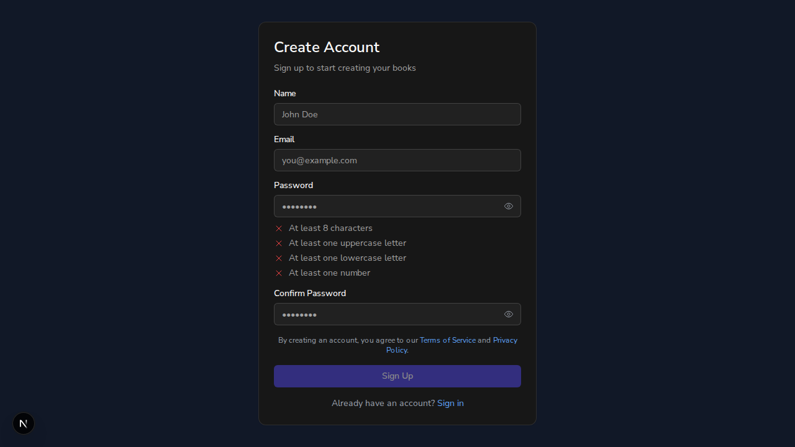

# Issue #789: sign-up records Terms acceptance, notice above the button

*2026-10-11T18:47:56Z by Showboat 0.6.1*
<!-- showboat-id: 18fbcbc2-8420-4c1b-bf5d-8425ea1cf113 -->

The real stack is running locally: the Next.js app with real better-auth (no auth bypass) on $WEB, the FastAPI backend on $API, both on a throwaway local MongoDB database ($DB). Nothing here reaches staging or any third party.

```bash
curl -s $API/health; echo; git log --oneline -1 -- frontend/src/lib/auth-terms.ts
```

```output
{"status":"healthy","checks":{"mongodb":"ok","config":"ok"}}
e93ce45 feat(auth): sign-up records the Terms version accepted and when, and shows the notice above the button (#789)
```

## Criterion 2: the notice sits above the submit button

Open the sign-up page in a real browser and measure where the two elements are drawn.

```bash
agent-browser eval '(() => { const n = [...document.querySelectorAll("p")].find(p => /By creating an account, you agree/.test(p.textContent)); const b = document.querySelector("button[type=submit]"); const nr = n.getBoundingClientRect(), br = b.getBoundingClientRect(); return { notice: n.textContent.trim(), noticeBottomPx: Math.round(nr.bottom), button: b.textContent, buttonTopPx: Math.round(br.top), noticeIsAboveButton: nr.bottom <= br.top }; })()'

```

```output
{
  "button": "Sign Up",
  "buttonTopPx": 588,
  "notice": "By creating an account, you agree to our Terms of Service and Privacy Policy.",
  "noticeBottomPx": 572,
  "noticeIsAboveButton": true
}
```

```bash {image}

```



## Criterion 1: user docs carry `terms_version` and `terms_accepted_at`

Sign up through the page itself (the password comes from an environment variable and is not shown). The page sends only name, email and password; it does not send the Terms fields.

```bash
date -u +"clock before sign-up: %Y-%m-%dT%H:%M:%SZ"
agent-browser fill '#name' 'Dana Demo' >/dev/null
agent-browser fill '#email' 'demo-789@example.com' >/dev/null
agent-browser fill '#password' "$DEMO_PW" >/dev/null
agent-browser fill '#confirmPassword' "$DEMO_PW" >/dev/null
agent-browser click 'button[type=submit]' >/dev/null
sleep 6
echo "browser is now at: $(agent-browser get url)"

```

```output
clock before sign-up: 2026-10-11T18:52:15Z
browser is now at: http://localhost:3102/dashboard
```

The better-auth `user` row, written by the sign-up request, and the backend `users` doc, written when the dashboard made its first API call:

```bash
mongosh --quiet "$DATABASE_URL/$DB" --eval '
print("better-auth user:");
printjson(db.user.findOne({email:"demo-789@example.com"},{_id:0,email:1,createdAt:1,termsVersion:1,termsAcceptedAt:1}));
print("backend users doc:");
printjson(db.users.findOne({email:"demo-789@example.com"},{_id:0,email:1,terms_version:1,terms_accepted_at:1}));'

```

```output
better-auth user:
{
  email: 'demo-789@example.com',
  createdAt: ISODate('2026-10-11T18:52:17.423Z'),
  termsVersion: '2026-10-10',
  termsAcceptedAt: ISODate('2026-10-11T18:52:17.423Z')
}
backend users doc:
{
  email: 'demo-789@example.com',
  terms_version: '2026-10-10',
  terms_accepted_at: ISODate('2026-10-11T18:52:17.423Z')
}
```

The version recorded is the one constant the Terms page shows as its date:

```bash
grep -n "TERMS_VERSION =" frontend/src/lib/constants/legal.ts
curl -s $WEB/terms | grep -o 'Last updated: [^<]*<!-- -->[^<]*\|Last updated: [^<]*' | head -1 | sed 's/<!-- -->//'

```

```output
5:export const TERMS_VERSION = '2026-10-10';
Last updated: October 10, 2026
```

A sign-up request that tries to choose its own Terms version or acceptance time is refused, and no account is created:

```bash
for field in '"termsVersion":"1999-01-01"' '"termsAcceptedAt":"1999-01-01T00:00:00Z"'; do
  body=$(jq -cn --arg p "$DEMO_PW" '{name:"Forger",email:"forged-789@example.com",password:$p}' | sed "s/}\$/,$field}/")
  echo "sent with $field"
  curl -s -X POST $WEB/api/auth/sign-up/email -H "Origin: $WEB" -H 'Content-Type: application/json' -d "$body" -w '\nHTTP %{http_code}\n'
done
mongosh --quiet "$DATABASE_URL/$DB" --eval 'print("accounts created for forged-789@example.com:", db.user.countDocuments({email:"forged-789@example.com"}))'

```

```output
sent with "termsVersion":"1999-01-01"
{"message":"termsVersion is not allowed to be set","code":"FIELD_NOT_ALLOWED"}
HTTP 400
sent with "termsAcceptedAt":"1999-01-01T00:00:00Z"
{"message":"termsAcceptedAt is not allowed to be set","code":"FIELD_NOT_ALLOWED"}
HTTP 400
accounts created for forged-789@example.com: 0
```

## Criterion 3: tests cover the stored fields and the placement

The named tests, run on their own: the stamp and its wiring, the placement, the Terms date, and the copy onto the `users` doc against real MongoDB session documents.

```bash
cd frontend && npx jest src/lib/__tests__/auth-terms.test.ts src/__tests__/SignUpPage.test.tsx src/app/terms/__tests__/page.test.tsx --coverage=false --verbose --reporters=default -t 'issue #789|Terms notice above|recorded Terms version' 2>&1 | grep -aE '✓|✕|^Tests:' | sed -E 's/ \([0-9]+ ms\)//' | sort
cd ../backend && TEST_MONGO_URI=mongodb://localhost:27017/auto-author-test-demo789 ENVIRONMENT=test uv run pytest tests/test_api/test_routes/test_terms_acceptance.py --no-cov -p no:cacheprovider -v 2>&1 | grep -E 'PASSED|FAILED|passed|failed' | sed -E 's/ in [0-9.]+s//; s/, [0-9]+ warnings?//'

```

```output
    ✓ is wired into the better-auth instance
    ✓ overwrites a value that arrived with the user
    ✓ refuses termsAcceptedAt from the client
    ✓ refuses termsVersion from the client
    ✓ shows the Terms notice above the submit button
    ✓ shows the recorded Terms version as its last-updated date
    ✓ stamps the current Terms version and the time on the user being created
    ✓ versions the Terms by an ISO date
Tests:       12 skipped, 8 passed, 20 total
tests/test_api/test_routes/test_terms_acceptance.py::test_first_request_copies_terms_acceptance_onto_the_users_doc PASSED [ 50%]
tests/test_api/test_routes/test_terms_acceptance.py::test_an_account_with_no_recorded_acceptance_gets_none PASSED [100%]
============================== 2 passed ===============================
```

## Result

| Criterion | Action | Outcome evidence | Status |
|---|---|---|---|
| User docs carry `terms_version` and `terms_accepted_at` | Signed up through the page in a real browser, with real better-auth | The better-auth `user` row holds `termsVersion: 2026-10-10` and `termsAcceptedAt` equal to its `createdAt`; the backend `users` doc holds the same two values as `terms_version` and `terms_accepted_at`. A sign-up body carrying either field gets 400 and creates no account | VERIFIED |
| The notice sits above the submit button | Measured both elements in the rendered page | The notice ends at 572px and the Sign Up button starts at 588px; the screenshot shows it | VERIFIED |
| Tests cover the stored fields and placement | Ran the named tests alone | 8 Jest tests and 2 pytest tests pass, each named for the behaviour it checks | VERIFIED |
