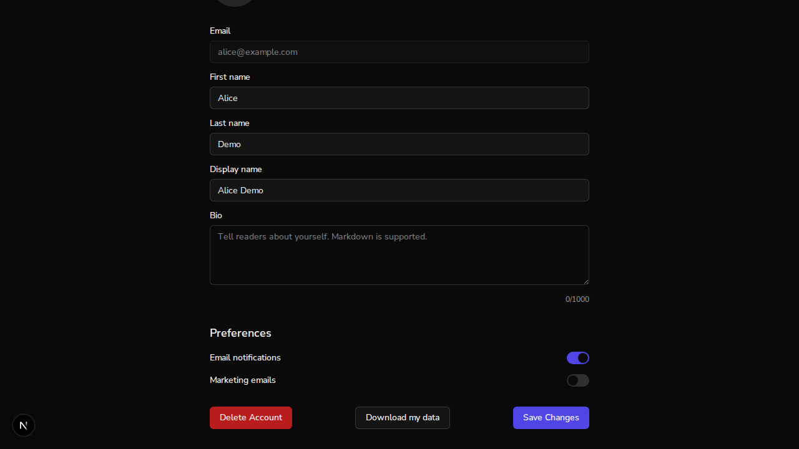

# Issue #790: an account can download its own data

*2026-10-11T21:42:28Z by Showboat 0.6.1*
<!-- showboat-id: 3db0ad64-3e92-4f1b-ab59-c3453efc3a44 -->

The privacy policy lists "receive a copy of your data in a portable format" as a right, and nothing produced that copy. This demo runs the branch: real better-auth on $WEB, the FastAPI backend on $API, and a throwaway local MongoDB database ($DB). Nothing here touches staging.

**Setup.** Two accounts sign up through real better-auth and each creates a book through the API. A seed script then adds chapter text, a question, an answer and a rating for each account.

```bash
for u in alice bob; do
  curl -s -o /dev/null -w "$u sign-up HTTP %{http_code}\n" -c "$D/jar-$u" -X POST "$WEB/api/auth/sign-up/email" -H "Origin: $WEB" -H "Content-Type: application/json" -d "{\"email\":\"$u@example.com\",\"password\":\"$DEMO_PW\",\"name\":\"${u^} Demo\"}"
  curl -s -o /dev/null -w "$u create book HTTP %{http_code}\n" -b "$D/jar-$u" -X POST "$API/books/" -H "Content-Type: application/json" -d "{\"title\":\"${u^^} field guide\",\"genre\":\"nonfiction\",\"target_audience\":\"readers\"}"
done
cat "$D/seed.js"
mongosh --quiet "$DATABASE_URL/$DB" "$D/seed.js"
```

```output
alice sign-up HTTP 200
alice create book HTTP 201
bob sign-up HTTP 200
bob create book HTTP 201
// Chapter text, a question, an answer and a rating for each demo account,
// keyed to that account's id. The AI flows that normally write these need a key.
for (const [email, tag] of [["alice@example.com", "ALICE"], ["bob@example.com", "BOB"]]) {
  const id = db.users.findOne({ email }).auth_id;
  const book = db.books.findOne({ owner_id: id });
  db.books.updateOne(
    { _id: book._id },
    { $set: { table_of_contents: { chapters: [{ id: "ch1", title: "One", content: `<p>${tag} chapter text</p>` }] } } }
  );
  const q = db.questions.insertOne({ book_id: String(book._id), chapter_id: "ch1", user_id: id, question_text: `${tag} question` }).insertedId;
  db.question_responses.insertOne({ question_id: String(q), user_id: id, response_text: `${tag} answer` });
  db.question_ratings.insertOne({ question_id: String(q), user_id: id, rating: 5 });
  print(`${tag}: seeded 1 chapter, 1 question, 1 answer, 1 rating`);
}
ALICE: seeded 1 chapter, 1 question, 1 answer, 1 rating
BOB: seeded 1 chapter, 1 question, 1 answer, 1 rating
```

**Criterion: `GET /users/me/export` returns the caller's data.** Alice downloads hers. The response is a JSON attachment.

```bash
curl -s -D "$D/headers" -o "$D/alice.json" -w "HTTP %{http_code}\n" -b "$D/jar-alice" "$API/users/me/export"
grep -i -E "^content-(type|disposition)" "$D/headers" | tr -d "\r"
jq "{top_level_keys: keys, profile: (.profile | {email, first_name, plan, terms_version}), books: [.books[] | {title, chapter_text: .table_of_contents.chapters[0].content}], questions: [.questions[].question_text], answers: [.question_responses[].response_text], ratings: [.question_ratings[].rating]}" "$D/alice.json"
```

```output
HTTP 200
content-disposition: attachment; filename="auto-author-data.json"
content-type: application/json
{
  "top_level_keys": [
    "books",
    "exported_at",
    "profile",
    "question_ratings",
    "question_responses",
    "questions"
  ],
  "profile": {
    "email": "alice@example.com",
    "first_name": "Alice",
    "plan": "free",
    "terms_version": "2026-10-10"
  },
  "books": [
    {
      "title": "ALICE field guide",
      "chapter_text": "<p>ALICE chapter text</p>"
    }
  ],
  "questions": [
    "ALICE question"
  ],
  "answers": [
    "ALICE answer"
  ],
  "ratings": [
    5
  ]
}
```

**Criterion: owner-scoped, user A cannot fetch B's export.** Bob downloads his, and each file is searched for the other account's marker and email address. The endpoint takes no id; putting Bob's id in the path as Alice is not a route. Without a session the answer is 401.

```bash
curl -s -o "$D/bob.json" -w "bob export HTTP %{http_code}\n" -b "$D/jar-bob" "$API/users/me/export"
for f in alice bob; do
  echo "$f.json: ALICE x$(grep -o ALICE "$D/$f.json" | wc -l), BOB x$(grep -o BOB "$D/$f.json" | wc -l), alice@example.com x$(grep -o alice@example.com "$D/$f.json" | wc -l), bob@example.com x$(grep -o bob@example.com "$D/$f.json" | wc -l), books $(jq ".books | length" "$D/$f.json")"
done
BOB_ID=$(mongosh --quiet "$DATABASE_URL/$DB" --eval "print(db.users.findOne({email:\"bob@example.com\"}).auth_id)")
curl -s -o /dev/null -w "alice asks for /users/<bob id>/export: HTTP %{http_code}\n" -b "$D/jar-alice" "$API/users/$BOB_ID/export"
curl -s -o /dev/null -w "no session: HTTP %{http_code}\n" "$API/users/me/export"
```

```output
bob export HTTP 200
alice.json: ALICE x4, BOB x0, alice@example.com x1, bob@example.com x0, books 1
bob.json: ALICE x0, BOB x4, alice@example.com x0, bob@example.com x1, books 1
alice asks for /users/<bob id>/export: HTTP 404
no session: HTTP 401
```

**No credential in the file.** The database holds a password hash, and Alice has a live session token in her cookie jar. Neither is in her export, and no key in the file is named like a credential.

```bash
mongosh --quiet "$DATABASE_URL/$DB" --eval "print(\"password hashes in the database:\", db.account.countDocuments({password:{\$exists:true}}))"
HASH=$(mongosh --quiet "$DATABASE_URL/$DB" --eval "print(db.account.findOne().password)")
TOKEN=$(mongosh --quiet "$DATABASE_URL/$DB" --eval "print(db.session.findOne().token)")
echo "a stored password hash in alice.json: x$(grep -c -F "$HASH" "$D/alice.json")"
echo "a live session token in alice.json: x$(grep -c -F "$TOKEN" "$D/alice.json")"
echo "keys named like a credential: $(jq "[paths | map(tostring) | join(\".\") | select(test(\"password|secret|token|backup\"; \"i\"))] | length" "$D/alice.json")"
jq ".profile | keys" "$D/alice.json" | tr -d "\n "; echo
```

```output
password hashes in the database: 2
a stored password hash in alice.json: x0
a live session token in alice.json: x0
keys named like a credential: 0
["created_at","email","first_name","last_name","plan","terms_accepted_at","terms_version","updated_at"]
```

**The control a user reaches it from.** Alice is signed in through the sign-in page in a real browser and is on her profile page. The link sits between Delete Account and Save Changes and points at the endpoint. Fetching that address from the page, with the cookies the browser holds, returns her data.

```bash
agent-browser eval "(() => { const a = [...document.querySelectorAll('a')].find(a => /download my data/i.test(a.textContent)); return { text: a.textContent, href: a.href, previous: a.previousElementSibling.textContent, next: a.nextElementSibling.textContent }; })()"
agent-browser eval "fetch([...document.querySelectorAll('a')].find(a => /download my data/i.test(a.textContent)).href, { credentials: 'include' }).then(async r => { const d = await r.json(); return { status: r.status, email: d.profile.email, books: d.books.map(b => b.title) }; })"

```

```output
{
  "href": "http://localhost:8100/api/v1/users/me/export",
  "next": "Save Changes",
  "previous": "Delete Account",
  "text": "Download my data"
}
{
  "books": [
    "ALICE field guide"
  ],
  "email": "alice@example.com",
  "status": 200
}
```

```bash {image}
2026-10-11-issue-790-profile-download.png
```



**The policy sentence.** `/privacy` section 9 as the browser renders it:

```bash
agent-browser eval "[...document.querySelectorAll('h2')].find(h => /Your Rights/.test(h.textContent)).closest('section').querySelector('ul + p').textContent.replace(/\s+/g,' ').split('. ').slice(0,2).join('. ') + '.'"

```

```output
"You can download a copy of your profile, your books and the questions, answers and ratings in them as a JSON file (Download my data), delete your content and close your account directly from your profile page. The download does not include uploaded images, activity and security logs, or payment records held by our payment processor."
```

**Criterion: a no-IDOR test exists.** The named tests, against a private test database:

```bash
cd "$WT/backend" && ENVIRONMENT=test TEST_MONGO_URI=mongodb://localhost:27017/auto-author-test-s790 uv run pytest -p no:cacheprovider --no-cov -o addopts="" -v tests/test_api/test_routes/test_account_export.py 2>&1 | grep -E "PASSED|FAILED|ERROR" | sed "s/ *\[.*//" | sort
cd "$WT/frontend" && npx jest src/app/privacy src/__tests__/ProfilePageDelete.test.tsx -t "#790" --verbose --reporters=default 2>&1 | grep -E "✓|✕" | sed "s/ ([0-9]* ms)//" | sort
```

```output
tests/test_api/test_routes/test_account_export.py::test_export_holds_no_credential_and_no_internal_field PASSED
tests/test_api/test_routes/test_account_export.py::test_export_never_contains_another_users_data PASSED
tests/test_api/test_routes/test_account_export.py::test_export_requires_a_session PASSED
tests/test_api/test_routes/test_account_export.py::test_export_returns_the_callers_profile_books_and_answers PASSED
    ✓ links to the account export endpoint
    ✓ says a copy of the account data can be downloaded from the profile page (#790)
```

Not shown: the browser saving the file from a click (the headless browser has no download folder; the fetch above uses the same address and cookies). Not in the export, by design: audit and access logs, usage counters, uploaded image files, and anything better-auth or the payment processor holds.
