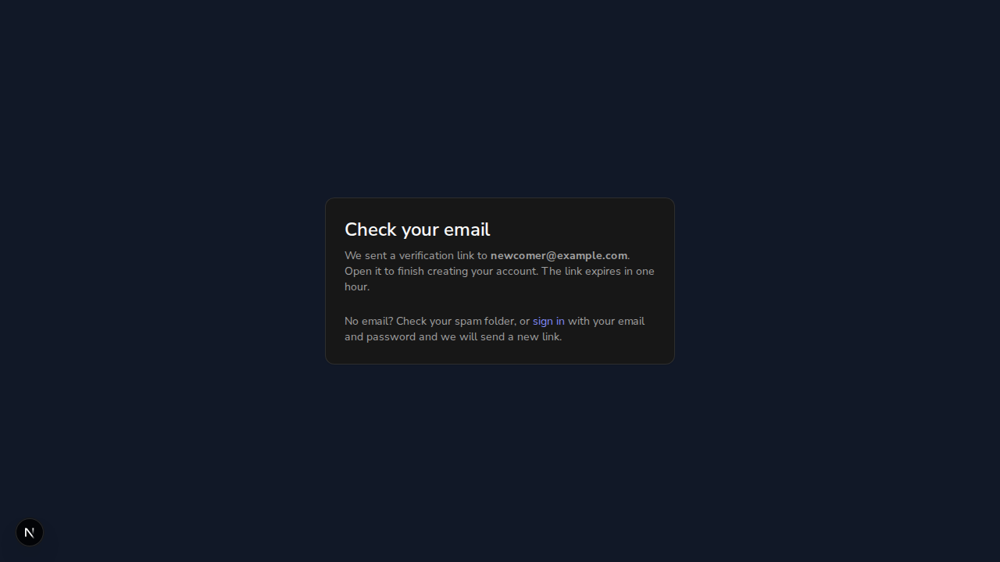

# Issue #792: a new account must verify its email address

*2026-10-11T22:40:41Z by Showboat 0.6.1*
<!-- showboat-id: bbd890e2-e7fe-4005-b0d8-7d31e59e9fd3 -->

Anyone could register any address and was signed in at once. This demo runs the branch: real better-auth on $WEB, the FastAPI backend on $API, and a throwaway local MongoDB database ($DB). No email provider is configured, so the development server prints each email, link included, to its log ($FRONTEND_LOG). Nothing here touches staging.

**Existing accounts are not locked out.** The backend is stopped. An account is created now, before the backend has ever started with this change, which is the position every account on staging is in today. It is unverified and cannot sign in.

```bash
curl -s -o /dev/null -w "sign-up HTTP %{http_code}\n" -X POST "$WEB/api/auth/sign-up/email" -H "Origin: $WEB" -H "Content-Type: application/json" -d "{\"email\":\"existing@example.com\",\"password\":\"$DEMO_PW\",\"name\":\"Existing User\"}"
mongosh --quiet "$DATABASE_URL/$DB" --eval "printjson(db.user.findOne({email:\"existing@example.com\"},{_id:0,email:1,emailVerified:1}))"
curl -s -w "\nsign-in HTTP %{http_code}\n" -X POST "$WEB/api/auth/sign-in/email" -H "Origin: $WEB" -H "Content-Type: application/json" -d "{\"email\":\"existing@example.com\",\"password\":\"$DEMO_PW\"}"
```

```output
sign-up HTTP 200
{
  email: 'existing@example.com',
  emailVerified: false
}
{"message":"Email not verified","code":"EMAIL_NOT_VERIFIED"}
sign-in HTTP 403
```

The backend now starts for the first time. Its log, the moment it recorded, and the account afterwards:

```bash
grep -o "Marked .* as email-verified" "$BACKEND_LOG"
mongosh --quiet "$DATABASE_URL/$DB" --eval "print(\"marker written:\", db.app_meta.countDocuments({_id:\"email_verification_required_from\"})); printjson(db.user.findOne({email:\"existing@example.com\"},{_id:0,email:1,emailVerified:1}))"
curl -s -o /dev/null -w "sign-in HTTP %{http_code}\n" -c "$D/jar-existing" -X POST "$WEB/api/auth/sign-in/email" -H "Origin: $WEB" -H "Content-Type: application/json" -d "{\"email\":\"existing@example.com\",\"password\":\"$DEMO_PW\"}"
curl -s -o /dev/null -w "GET /users/me HTTP %{http_code}\n" -b "$D/jar-existing" "$API/users/me"
```

```output
Marked 1 existing account(s) as email-verified
marker written: 1
{
  email: 'existing@example.com',
  emailVerified: true
}
sign-in HTTP 200
GET /users/me HTTP 200
```

**A new account gets no session.** In a real browser, the sign-up form is filled in for newcomer@example.com and submitted. The page that follows, and the cookies the browser holds:

```bash
agent-browser get url
agent-browser eval "({ heading: document.querySelector('h1').textContent, page: document.querySelector('main').textContent.replace(/\s+/g,' ').trim(), signUpButtonStillShown: !!document.querySelector('button[type=submit]') })"
agent-browser eval "fetch('/api/auth/get-session', { credentials: 'include' }).then(r => r.json()).then(s => ({ sessionInThisBrowser: s }))"

```

```output
http://localhost:3102/auth/sign-up
{
  "heading": "Check your email",
  "page": "Check your emailWe sent a verification link to newcomer@example.com. Open it to finish creating your account. The link expires in one hour.No email? Check your spam folder, or sign in with your email and password and we will send a new link.",
  "signUpButtonStillShown": false
}
{
  "sessionInThisBrowser": null
}
```

```bash {image}
2026-10-11-issue-792-check-your-email.png
```



**Criterion 1: an unverified sign-in returns EMAIL_NOT_VERIFIED.** The same browser goes to the sign-in page and submits the new account's email and password. What the page shows, and what the same request returns over HTTP:

```bash
agent-browser eval "({ url: location.pathname, alert: document.querySelector('[role=alert]')?.textContent.trim() })"
curl -s -w "\nPOST /api/auth/sign-in/email HTTP %{http_code}\n" -X POST "$WEB/api/auth/sign-in/email" -H "Origin: $WEB" -H "Content-Type: application/json" -d "{\"email\":\"newcomer@example.com\",\"password\":\"$DEMO_PW\"}"

```

```output
{
  "alert": "Verify your email address to sign in. We have sent you a new link.",
  "url": "/auth/sign-in"
}
{"message":"Email not verified","code":"EMAIL_NOT_VERIFIED"}
POST /api/auth/sign-in/email HTTP 403
```

**Criterion 2: the backend will not create a record for an unverified account.** better-auth gives this account no session, so one is written straight into the database to stand in for a session that exists anyway. The backend is asked for the profile with it.

```bash
mongosh --quiet "$DATABASE_URL/$DB" --eval "const u = db.user.findOne({email:\"newcomer@example.com\"}); db.session.insertOne({token:\"demo-forced-session\", userId:u._id, expiresAt:new Date(Date.now()+3600e3), createdAt:new Date(), updatedAt:new Date()}); print(\"forced sessions:\", db.session.countDocuments({token:\"demo-forced-session\"}))"
curl -s -w "\nGET /users/me HTTP %{http_code}\n" -H "Cookie: better-auth.session_token=demo-forced-session.sig" "$API/users/me"
mongosh --quiet "$DATABASE_URL/$DB" --eval "print(\"backend records for newcomer@example.com:\", db.users.countDocuments({email:\"newcomer@example.com\"})); db.session.deleteOne({token:\"demo-forced-session\"})" | head -1
```

```output
forced sessions: 1
{"detail":"Verify your email address to use this account."}
GET /users/me HTTP 403
backend records for newcomer@example.com: 0
```

**A restart does not verify it.** The backend has been restarted. The moment recorded at the first start is unchanged, so the account created after it is left alone.

```bash
echo "accounts marked verified by this start: $(grep -c "as email-verified" "$BACKEND_LOG")"
mongosh --quiet "$DATABASE_URL/$DB" --eval "printjson(db.user.findOne({email:\"newcomer@example.com\"},{_id:0,email:1,emailVerified:1}))"
```

```output
accounts marked verified by this start: 0
{
  email: 'newcomer@example.com',
  emailVerified: false
}
```

**Opening the link verifies the address and signs the user in.** The link is taken from the email the development server printed at sign-up, and opened in the same browser.

**Opening the link verifies the address and signs the user in, once.** A second account signs up. The link is taken from the email the development server printed, and opened in a browser that holds no cookies.

```bash
curl -s -o /dev/null -w "sign-up HTTP %{http_code}\n" -X POST "$WEB/api/auth/sign-up/email" -H "Origin: $WEB" -H "Content-Type: application/json" -d "{\"email\":\"reader@example.com\",\"password\":\"$DEMO_PW\",\"name\":\"Rita Reader\",\"callbackURL\":\"/dashboard\"}"
grep -B2 -A3 "^Subject: Verify your email address" "$FRONTEND_LOG" | tail -6 | sed 's/token=[^&]*/token=<signed token>/'
LINK=$(grep -o "URL: http[^ ]*callbackURL=%2Fdashboard" "$FRONTEND_LOG" | tail -1 | cut -c6-)
agent-browser open "$LINK" >/dev/null 2>&1; agent-browser wait 3000 >/dev/null
echo "browser is now at: $(agent-browser get url)"
agent-browser eval "fetch('/api/auth/get-session', { credentials: 'include' }).then(r => r.json()).then(s => ({ signedInAs: s.user.email, emailVerified: s.user.emailVerified }))"
agent-browser eval "fetch('http://localhost:8100/api/v1/users/me', { credentials: 'include' }).then(async r => ({ backendStatus: r.status, backendEmail: (await r.json()).email }))"
mongosh --quiet "$DATABASE_URL/$DB" --eval "print(\"backend records for reader@example.com:\", db.users.countDocuments({email:\"reader@example.com\"}))"
echo "the same link opened again, from a client with no cookies, sets $(curl -s -o /dev/null -D - "$LINK" | grep -c -i "set-cookie: better-auth.session_token") session cookie(s)"

```

```output
sign-up HTTP 200
To: reader@example.com
From: Auto Author <noreply@autoauthor.app>
Subject: Verify your email address
------------------------------------------------------------
Open this link to finish creating your Auto Author account:
http://localhost:3102/api/auth/verify-email?token=<signed token>&callbackURL=%2Fdashboard
browser is now at: http://localhost:3102/dashboard
{
  "emailVerified": true,
  "signedInAs": "reader@example.com"
}
{
  "backendEmail": "reader@example.com",
  "backendStatus": 200
}
backend records for reader@example.com: 1
the same link opened again, from a client with no cookies, sets 0 session cookie(s)
```

**Criterion 3: tests cover both.** The named tests, against a private test database:

```bash
cd "$WT/backend" && ENVIRONMENT=test TEST_MONGO_URI=mongodb://localhost:27017/auto-author-test-s792demo uv run pytest -p no:cacheprovider --no-cov -o addopts="" -v tests/test_api/test_routes/test_email_verification.py 2>&1 | grep -E "PASSED|FAILED|ERROR" | sed "s/ *\[ *[0-9]*%\]//" | sort
cd "$WT/frontend" && npx jest src/lib/__tests__/auth-email-verification.test.ts src/lib/__tests__/email.test.ts src/__tests__/SignUpPage.test.tsx src/__tests__/SignInPage.test.tsx -t "792|sendVerificationEmail|Email verification is required" --verbose --reporters=default 2>&1 | grep -E "✓|✕" | sed "s/ ([0-9]* ms)//" | sort
```

```output
tests/test_api/test_routes/test_email_verification.py::test_a_verified_account_gets_its_record_on_the_first_request PASSED
tests/test_api/test_routes/test_email_verification.py::test_accounts_that_predate_the_requirement_are_marked_verified PASSED
tests/test_api/test_routes/test_email_verification.py::test_an_account_created_under_the_requirement_is_never_marked_verified PASSED
tests/test_api/test_routes/test_email_verification.py::test_first_request_from_an_unverified_account_is_refused[change0] PASSED
tests/test_api/test_routes/test_email_verification.py::test_first_request_from_an_unverified_account_is_refused[change1] PASSED
tests/test_api/test_routes/test_email_verification.py::test_startup_marks_existing_accounts_verified PASSED
      ✓ dumps the link to the console in development with no provider
      ✓ sends the link to the address via Resend, in both the text and the HTML part
      ✓ throws and logs a loud [email] error when no provider is configured
    ✓ does not swallow a failed send
    ✓ mails the link to the address being verified
    ✓ refuses a session to an unverified address
    ✓ sends the link at sign-up and again at a refused sign-in, valid for one hour
    ✓ signs up, then asks the user to check their email instead of entering the app (#792)
    ✓ tells an unverified account to use the link it was just sent (#792)
```

Not shown: delivery through a real email provider (none is configured here; the provider call is covered by a unit test with a stubbed HTTP request), and what a user sees when the provider is down, which is the same "Check your email" page, because better-auth logs a failed send without failing the request. Whether staging has a provider configured was not checked.
