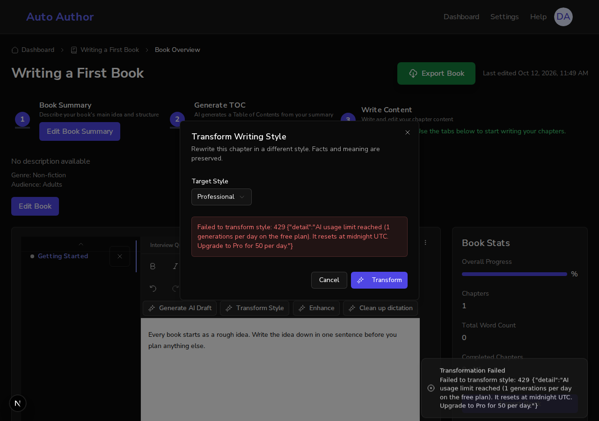
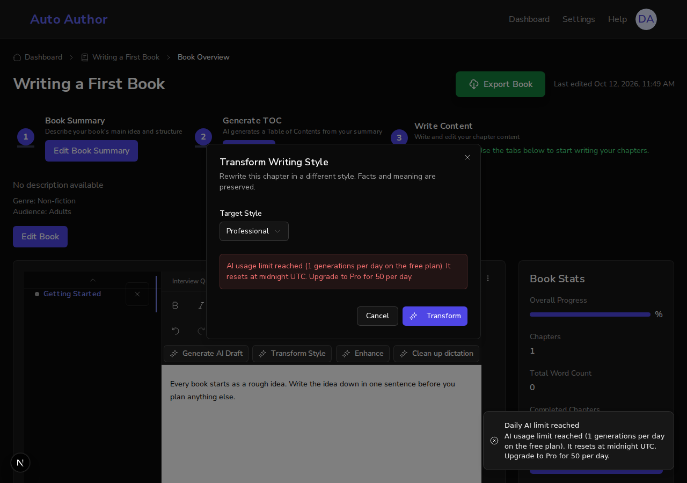
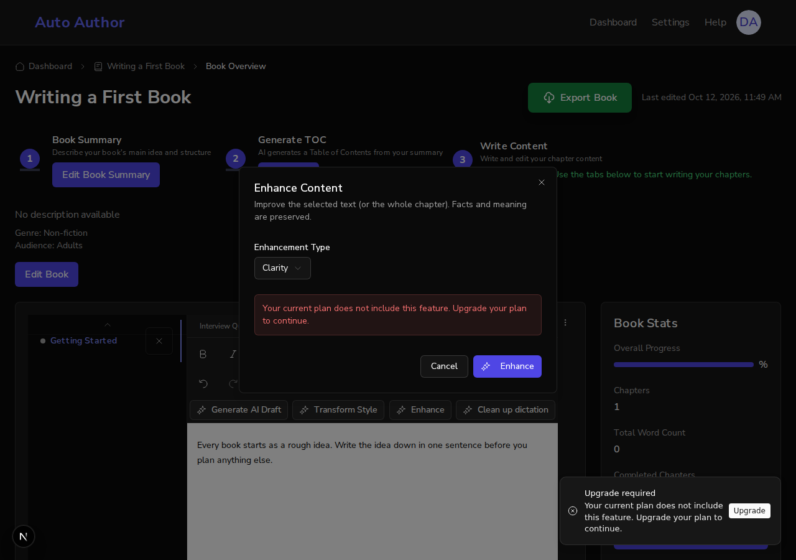
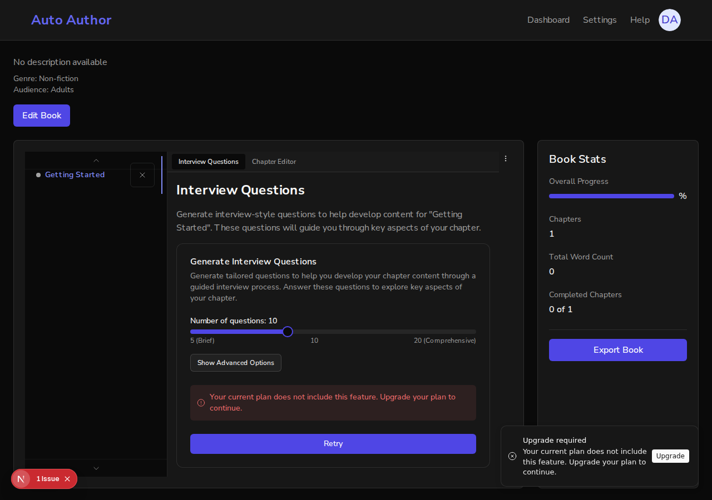
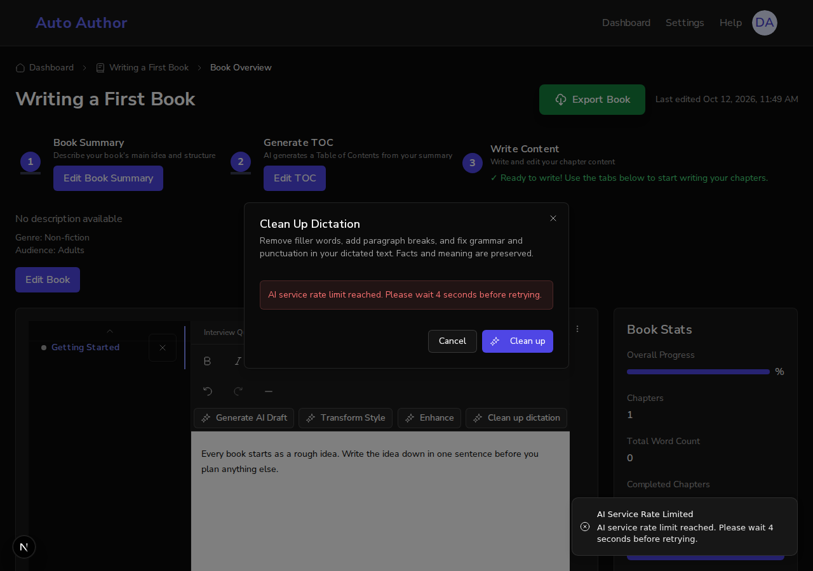

# A refused AI request shows what happened and what to do, not a status and JSON (#803)

*2026-10-12T11:50:07Z by Showboat 0.6.1*
<!-- showboat-id: 041e2c66-22fb-4476-a7c6-e67185c26483 -->

Five AI client methods threw the status and the raw response body as their message, and the screens printed it. A plan refusal never reached the Upgrade notification, and an exhausted allowance looked like any failure. This demo runs main and this branch side by side: each has its own backend and its own frontend on its own port, both use one local database and one stand-in AI provider, and the browser is signed in as a real account (sign-up, email verification link, sign-in form). The free plan is set to one AI generation a day so the allowance runs out on the second request.

```bash
source /tmp/claude-1000/-home-frankbria-projects-auto-author/37b63b79-18ca-4958-9013-d3974f437927/scratchpad/demo803/env.sh; export AGENT_BROWSER_SESSION=demo803; echo "main:   frontend $OLD_WEB ($(curl -s -o /dev/null -w '%{http_code}' $OLD_WEB/)), backend $(curl -s localhost:8101/api/v1/health | cut -c1-40), code $(git -C $MAIN log --oneline -1 | cut -c1-7)"; echo "branch: frontend $WEB ($(curl -s -o /dev/null -w '%{http_code}' $WEB/)), backend $(curl -s localhost:8100/api/v1/health | cut -c1-40), code $(git -C $WT rev-parse --abbrev-ref HEAD)"; mongo 'db.user.find({}, {email: 1, emailVerified: 1, _id: 0}).toArray()' | tr -d '\n'; echo
```

```output
main:   frontend http://localhost:3103 (200), backend {"status":"healthy","checks":{"mongodb":, code ed39e8f
branch: frontend http://localhost:3102 (200), backend {"status":"healthy","checks":{"mongodb":, code feature/issue-803-ai-client-errors
[ { email: 'author@example.com', emailVerified: true } ]
```

First the part no client code can fix. The page and the API are on different origins, and a browser lets a script read only a few response headers across origins unless the server names more. Main names none, so the page could never read which allowance ran out or when to retry. This branch exposes the three it needs.

```bash
source /tmp/claude-1000/-home-frankbria-projects-auto-author/37b63b79-18ca-4958-9013-d3974f437927/scratchpad/demo803/env.sh; export AGENT_BROWSER_SESSION=demo803; for port in 8101 8100; do echo "backend on $port: $(curl -s -D - -o /dev/null -H "Origin: http://localhost:$((port - 4998))" localhost:$port/api/v1/health | grep -i '^access-control-expose-headers' | tr -d '\r' || true)"; done
```

```output
backend on 8101: 
backend on 8100: access-control-expose-headers: Retry-After, X-AI-Quota-Limit, X-AI-Quota-Period
```

Before. On main, Transform Style is used twice. The second request is over the allowance, and the dialog and the toast both print the status and the JSON body.

```bash
source /tmp/claude-1000/-home-frankbria-projects-auto-author/37b63b79-18ca-4958-9013-d3974f437927/scratchpad/demo803/env.sh; export AGENT_BROWSER_SESSION=demo803; agent-browser eval "$(cat $D/state.js)" | tail -1 | python3 -c 'import sys, json; print(json.loads(sys.stdin.read()))' | fold -s -w 150
```

```output
{
 "on_the_page": "Failed to transform style: 429 {\"detail\":\"AI usage limit reached (1 generations per day on the free plan). It resets at midnight 
UTC. Upgrade to Pro for 50 per day.\"}",
 "notifications": [
  "Transformation Failed | Failed to transform style: 429 {\"detail\":\"AI usage limit reached (1 generations per day on the free plan). It resets at 
midnight UTC. Upgrade to Pro for 50 per day.\"}"
 ]
}
```

```bash {image}

```



After. The same two requests on this branch. The dialog shows the sentence the backend wrote, and one notification names the allowance: "Daily AI limit reached". The word "Daily" comes from the X-AI-Quota-Period header, read across origins.

```bash
source /tmp/claude-1000/-home-frankbria-projects-auto-author/37b63b79-18ca-4958-9013-d3974f437927/scratchpad/demo803/env.sh; export AGENT_BROWSER_SESSION=demo803; agent-browser eval "$(cat $D/state.js)" | tail -1 | python3 -c 'import sys, json; print(json.loads(sys.stdin.read()))' | fold -s -w 150
```

```output
{
 "on_the_page": "AI usage limit reached (1 generations per day on the free plan). It resets at midnight UTC. Upgrade to Pro for 50 per day.",
 "notifications": [
  "Daily AI limit reached | AI usage limit reached (1 generations per day on the free plan). It resets at midnight UTC. Upgrade to Pro for 50 per 
day."
 ]
}
```

```bash {image}

```



A plan that does not include the feature. The account is moved to the restricted plan, which the backend refuses with a 402. Enhance: one notification, "Upgrade required", with an Upgrade button. Then the Interview Questions tab, where generating questions is refused the same way.

```bash
source /tmp/claude-1000/-home-frankbria-projects-auto-author/37b63b79-18ca-4958-9013-d3974f437927/scratchpad/demo803/env.sh; export AGENT_BROWSER_SESSION=demo803; agent-browser eval "$(cat $D/state.js)" | tail -1 | python3 -c 'import sys, json; print(json.loads(sys.stdin.read()))' | fold -s -w 150; source /tmp/claude-1000/-home-frankbria-projects-auto-author/37b63b79-18ca-4958-9013-d3974f437927/scratchpad/demo803/env.sh; export AGENT_BROWSER_SESSION=demo803; agent-browser eval '[...document.querySelectorAll("[data-sonner-toast] button, [data-sonner-toast] a")].map(b => b.textContent.trim()).filter(Boolean).join(", ")' | tail -1 | sed 's/^/buttons on the notification: /'
```

```output
{
 "on_the_page": "Your current plan does not include this feature. Upgrade your plan to continue.",
 "notifications": [
  "Upgrade required | Your current plan does not include this feature. Upgrade your plan to continue. | Upgrade"
 ]
}
buttons on the notification: "Upgrade"
```

```bash {image}

```



```bash
source /tmp/claude-1000/-home-frankbria-projects-auto-author/37b63b79-18ca-4958-9013-d3974f437927/scratchpad/demo803/env.sh; export AGENT_BROWSER_SESSION=demo803; agent-browser eval "$(cat $D/state.js)" | tail -1 | python3 -c 'import sys, json; print(json.loads(sys.stdin.read()))' | fold -s -w 150
```

```output
{
 "on_the_page": "Your current plan does not include this feature. Upgrade your plan to continue.",
 "notifications": [
  "Upgrade required | Your current plan does not include this feature. Upgrade your plan to continue. | Upgrade"
 ]
}
```

```bash {image}

```



A rate limit at the AI provider. The stand-in provider now answers 429. The backend tries three times and reports a 429 of its own with Retry-After (#802). The page says how long to wait, in seconds, and does not call it an allowance; the dialog is back on its first step, where the same button sends the request again.

```bash
source /tmp/claude-1000/-home-frankbria-projects-auto-author/37b63b79-18ca-4958-9013-d3974f437927/scratchpad/demo803/env.sh; export AGENT_BROWSER_SESSION=demo803; agent-browser eval "$(cat $D/state.js)" | tail -1 | python3 -c 'import sys, json; print(json.loads(sys.stdin.read()))' | fold -s -w 150
```

```output
{
 "on_the_page": "AI service rate limit reached. Please wait 4 seconds before retrying.",
 "notifications": [
  "AI Service Rate Limited | AI service rate limit reached. Please wait 4 seconds before retrying."
 ]
}
```

```bash {image}

```



The same behaviour as tests. Frontend: the five client methods against refused responses, the classifier, and each of the four screens given a 402 and a 429. Backend: the exposed headers on a cross-origin response.

```bash
cd /home/frankbria/projects/worktrees/issue-803-ai-client-errors/frontend && npx jest src/lib/api/__tests__/bookClient.aiErrors.test.ts src/lib/api/__tests__/aiErrorHandler.test.ts src/__tests__/RewriteDialogRefusals.test.tsx src/components/chapters/questions/__tests__/QuestionContainer.test.tsx 2>&1 | grep -E '^Tests:'; cd /home/frankbria/projects/worktrees/issue-803-ai-client-errors/backend && ENVIRONMENT=test TEST_MONGO_URI=mongodb://localhost:27017/auto-author-test-demo803 uv run pytest tests/test_api/test_cors_exposed_headers.py -q -p no:cacheprovider --no-cov 2>&1 | tail -1 | sed 's/ in [0-9.]*s//'
```

```output
Tests:       97 passed, 97 total
============================== 1 passed ===============================
```
