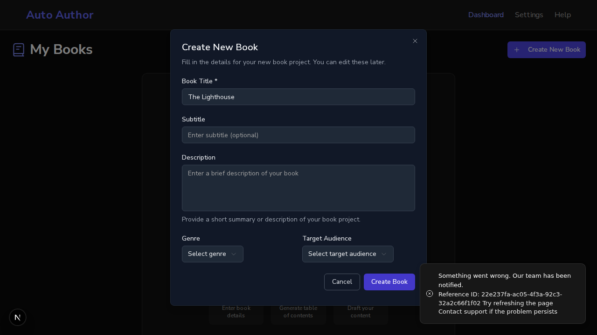

# One id names a request, from the server log to the Reference ID the user is shown (#810)

*2026-10-12T18:51:41Z by Showboat 0.6.1*
<!-- showboat-id: b7e3088f-ce66-4f36-80cd-7bf03b0b9876 -->

The backend minted an id for every request and used it in two of its own log lines. A 500 carried no id. Structured errors carried a second, unrelated one. And the Reference ID in the frontend's error message was made up in the browser. This demo runs the real backend and frontend from main and from this branch, with the frontend on a different origin from the API, as on staging. Auth is bypassed for the demo account. A stand-in on this machine receives what the backend would send to Sentry.

```bash
source /tmp/claude-1000/-home-frankbria-projects-auto-author/37b63b79-18ca-4958-9013-d3974f437927/scratchpad/demo810/env.sh; echo "main:   $(git -C $MAIN log --oneline -1 | cut -c1-7)"; echo "branch: $(git -C $WT rev-parse --abbrev-ref HEAD)"; echo "frontend origin: $WEB   API: $API"
```

```output
main:   1dba0bd
branch: feature/issue-810-request-id
frontend origin: http://localhost:3110   API: http://localhost:8110/api/v1
```

Before, a failure nobody handled. The app wraps most failures itself, so the demo adds one route that raises. Asked as a page on the frontend's origin would ask: main answers 500 with no CORS headers at all, so the browser refuses to give the page the answer, and there is no id in it either.

```bash
source /tmp/claude-1000/-home-frankbria-projects-auto-author/37b63b79-18ca-4958-9013-d3974f437927/scratchpad/demo810/env.sh; backend $MAIN; cross_origin /demo-unhandled; stop
```

```output
status:                        500
access-control-allow-origin:   
access-control-expose-headers: 
x-request-id:                  
body:                          {"detail":"An unexpected error occurred"} | request_id in the body: none
```

Before, a structured error from a real route (questions for a book that does not exist). The response header names one id and the body another.

```bash
source /tmp/claude-1000/-home-frankbria-projects-auto-author/37b63b79-18ca-4958-9013-d3974f437927/scratchpad/demo810/env.sh; backend $MAIN; cross_origin /books/507f1f77bcf86cd799439011/chapters/c1/generate-questions -X POST -H 'content-type: application/json' -d '{}'; stop
```

```output
status:                        404
access-control-allow-origin:   http://localhost:3110
access-control-expose-headers: Retry-After, X-AI-Quota-Limit, X-AI-Quota-Period
x-request-id:                  bf25e8ae-1c65-4946-bbb0-cf8e5187e721
body:                          {"detail":{"error":"Book not found","error_code":"BOOK_NOT_FOUND","sta... | request_id in the body: req_36f4061132e8
```

After, the same two requests. The 500 is readable from the frontend's origin, the header is one the page may read, and header and body name the same id in both.

```bash
source /tmp/claude-1000/-home-frankbria-projects-auto-author/37b63b79-18ca-4958-9013-d3974f437927/scratchpad/demo810/env.sh; backend $WT; echo 'a failure nobody handled:'; cross_origin /demo-unhandled; echo; echo 'a structured error:'; cross_origin /books/507f1f77bcf86cd799439011/chapters/c1/generate-questions -X POST -H 'content-type: application/json' -d '{}'; stop
```

```output
a failure nobody handled:
status:                        500
access-control-allow-origin:   http://localhost:3110
access-control-expose-headers: Retry-After, X-AI-Quota-Limit, X-AI-Quota-Period, X-Request-ID
x-request-id:                  10999b59-63a4-4f26-9525-c2b6095cf66e
body:                          {"detail":"An unexpected error occurred","request_id":"10999b59-63a4-4... | request_id in the body: 10999b59-63a4-4f26-9525-c2b6095cf66e

a structured error:
status:                        404
access-control-allow-origin:   http://localhost:3110
access-control-expose-headers: Retry-After, X-AI-Quota-Limit, X-AI-Quota-Period, X-Request-ID
x-request-id:                  c8a40d9d-69f5-4632-961d-6ef676bbd20e
body:                          {"detail":{"error":"Book not found","error_code":"BOOK_NOT_FOUND","sta... | request_id in the body: c8a40d9d-69f5-4632-961d-6ef676bbd20e
```

After, the same id everywhere. Every log line written while the failing request was handled carries it, and so does the report that went to the Sentry stand-in.

```bash
source /tmp/claude-1000/-home-frankbria-projects-auto-author/37b63b79-18ca-4958-9013-d3974f437927/scratchpad/demo810/env.sh; backend $WT; cross_origin /demo-unhandled | grep x-request-id; id=$(header_id); sleep 2; echo "log lines carrying it: $(grep -c "\[$id\]" $D/backend.log)"; grep "\[$id\]" $D/backend.log | sed -E 's/^[0-9-]+ [0-9:,]+ - //; s/ \[ID: [^]]+\]//' | cut -c1-150; python3 -c "
import json
events = [json.loads(l) for l in open('$D/envelopes.txt', errors='replace').read().splitlines() if '\"exception\"' in l]
print('reports sent to Sentry:', len(events), '| tagged request_id:', events[0]['tags']['request_id'])"; stop
```

```output
x-request-id:                  a66c4996-180f-40b8-946e-0511fdda5ab9
log lines carrying it: 3
app.api.request_validation - INFO - [a66c4996-180f-40b8-946e-0511fdda5ab9] Request started: GET /api/v1/demo-unhandled from 127.0.0.1
app.api.request_validation - ERROR - [a66c4996-180f-40b8-946e-0511fdda5ab9] Request failed: GET /api/v1/demo-unhandled - Error: something nobody handl
app.main - ERROR - [a66c4996-180f-40b8-946e-0511fdda5ab9] Unhandled exception: something nobody handled
reports sent to Sentry: 1 | tagged request_id: a66c4996-180f-40b8-946e-0511fdda5ab9
```

The browser, before. A real Chromium opens the dashboard and creates a book whose title is already taken; the database refuses and the create route answers 500. On main the Reference ID in the message is a value made in the browser. The server knows the request by another id, and no log line contains what the user was shown. (The message also prints its Reference ID twice.)

```bash
source /tmp/claude-1000/-home-frankbria-projects-auto-author/37b63b79-18ca-4958-9013-d3974f437927/scratchpad/demo810/env.sh; backend $MAIN; frontend $MAIN; bash $D/browser-probe.sh; stop
```

```output
the user is shown:        Reference ID: mv5m0bnz-ibunxi6  (printed 2 time(s) on the page)
the server's request was: 32234b03-d991-4014-9d9e-59f9460abe5e (status 500)
log lines that name the id the user was shown: 0
```

The browser, after. The Reference ID is the server's id for that request, printed once, and the log lines for the request are found by it. The picture below is the message as the user sees it.

```bash
source /tmp/claude-1000/-home-frankbria-projects-auto-author/37b63b79-18ca-4958-9013-d3974f437927/scratchpad/demo810/env.sh; backend $WT; frontend $WT; bash $D/browser-probe.sh $WT/docs/demos/issue-810-toast.png; echo 'the lines found by it:'; grep "$(grep 'Request completed: POST /api/v1/books/ ' $D/backend.log | tail -1 | sed -E 's/.*\[ID: ([^]]+)\].*/\1/')" $D/backend.log | sed -E 's/^[0-9-]+ [0-9:,]+ - //; s/ \[ID: [^]]+\]//' | cut -c1-150; stop
```

```output
the user is shown:        Reference ID: 22e237fa-ac05-4f3a-92c3-32a2c66f1f02  (printed 1 time(s) on the page)
the server's request was: 22e237fa-ac05-4f3a-92c3-32a2c66f1f02 (status 500)
log lines that name the id the user was shown: 4
the lines found by it:
app.api.request_validation - INFO - [22e237fa-ac05-4f3a-92c3-32a2c66f1f02] Request started: POST /api/v1/books/ from 127.0.0.1
app.db.book - ERROR - [22e237fa-ac05-4f3a-92c3-32a2c66f1f02] Failed to create book
app.api.endpoints.books - ERROR - [22e237fa-ac05-4f3a-92c3-32a2c66f1f02] Failed to create book
app.api.request_validation - INFO - [22e237fa-ac05-4f3a-92c3-32a2c66f1f02] Request completed: POST /api/v1/books/ - Status: 500, Took: 38.96ms
```

```bash {image}

```



The same behaviour as tests: the backend with the real Sentry SDK, and the frontend's API client and error classifiers.

```bash
cd /home/frankbria/projects/worktrees/issue-810-request-id/backend && ENVIRONMENT=test TEST_MONGO_URI=mongodb://localhost:27017/auto-author-test-demo810 uv run pytest tests/test_api/test_request_id.py -q -p no:cacheprovider --no-cov 2>&1 | tail -1 | sed -E 's/ in [0-9.]*s//; s/, [0-9]+ warnings?//'; cd /home/frankbria/projects/worktrees/issue-810-request-id/frontend && npx jest src/lib/api/__tests__/requestId.test.ts 2>&1 | grep -E '^Tests:' | sed -E 's/ +/ /g'
```

```output
======================== 17 passed ========================
Tests: 15 passed, 15 total
```
