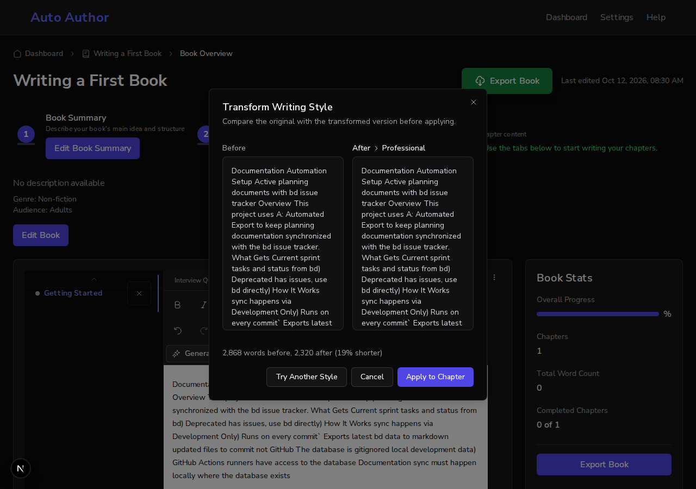
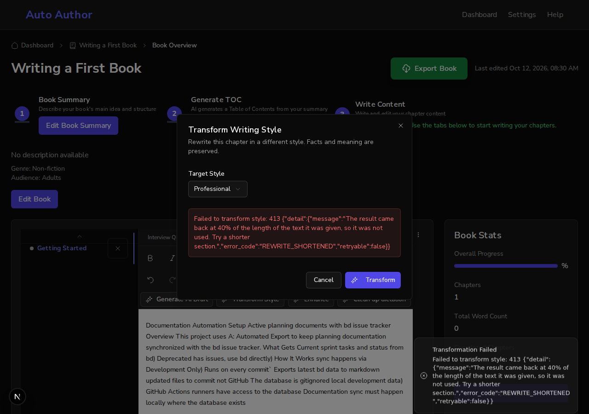

# A rewrite that lost most of the text is refused, and the preview shows the word counts (#983)

*2026-10-12T08:30:33Z by Showboat 0.6.1*
<!-- showboat-id: 928bdf49-faf7-4ad7-8c02-6a98a0277c22 -->

Transform, enhance and dictation cleanup already refuse an answer the model reports as cut off. A model can also condense a long text and report a normal finish; in live runs for #801 a 5,000-word chapter came back at 28% to 49% of its length as a success. This demo has three parts: the API on main and on this branch against a stand-in provider that returns a chosen share of the words it was sent, the real page in a browser, and this branch against a real model.

```bash
source /tmp/claude-1000/-home-frankbria-projects-auto-author/37b63b79-18ca-4958-9013-d3974f437927/scratchpad/demo983/env.sh; echo "main:   $(git -C $MAIN log --oneline -1 | cut -c1-7)  $(curl -s localhost:8101/api/v1/health | cut -c1-60)"; echo "branch: $(git -C $WT rev-parse --abbrev-ref HEAD)  $(curl -s localhost:8100/api/v1/health | cut -c1-60)"
```

```output
main:   7abdefb  {"status":"healthy","checks":{"mongodb":"ok","config":"ok"}}
branch: feature/issue-983-shortened-rewrites  {"status":"healthy","checks":{"mongodb":"ok","config":"ok"}}
```

Before. The provider keeps 40% of a 2,900-word chapter and reports a normal finish. Main returns it as a successful transform.

```bash
source /tmp/claude-1000/-home-frankbria-projects-auto-author/37b63b79-18ca-4958-9013-d3974f437927/scratchpad/demo983/env.sh; echo share:40 > $D/provider-mode; before 'main: transform, 40% comes back' POST chapters/ch1/transform-style "{'content': chapter(2900), 'target_style': 'professional'}" | sed 's/ | provider received[^|]*//'; words
```

```output
main: transform, 40% comes back          HTTP 200| charged today: 1
  words: 2868 in, 1160 out
```

After. The same answer is refused with a 413 and a fixed code, and the message says how much was lost. The provider was called, so the generation stays charged. A rewrite that keeps 80% is returned, with both word counts.

```bash
source /tmp/claude-1000/-home-frankbria-projects-auto-author/37b63b79-18ca-4958-9013-d3974f437927/scratchpad/demo983/env.sh; echo share:40 > $D/provider-mode; after 'transform, 40% comes back' POST chapters/ch1/transform-style "{'content': chapter(2900), 'target_style': 'professional'}" | sed 's/ | provider received[^|]*//'; words; echo share:59 > $D/provider-mode; after 'enhance, 59% comes back' POST chapters/ch1/enhance-text "{'content': chapter(2900), 'enhancement_type': 'clarity'}" | sed 's/ | provider received[^|]*//'; words; echo share:80 > $D/provider-mode; after 'transform, 80% comes back' POST chapters/ch1/transform-style "{'content': chapter(2900), 'target_style': 'professional'}" | sed 's/ | provider received[^|]*//'; words
```

```output
transform, 40% comes back                HTTP 413| charged today: 1
  REWRITE_SHORTENED: The result came back at 40% of the length of the text it was given, so it was not used. Try a shorter section.
enhance, 59% comes back                  HTTP 413| charged today: 2
  REWRITE_SHORTENED: The result came back at 59% of the length of the text it was given, so it was not used. Try a shorter section.
transform, 80% comes back                HTTP 200| charged today: 3
  words: 2868 in, 2320 out
```

Dictation cleanup removes filler, so it may lose more: it is refused under 40% where transform and enhance are refused under 60%. A text under 1,000 characters is not checked at all, because tightening a paragraph can halve it. The measure is characters of text, with markup and whitespace left out, so a script written without spaces is measured like any other.

```bash
source /tmp/claude-1000/-home-frankbria-projects-auto-author/37b63b79-18ca-4958-9013-d3974f437927/scratchpad/demo983/env.sh; echo share:50 > $D/provider-mode; after 'cleanup, 50% comes back' POST chapters/ch1/enhance-transcription "{'content': chapter(2900)}" | sed 's/ | provider received[^|]*//'; words; echo share:39 > $D/provider-mode; after 'cleanup, 39% comes back' POST chapters/ch1/enhance-transcription "{'content': chapter(2900)}" | sed 's/ | provider received[^|]*//'; words; echo share:30 > $D/provider-mode; after 'enhance 150 words, 30% comes back' POST chapters/ch1/enhance-text "{'content': '<p>' + ' '.join(['word'] * 150) + '</p>', 'enhancement_type': 'clarity'}" | sed 's/ | provider received[^|]*//'; words; echo share:35 > $D/provider-mode; after 'transform 3,000 Chinese characters, 35%' POST chapters/ch1/transform-style "{'content': ''.join('<p>' + ' '.join(['写'] * 60) + '</p>' for _ in range(50)).replace(' ', ''), 'target_style': 'professional'}" | sed 's/ | provider received[^|]*//'; words
```

```output
cleanup, 50% comes back                  HTTP 200| charged today: 4
  words: 2868 in, 1450 out
cleanup, 39% comes back                  HTTP 413| charged today: 5
  REWRITE_SHORTENED: The result came back at 39% of the length of the text it was given, so it was not used. Try a shorter section.
enhance 150 words, 30% comes back        HTTP 200| charged today: 6
  words: 150 in, 45 out
transform 3,000 Chinese characters, 35%  HTTP 413| charged today: 7
  REWRITE_SHORTENED: The result came back at 34% of the length of the text it was given, so it was not used. Try a shorter section.
```

The page. A real backend and the real frontend, with authentication bypassed on both sides and the same stand-in provider. The book has one 2,900-word chapter. The provider keeps 80% of it. Transform Style, then Transform: the preview now carries a line with the word counts before and after, and the change in words, under the two panes.

```bash
source /tmp/claude-1000/-home-frankbria-projects-auto-author/37b63b79-18ca-4958-9013-d3974f437927/scratchpad/demo983/env.sh; export AGENT_BROWSER_SESSION=demo983; agent-browser eval 'document.querySelector("[data-slot=rewrite-word-counts]").textContent' | tail -1; agent-browser eval '[...document.querySelectorAll("[role=dialog] button")].map(b => b.textContent.trim()).filter(Boolean).join(" | ")' | tail -1
```

```output
"2,868 words before, 2,320 after (19% shorter)"
"Try Another Style | Cancel | Apply to Chapter | Close"
```

```bash {image}

```



Now the provider keeps 40%. Try Another Style, then Transform again: the backend refuses the result, the dialog goes back to the options with the reason, and nothing is offered to apply. The message is shown raw, status and JSON included; these client methods show every error that way, which #803 covers.

```bash
source /tmp/claude-1000/-home-frankbria-projects-auto-author/37b63b79-18ca-4958-9013-d3974f437927/scratchpad/demo983/env.sh; export AGENT_BROWSER_SESSION=demo983; agent-browser eval 'document.querySelector("[role=dialog] .text-destructive")?.textContent ?? "no error shown"' | tail -1; agent-browser eval '"word-count line present: " + !!document.querySelector("[data-slot=rewrite-word-counts]") + "; buttons: " + [...document.querySelectorAll("[role=dialog] button")].map(b => b.textContent.trim()).filter(Boolean).join(" | ")' | tail -1
```

```output
"Failed to transform style: 413 {\"detail\":{\"message\":\"The result came back at 40% of the length of the text it was given, so it was not used. Try a shorter section.\",\"error_code\":\"REWRITE_SHORTENED\",\"retryable\":false}}"
"word-count line present: false; buttons: Professional | Cancel | Transform | Close"
```

```bash {image}

```



A real model. This branch against gpt-oss:120b through the local Ollama endpoint, set as the long-output model: the model that condensed the 5,000-word chapter in the #801 demo. Each request is sent three times, because a real model does not answer the same way twice.

```bash
source /tmp/claude-1000/-home-frankbria-projects-auto-author/37b63b79-18ca-4958-9013-d3974f437927/scratchpad/demo983/env.sh; export AGENT_BROWSER_SESSION=demo983; live() { send 8102 aa_demo_983_live "$1" POST chapters/ch1/$2 "$3" | sed 's/ | provider received[^|]*//' | sed 's/| charged.*//' | tr '\n' ' '; words | cut -c1-150; }; for i in 1 2 3; do live "live $i: transform 5,000 words" transform-style "{'content': chapter(5000), 'target_style': 'conversational'}"; done; for i in 1 2 3; do live "live $i: transform 1,000 words" transform-style "{'content': chapter(1000), 'target_style': 'conversational'}"; done; for i in 1 2 3; do live "live $i: clean up a 1,359-word dictation" enhance-transcription "{'content': open('$D/dictation.txt').read()}"; done
```

```output
live 1: transform 5,000 words            HTTP 413   REWRITE_SHORTENED: The result came back at 33% of the length of the text it was given, so it was not used. Try a shorter section.
live 2: transform 5,000 words            HTTP 413   REWRITE_SHORTENED: The result came back at 36% of the length of the text it was given, so it was not used. Try a shorter section.
live 3: transform 5,000 words            HTTP 413   REWRITE_SHORTENED: The result came back at 33% of the length of the text it was given, so it was not used. Try a shorter section.
live 1: transform 1,000 words            HTTP 200   words: 989 in, 1063 out
live 2: transform 1,000 words            HTTP 413   REWRITE_TRUNCATED: This chapter is too long to transform in one pass. Try transforming a shorter section.
live 3: transform 1,000 words            HTTP 200   words: 989 in, 1004 out
live 1: clean up a 1,359-word dictation  HTTP 200   words: 1359 in, 937 out
live 2: clean up a 1,359-word dictation  HTTP 200   words: 1359 in, 820 out
live 3: clean up a 1,359-word dictation  HTTP 200   words: 1359 in, 801 out
```

What the live runs show. The model condensed the 5,000-word chapter all three times, to about a third of its length, and all three were refused; on main each would have been offered as the finished rewrite. The 1,000-word chapter was returned twice at about its own length; once the model spent its whole budget and the answer was cut off, which is the older refusal (it is a reasoning model, #925). The dictation, about a quarter filler, came back at 59% to 69% of its words and was returned each time: two of those are at or under the 60% that transform and enhance require, which is why cleanup has its own, lower share. A refused request still costs the author a generation, because the provider was called.

The same behaviour as tests. Backend: real routes and real MongoDB counters with the provider stubbed at the wire. Frontend: the three dialogs rendered with a mocked client.

```bash
cd /home/frankbria/projects/worktrees/issue-983-shortened-rewrites/backend && ENVIRONMENT=test TEST_MONGO_URI=mongodb://localhost:27017/auto-author-test-demo983 uv run pytest tests/test_api/test_ai_rewrite_long_chapters.py -q -p no:cacheprovider --no-cov 2>&1 | tail -1 | sed 's/ in [0-9.]*s//'; cd /home/frankbria/projects/worktrees/issue-983-shortened-rewrites/frontend && npx jest src/__tests__/StyleTransformer.test.tsx src/__tests__/ContentEnhancer.test.tsx src/__tests__/VoiceEnhancer.test.tsx 2>&1 | grep -E '^Tests:'
```

```output
============================== 19 passed ==============================
Tests:       16 passed, 16 total
```
