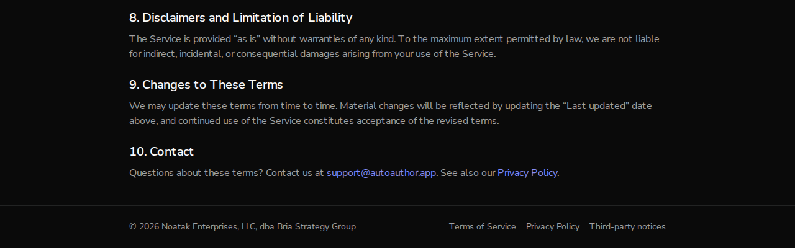
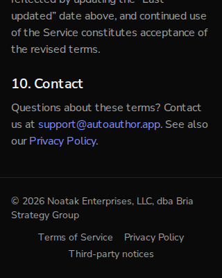

# Issue #825: the frontend ships the notices of the software it is built with

*2026-10-13T17:26:49Z by Showboat 0.6.1*
<!-- showboat-id: e08152f7-3ea9-436b-b0ce-e05dd2231fd1 -->

Two acceptance criteria: a third-party notices file is generated at build time and linked from the footer; the LGPL and GPL texts are present in the frontend image.

The two images compared are the one published from main (`sha-24c89cf-staging`) and one built from this branch with `docker build frontend/` (`aa825-frontend`). `serve.sh` boots an image and asks it for the notices, the two licence texts and the footer of `/terms`. `image_check.py` takes the licence check out of the image build workflow and runs it against an image.

## Before: the image published from main

It carries libvips, which is LGPL, as a shared library. There is no licence file of any kind in the application directory, the three addresses are not found, and the footer has two links.

```bash
docker run --rm --entrypoint sh ghcr.io/frankbria/auto-author-frontend:sha-24c89cf-staging -c 'ls node_modules/@img/sharp-libvips-linuxmusl-x64/lib; grep -o "\"license\": *\"[^\"]*\"" node_modules/@img/sharp-libvips-linuxmusl-x64/package.json; echo "licence files under /app: $(find /app -type f \( -iname "LICEN[CS]E*" -o -iname "COPYING*" -o -iname "NOTICE*" \) | wc -l)"; ls public'
```

```output
glib-2.0
index.js
libvips-cpp.so.8.18.7
"license": "LGPL-3.0-or-later"
licence files under /app: 0
book-placeholder.svg
file.svg
globe.svg
next.svg
vercel.svg
window.svg
```

```bash
bash /tmp/claude-1000/-home-frankbria-projects-auto-author/37b63b79-18ca-4958-9013-d3974f437927/scratchpad/demo825/serve.sh ghcr.io/frankbria/auto-author-frontend:sha-24c89cf-staging
```

```output
/third-party-notices.txt -> 404 text/html; charset=utf-8, 14407 bytes
/licenses/LGPL-3.0.txt -> 404 text/html; charset=utf-8, 14409 bytes
/licenses/GPL-3.0.txt -> 404 text/html; charset=utf-8, 14408 bytes
links in the footer of /terms:
  Terms of Service -> /terms
  Privacy Policy -> /privacy
```

## After: the image built from this branch

### The files are in the image

The notices, written by the build inside the image, and the two licence texts.

```bash
docker run --rm --entrypoint sh aa825-frontend -c 'wc -c public/third-party-notices.txt public/licenses/LGPL-3.0.txt public/licenses/GPL-3.0.txt | head -3'
```

```output
   778781 public/third-party-notices.txt
     7652 public/licenses/LGPL-3.0.txt
    35149 public/licenses/GPL-3.0.txt
```

```bash
docker run --rm --entrypoint sh aa825-frontend -c 'head -12 public/third-party-notices.txt'
```

```output
Third-party software notices

This web application is built with the 367 third-party packages listed below. Each entry gives
the package and version, its licence, where its source is, and the licence text the package ships.

Under a GNU licence, which the entry names:
  @img/sharp-libvips-linuxmusl-x64@1.3.4
The full text of the GNU Lesser General Public License, version 3, and of the GNU General Public
License, version 3, which it adds to, are at /licenses/LGPL-3.0.txt and /licenses/GPL-3.0.txt.
The source is at the address in the entry.

========================================================================
```

### What an entry holds

React, as most are: the licence it names and the text of the licence file it ships. Then libvips, which ships no licence file: its entry names the LGPL, says where its source is, and carries the table from its README of the libraries built into it (the first lines of it here).

```bash
docker run --rm --entrypoint sh aa825-frontend -c 'awk "/^react@/{p=1} p&&/^={72}$/{exit} p" public/third-party-notices.txt | head -9'
```

```output
react@19.3.0
Licence: MIT
Source: https://github.com/react/react.git

MIT License

Copyright (c) Meta Platforms, Inc. and affiliates.

Permission is hereby granted, free of charge, to any person obtaining a copy
```

```bash
docker run --rm --entrypoint sh aa825-frontend -c 'awk "/^@img\/sharp-libvips/{p=1} p&&/^={72}$/{exit} p" public/third-party-notices.txt | head -16'
```

```output
@img/sharp-libvips-linuxmusl-x64@1.3.4
Licence: LGPL-3.0-or-later
Source: git+https://github.com/lovell/sharp-libvips.git

Licensing

This software contains third-party libraries
used under the terms of the following licenses:

| Library       | Used under the terms of                                                                                   |
|---------------|-----------------------------------------------------------------------------------------------------------|
| aom           | BSD 2-Clause + [Alliance for Open Media Patent License 1.0](https://aomedia.org/license/patent-license/)  |
| cairo         | Mozilla Public License 1.1                                                                                |
| cgif          | MIT License                                                                                               |
| expat         | MIT License                                                                                               |
| fontconfig    | [fontconfig License](https://gitlab.freedesktop.org/fontconfig/fontconfig/blob/main/COPYING) (BSD-like)   |
```

```bash
docker run --rm --entrypoint sh aa825-frontend -c 'echo "entries: $(grep -c "^Licence: " public/third-party-notices.txt)"; echo "entries for jest, eslint or typescript: $(grep -cE "^(jest|eslint|typescript)@" public/third-party-notices.txt)"'
```

```output
entries: 367
entries for jest, eslint or typescript: 0
```

### The licence texts are the ones at gnu.org

The two files in the image, then the same two fetched from gnu.org.

```bash
docker run --rm --entrypoint sh aa825-frontend -c 'sha256sum public/licenses/LGPL-3.0.txt public/licenses/GPL-3.0.txt; head -2 public/licenses/LGPL-3.0.txt; head -2 public/licenses/GPL-3.0.txt'
```

```output
e3a994d82e644b03a792a930f574002658412f62407f5fee083f2555c5f23118  public/licenses/LGPL-3.0.txt
3972dc9744f6499f0f9b2dbf76696f2ae7ad8af9b23dde66d6af86c9dfb36986  public/licenses/GPL-3.0.txt
                   GNU LESSER GENERAL PUBLIC LICENSE
                       Version 3, 29 June 2007
                    GNU GENERAL PUBLIC LICENSE
                       Version 3, 29 June 2007
```

```bash
for name in lgpl-3.0 gpl-3.0; do echo "$(curl -sL https://www.gnu.org/licenses/$name.txt | sha256sum | cut -d' ' -f1)  gnu.org/licenses/$name.txt"; done
```

```output
e3a994d82e644b03a792a930f574002658412f62407f5fee083f2555c5f23118  gnu.org/licenses/lgpl-3.0.txt
3972dc9744f6499f0f9b2dbf76696f2ae7ad8af9b23dde66d6af86c9dfb36986  gnu.org/licenses/gpl-3.0.txt
```

### Served, and linked from the footer

The same requests as before. All three are found, as plain text, and the footer has a third link.

```bash
bash /tmp/claude-1000/-home-frankbria-projects-auto-author/37b63b79-18ca-4958-9013-d3974f437927/scratchpad/demo825/serve.sh aa825-frontend keep
```

```output
/third-party-notices.txt -> 200 text/plain; charset=UTF-8, 778781 bytes
/licenses/LGPL-3.0.txt -> 200 text/plain; charset=UTF-8, 7652 bytes
/licenses/GPL-3.0.txt -> 200 text/plain; charset=UTF-8, 35149 bytes
links in the footer of /terms:
  Terms of Service -> /terms
  Privacy Policy -> /privacy
  Third-party notices -> /third-party-notices.txt
```

The footer of `/terms` at 1280 pixels wide and at 320. At 320 the three links do not fit on one line; they wrap whole, not word by word.

```bash {image}

```



```bash {image}

```



```bash
agent-browser eval 'JSON.stringify({pageWidth: document.documentElement.scrollWidth, viewport: document.documentElement.clientWidth})' | tail -1
```

```output
"{\"pageWidth\":320,\"viewport\":320}"
```

### The image build checks for them

The check is the one in `.github/workflows/build-images.yml`, taken from the file and run here against each image. Against main's it fails; against this branch's it passes. In the workflow it runs before the image is pushed.

```bash
cd /home/frankbria/projects/worktrees/issue-825-third-party-notices && uvx --with pyyaml python /tmp/claude-1000/-home-frankbria-projects-auto-author/37b63b79-18ca-4958-9013-d3974f437927/scratchpad/demo825/image_check.py .github/workflows/build-images.yml ghcr.io/frankbria/auto-author-frontend:sha-24c89cf-staging 2>&1
```

```output
  for file in public/third-party-notices.txt public/licenses/LGPL-3.0.txt public/licenses/GPL-3.0.txt; do
    if ! docker run --rm --entrypoint test "$TAG" -s "$file"; then
      echo "::error::$TAG: $file is missing or empty"
      exit 1
    fi
  done
  echo "OK: the licence texts are in the image"

::error::ghcr.io/frankbria/auto-author-frontend:sha-24c89cf-staging: public/third-party-notices.txt is missing or empty
exit 1
```

```bash
cd /home/frankbria/projects/worktrees/issue-825-third-party-notices && uvx --with pyyaml python /tmp/claude-1000/-home-frankbria-projects-auto-author/37b63b79-18ca-4958-9013-d3974f437927/scratchpad/demo825/image_check.py .github/workflows/build-images.yml aa825-frontend 2>&1 | tail -2
```

```output
OK: the licence texts are in the image
exit 0
```

### Tests

```bash
cd /home/frankbria/projects/worktrees/issue-825-third-party-notices/frontend && npx jest src/__tests__/third-party-notices.test.ts src/components/__tests__/SiteFooter.test.tsx 2>&1 | grep -E '✓|✕|^Tests:' | sed -e 's/ ([0-9]* ms)//' -e 's/, [0-9.]* s$//'
```

```output
Tests:       10 passed, 10 total
```

```bash
cd /home/frankbria/projects/worktrees/issue-825-third-party-notices && uvx --with pytest --with pyyaml pytest scripts/test_frontend_image_per_environment.py -q 2>&1 | tail -1 | sed -e 's/ in [0-9.]*s//'
```

```output
10 passed
```
