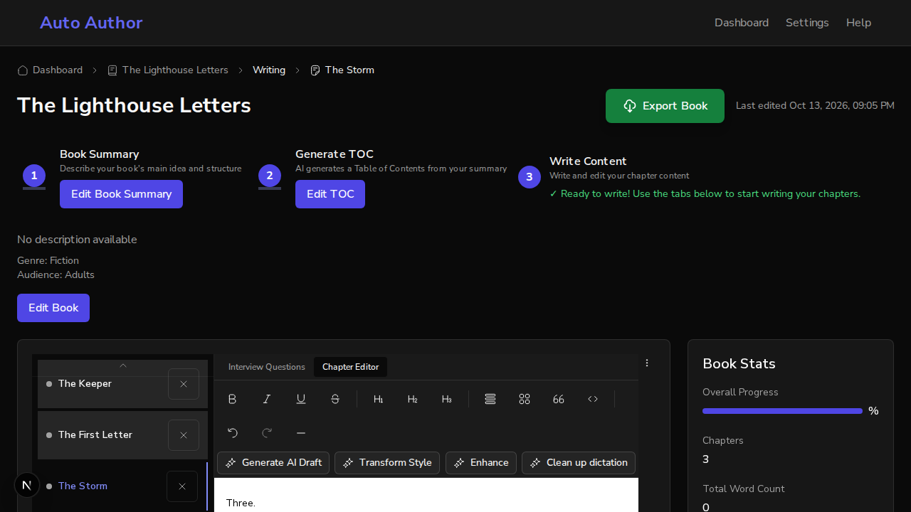
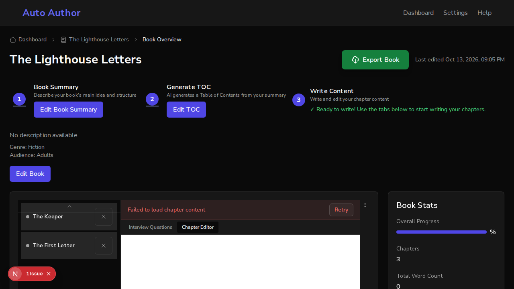
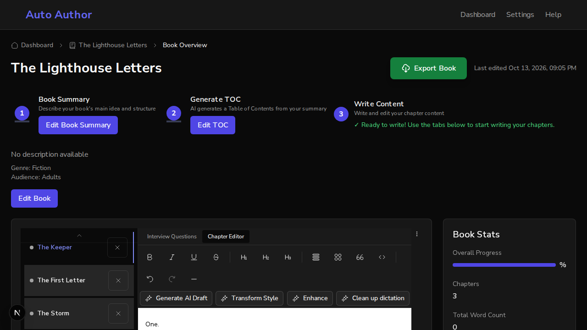

# Issue #830: chapter tabs follow a link to a chapter, and saved tabs are reconciled with the book

*2026-10-13T21:06:22Z by Showboat 0.6.1*
<!-- showboat-id: 78a37d3f-3b69-4eb9-b0a2-40c38da52eca -->

Two acceptance criteria: a hook test shows the chapter a link names wins over the saved one; one shared helper reconciles saved tab state with the table of contents on load and on refresh, and the case of saved [c1, c2], a table of contents of c1 to c3 and an active chapter that is gone is reconciled.

The tests are at the end. First, the same two things in a real browser. One backend runs on a scratch database with a book of three chapters: The Keeper (c1), The First Letter (c2), The Storm (c3). Two frontends run against it: the one on `main` (port 3130) and this branch's (port 3131). `tabs.sh` saves a tab state for the book through the API, as a last visit would have left it, opens the book in a browser that has nothing saved locally, and prints the tabs the tab bar shows, with the selected one in brackets.

## A link to a chapter

The last visit ended on The Keeper. The link names The Storm.

On main the link is ignored: The Keeper is selected.

```bash
bash /tmp/claude-1000/-home-frankbria-projects-auto-author/37b63b79-18ca-4958-9013-d3974f437927/scratchpad/demo830/tabs.sh 3130 '{"active_chapter_id":"c1","open_tab_ids":["c1"],"tab_order":["c1","c2","c3"]}' '?chapter=c3'
```

```output
saved: {"active_chapter_id":"c1","open_tab_ids":["c1"],"tab_order":["c1","c2","c3"]}
opened: /dashboard/books/<book>?chapter=c3
tabs, the selected one in brackets: [The Keeper] | The First Letter | The Storm
```

On this branch The Storm is selected.

```bash
SHOT=/tmp/claude-1000/-home-frankbria-projects-auto-author/37b63b79-18ca-4958-9013-d3974f437927/scratchpad/demo830/shot-link.png bash /tmp/claude-1000/-home-frankbria-projects-auto-author/37b63b79-18ca-4958-9013-d3974f437927/scratchpad/demo830/tabs.sh 3131 '{"active_chapter_id":"c1","open_tab_ids":["c1"],"tab_order":["c1","c2","c3"]}' '?chapter=c3'
```

```output
saved: {"active_chapter_id":"c1","open_tab_ids":["c1"],"tab_order":["c1","c2","c3"]}
opened: /dashboard/books/<book>?chapter=c3
tabs, the selected one in brackets: The Keeper | The First Letter | [The Storm]
```

```bash {image}

```



## Saved tabs that no longer match the book

The last visit had two tabs, The Keeper and The First Letter, and was on a chapter that has since been deleted. The Storm was added afterwards.

On main there are two tabs and neither is selected. The tab bar draws only the saved order, so The Storm cannot be opened from it.

```bash
SHOT=/tmp/claude-1000/-home-frankbria-projects-auto-author/37b63b79-18ca-4958-9013-d3974f437927/scratchpad/demo830/shot-stale-main.png bash /tmp/claude-1000/-home-frankbria-projects-auto-author/37b63b79-18ca-4958-9013-d3974f437927/scratchpad/demo830/tabs.sh 3130 '{"active_chapter_id":"gone","open_tab_ids":["c1","c2"],"tab_order":["c1","c2"]}'
```

```output
saved: {"active_chapter_id":"gone","open_tab_ids":["c1","c2"],"tab_order":["c1","c2"]}
opened: /dashboard/books/<book>
tabs, the selected one in brackets: The Keeper | The First Letter
```

```bash {image}

```



On this branch The Storm has a tab, after the two that were saved, and the first of the saved tabs is selected in place of the chapter that is gone.

```bash
SHOT=/tmp/claude-1000/-home-frankbria-projects-auto-author/37b63b79-18ca-4958-9013-d3974f437927/scratchpad/demo830/shot-stale-branch.png bash /tmp/claude-1000/-home-frankbria-projects-auto-author/37b63b79-18ca-4958-9013-d3974f437927/scratchpad/demo830/tabs.sh 3131 '{"active_chapter_id":"gone","open_tab_ids":["c1","c2"],"tab_order":["c1","c2"]}'
```

```output
saved: {"active_chapter_id":"gone","open_tab_ids":["c1","c2"],"tab_order":["c1","c2"]}
opened: /dashboard/books/<book>
tabs, the selected one in brackets: [The Keeper] | The First Letter | The Storm
```

```bash {image}

```



## Tests

The helper on its own, with the case the issue names first; the hook on load, where the link wins; and the hook on refresh, which uses the same helper. Then the tab tests that were already there, two of which pinned the old restore and were changed.

```bash
cd /home/frankbria/projects/worktrees/issue-830-chapter-tabs-reconcile/frontend && npx jest src/hooks/__tests__/useChapterTabs.reconcile.test.tsx --json --outputFile=/tmp/claude-1000/-home-frankbria-projects-auto-author/37b63b79-18ca-4958-9013-d3974f437927/scratchpad/demo830/jest.json >/dev/null 2>&1; python3 -c "
import json
r = json.load(open('/tmp/claude-1000/-home-frankbria-projects-auto-author/37b63b79-18ca-4958-9013-d3974f437927/scratchpad/demo830/jest.json'))
for t in r['testResults'][0]['assertionResults']: print(t['status'], '|', t['fullName'])
print(r['numPassedTests'], 'passed,', r['numFailedTests'], 'failed')"
```

```output
passed | reconcileTabState reconciles saved [c1, c2] with a table of contents of c1 to c3 when the active chapter is gone
passed | reconcileTabState drops chapters that are no longer there, from the open tabs and from the order
passed | reconcileTabState keeps the order the reader gave the tabs and puts new chapters after it
passed | reconcileTabState makes the chapter that was asked for the active one, and opens it
passed | reconcileTabState ignores a chapter that was asked for but is not in the book
passed | reconcileTabState starts on the first chapter when nothing was saved
passed | reconcileTabState lists a chapter once however often the saved state names it
passed | reconcileTabState has nothing active in a book with no chapters
passed | useChapterTabs on load opens the chapter the link names, not the one that was active last time
passed | useChapterTabs on load does the same when the last visit was saved in the browser
passed | useChapterTabs on load still opens the chapter that was active last time when no link names one
passed | useChapterTabs on load gives a chapter added since the last visit a tab, and does not stay on one that was deleted
passed | useChapterTabs on refresh reconciles the same way when the table of contents changes under it
13 passed, 0 failed
```

```bash
cd /home/frankbria/projects/worktrees/issue-830-chapter-tabs-reconcile/frontend && npx jest src/hooks src/components/chapters src/__tests__/TabStatePersistence.test.tsx src/__tests__/ChapterTabsTocIntegration.test.tsx 2>&1 | grep -E '^Tests:|^Test Suites:' | sed 's/, [0-9.]* s$//'
```

```output
Test Suites: 36 passed, 36 total
Tests:       549 passed, 549 total
```
