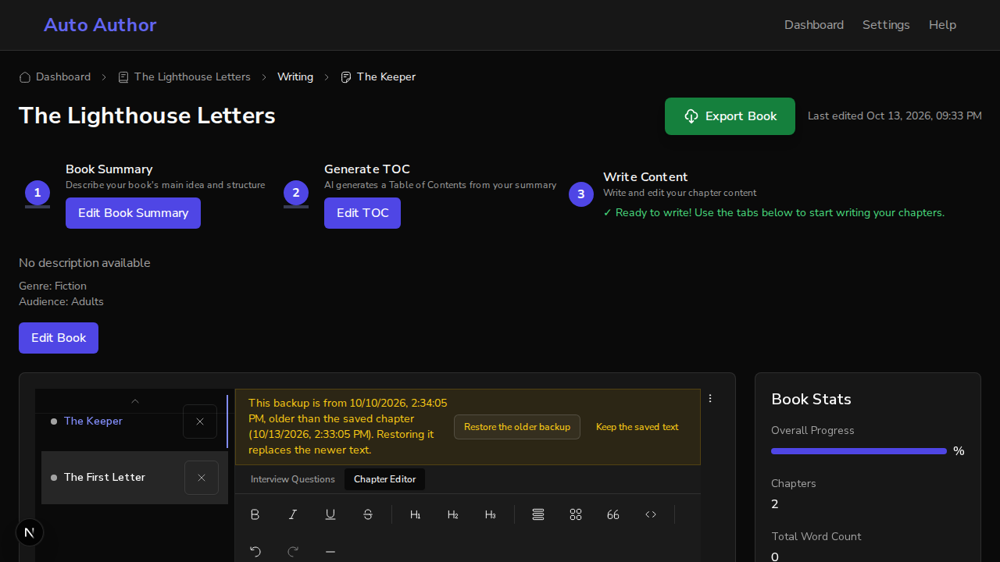

# Issue #831: opening a chapter is not editing it, and an old backup does not quietly replace newer text

*2026-10-13T21:33:22Z by Showboat 0.6.1*
<!-- showboat-id: e5267c52-7e02-49d6-a7dd-da05bec37db5 -->

Three acceptance criteria: loaded text is put into the editor without an update event, and an untouched load does not make the browser ask before leaving; restoring a backup older than the chapter's last save asks first; backups past their week are removed when the editor mounts.

The unit tests use a stand-in for the editor library, so this was checked first in a real browser, with the real editor. One backend runs on a scratch database with a book whose first chapter, The Keeper, was saved a minute ago. Two frontends run against it: the one on `main` (port 3130) and this branch's (port 3131). `editor.sh` puts the browser in a known state, opens the chapter, and reports what the editor shows, whether the browser would ask before leaving the page (it dispatches a cancellable `beforeunload` and reads whether the page cancelled it), and how many saves reached the backend.

## Opening a chapter and touching nothing

On main the chapter is treated as unsaved for three seconds: until the autosave timer runs, finds nothing to save, and clears the mark. Closing the tab in those seconds gets the browser's "leave site?" question. The issue says it always asks; measured, it is those three seconds, after every chapter that is opened.

```bash
bash /tmp/claude-1000/-home-frankbria-projects-auto-author/37b63b79-18ca-4958-9013-d3974f437927/scratchpad/demo831/editor.sh 3130 untouched
```

```output
the editor shows: The saved text of the first chapter.
would the browser ask before leaving, second 1: yes
would the browser ask before leaving, second 2: yes
would the browser ask before leaving, second 3: yes
would the browser ask before leaving, second 4: no
would the browser ask before leaving, second 5: no
would the browser ask before leaving, second 6: no
saves sent to the server: 0
```

On this branch it never asks.

```bash
bash /tmp/claude-1000/-home-frankbria-projects-auto-author/37b63b79-18ca-4958-9013-d3974f437927/scratchpad/demo831/editor.sh 3131 untouched
```

```output
the editor shows: The saved text of the first chapter.
would the browser ask before leaving, second 1: no
would the browser ask before leaving, second 2: no
would the browser ask before leaving, second 3: no
would the browser ask before leaving, second 4: no
would the browser ask before leaving, second 5: no
would the browser ask before leaving, second 6: no
saves sent to the server: 0
```

## Typing still counts

On this branch, straight after typing the browser would ask; six seconds later the text has been saved, once, and it would not.

```bash
bash /tmp/claude-1000/-home-frankbria-projects-auto-author/37b63b79-18ca-4958-9013-d3974f437927/scratchpad/demo831/editor.sh 3131 typed
```

```output
the editor shows: The saved text of the first chapter. And a new sentence.
would the browser ask before leaving, straight after typing: yes
saves sent to the server six seconds later: 1
would the browser ask before leaving now: no
```

## A backup older than what is saved

A backup from three days ago is on this device. The chapter was saved a minute ago.

On main, Restore Backup replaces the saved text with the three-day-old draft at once.

```bash
bash /tmp/claude-1000/-home-frankbria-projects-auto-author/37b63b79-18ca-4958-9013-d3974f437927/scratchpad/demo831/editor.sh 3130 old-backup
```

```output
offered: Restore Backup | Dismiss
after pressing Restore Backup, the editor shows: An older draft, from the backup.
the page says: (nothing about a backup)
offered: (nothing)
```

On this branch, Restore Backup leaves the saved text where it is, says which of the two is older, and offers the choice. Choosing to restore then does.

```bash
SHOT=/tmp/claude-1000/-home-frankbria-projects-auto-author/37b63b79-18ca-4958-9013-d3974f437927/scratchpad/demo831/shot-older.png bash /tmp/claude-1000/-home-frankbria-projects-auto-author/37b63b79-18ca-4958-9013-d3974f437927/scratchpad/demo831/editor.sh 3131 old-backup
```

```output
offered: Restore Backup | Dismiss
after pressing Restore Backup, the editor shows: The saved text of the first chapter.
the page says: This backup is from 10/10/2026, 2:34:05 PM, older than the saved chapter (10/13/2026, 2:33:05 PM). Restoring it replaces the newer text.
offered: Restore the older backup | Keep the saved text
after pressing Restore the older backup, the editor shows: An older draft, from the backup.
```

```bash {image}

```



## A backup past its week

A backup from eight days ago is on this device. On main it is still offered. On this branch it was removed as the editor mounted, and nothing is offered.

```bash
bash /tmp/claude-1000/-home-frankbria-projects-auto-author/37b63b79-18ca-4958-9013-d3974f437927/scratchpad/demo831/editor.sh 3130 expired
```

```output
offered: Restore Backup | Dismiss
the eight-day-old backup is still on this device: yes
```

```bash
bash /tmp/claude-1000/-home-frankbria-projects-auto-author/37b63b79-18ca-4958-9013-d3974f437927/scratchpad/demo831/editor.sh 3131 expired
```

```output
offered: (nothing)
the eight-day-old backup is still on this device: no
```

## Tests

The new tests, then every editor test that was already there.

```bash
cd /home/frankbria/projects/worktrees/issue-831-editor-dirty-and-backup/frontend && npx jest src/components/chapters/__tests__/ChapterEditor.untouchedAndBackup.test.tsx --json --outputFile=/tmp/claude-1000/-home-frankbria-projects-auto-author/37b63b79-18ca-4958-9013-d3974f437927/scratchpad/demo831/jest.json >/dev/null 2>&1; python3 -c "
import json
r = json.load(open('/tmp/claude-1000/-home-frankbria-projects-auto-author/37b63b79-18ca-4958-9013-d3974f437927/scratchpad/demo831/jest.json'))
for t in r['testResults'][0]['assertionResults']: print(t['status'], '|', t['fullName'])
print(r['numPassedTests'], 'passed,', r['numFailedTests'], 'failed')"
```

```output
passed | a chapter that is opened and not touched does not make the browser ask before the page is left
passed | a chapter that is opened and not touched is not saved again
passed | a chapter that is opened and not touched still asks once something has been typed
passed | restoring a backup asks first when the backup is older than what is saved
passed | restoring a backup restores it when the writer says so
passed | restoring a backup keeps the saved text, and the backup, when the writer says not to
passed | restoring a backup does not ask when the backup is the newer of the two: a save that failed
passed | restoring a backup does not ask for a chapter that has never been saved
passed | backups past their week are removed when the editor opens, for this chapter and for others
passed | backups past their week leaves a backup that is still within its week, and anything that is not a backup
10 passed, 0 failed
```

```bash
cd /home/frankbria/projects/worktrees/issue-831-editor-dirty-and-backup/frontend && npx jest src/components/chapters src/lib/storage 2>&1 | grep -E '^Tests:|^Test Suites:' | sed 's/, [0-9.]* s$//'
```

```output
Test Suites: 27 passed, 27 total
Tests:       462 passed, 462 total
```
