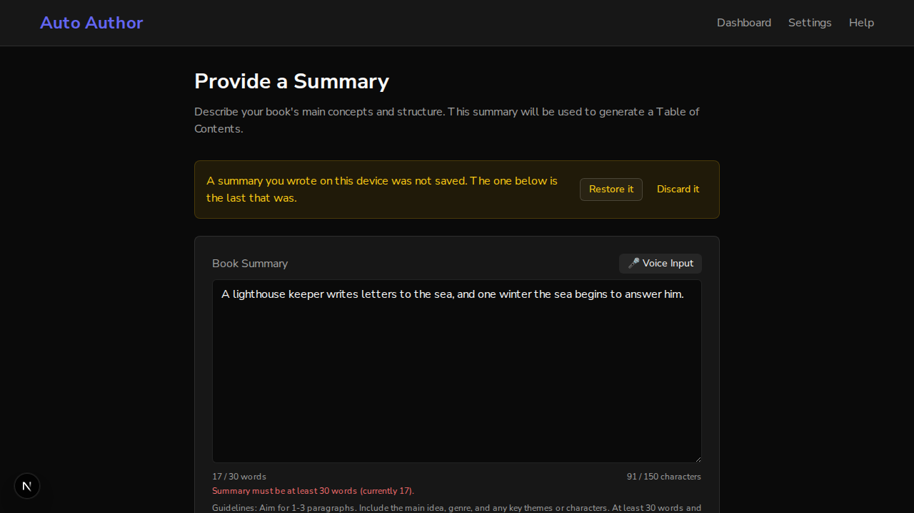

# Issue #832: a summary that could not be saved is not lost, and the writer is told

*2026-10-13T22:20:12Z by Showboat 0.6.1*
<!-- showboat-id: ee964241-4182-46f5-8ecb-2c697c7a82a9 -->

Three acceptance criteria: a save failure shows a status; the unsaved draft is kept and a restore choice is offered; `setItem` is wrapped in try/catch.

The first two are shown in a real browser. One backend runs on a scratch database with a book that has a saved summary. Two frontends run against it: the one on `main` (port 3130) and this branch's (port 3131). `summary.sh` opens the summary page, stops the backend, types a new summary, waits past the page's save, and reports what the page says and where the two summaries are; then it starts the backend again, opens the page again, and reports the same.

## Main

The save fails and the page says nothing. The new summary is in the browser's storage and nowhere else. On the next visit the field holds the saved summary, the browser's copy has been written over with it, and nothing is offered: the new summary is gone.

```bash
bash /tmp/claude-1000/-home-frankbria-projects-auto-author/37b63b79-18ca-4958-9013-d3974f437927/scratchpad/demo832/summary.sh 3130
```

```output
the backend is stopped
the writer typed the new summary; the field holds: the new summary
the page says: (nothing)
in the browser's storage: book-summary-<book> = the new summary
on the server: the saved summary
the backend is running again
the next visit; the field holds: the saved summary
the page says: (nothing)
offered: (nothing)
in the browser's storage: book-summary-<book> = the saved summary
```

## This branch

The save fails and the page says so, and where the text is. It is kept under a second key. On the next visit the field holds the saved summary, the page says a summary was not saved, and it is offered back; the kept copy is still there. Restoring it puts it in the field and saves it, and the kept copy is let go.

```bash
SHOT=/tmp/claude-1000/-home-frankbria-projects-auto-author/37b63b79-18ca-4958-9013-d3974f437927/scratchpad/demo832/shot-offer.png bash /tmp/claude-1000/-home-frankbria-projects-auto-author/37b63b79-18ca-4958-9013-d3974f437927/scratchpad/demo832/summary.sh 3131
```

```output
the backend is stopped
the writer typed the new summary; the field holds: the new summary
the page says: Your summary could not be saved. It is kept on this device, and saving is tried again when you change it.
in the browser's storage: book-summary-<book> = the new summary; book-summary-unsaved-<book> = the new summary
on the server: the saved summary
the backend is running again
the next visit; the field holds: the saved summary
the page says: A summary you wrote on this device was not saved. The one below is the last that was.
offered: Restore it | Discard it
in the browser's storage: book-summary-<book> = the saved summary; book-summary-unsaved-<book> = the new summary
after Restore it, the field holds: the new summary
on the server: the new summary
in the browser's storage: book-summary-<book> = the new summary
```

```bash {image}

```



## Tests

The third criterion is here: with `localStorage.setItem` throwing, typing still works and the save still reaches the server; before the change both of these tests ended in an uncaught QuotaExceededError.

```bash
cd /home/frankbria/projects/worktrees/issue-832-summary-save-failures/frontend && npx jest 'src/app/dashboard/books/\[bookId\]/summary/__tests__/page.saveFailure.test.tsx' --json --outputFile=/tmp/claude-1000/-home-frankbria-projects-auto-author/37b63b79-18ca-4958-9013-d3974f437927/scratchpad/demo832/jest.json >/dev/null 2>&1; python3 -c "
import json
r = json.load(open('/tmp/claude-1000/-home-frankbria-projects-auto-author/37b63b79-18ca-4958-9013-d3974f437927/scratchpad/demo832/jest.json'))
for t in r['testResults'][0]['assertionResults']: print(t['status'], '|', t['fullName'])
print(r['numPassedTests'], 'passed,', r['numFailedTests'], 'failed')"
```

```output
passed | a summary save that fails says so
passed | a summary save that fails keeps the text that was not saved, apart from the working copy
passed | a summary save that fails stops saying so, and lets the kept copy go, once a save gets through
passed | a summary save that fails says nothing when the save works
passed | coming back after a save failed shows the saved summary, keeps the unsaved one, and offers the choice
passed | coming back after a save failed keeps the unsaved one through the page saving its working copy, and through typing
passed | coming back after a save failed restores it when asked, and saves it
passed | coming back after a save failed discards it when asked
passed | coming back after a save failed offers nothing when what was kept is what the server has
passed | coming back after a save failed offers nothing for another book
passed | a browser that will not store anything does not break typing, and says the text is in neither place when the save fails too
passed | a browser that will not store anything still saves to the server
12 passed, 0 failed
```

```bash
cd /home/frankbria/projects/worktrees/issue-832-summary-save-failures/frontend && npx jest 'src/app/dashboard/books/\[bookId\]/summary' 2>&1 | grep -E '^Tests:|^Test Suites:' | sed 's/, [0-9.]* s$//'
```

```output
Test Suites: 4 passed, 4 total
Tests:       34 passed, 34 total
```
