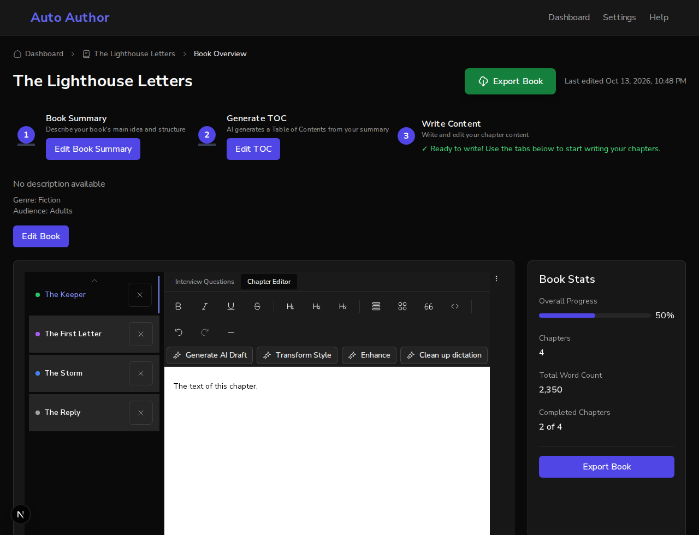

# Issue #833: the Book Stats panel shows the numbers the book has

*2026-10-13T22:48:28Z by Showboat 0.6.1*
<!-- showboat-id: 4b98a795-c6b9-4c53-854a-d869fb11d211 -->

Two acceptance criteria: the stats come from `getChaptersMetadata` using the helper from #291; a test confirms the panel never shows "undefined%".

First in a real browser. One backend runs on a scratch database with a book of four chapters: one completed (1,200 words), one published (800), one in progress (350) and one draft (0). So two of four are completed, which is 50%, and the book has 2,350 words. Two frontends run against it: the one on `main` (port 3130) and this branch's (port 3131). `stats.sh` opens the book's page and reads the Book Stats panel.

## Main

No figure before the percent sign, and the bar has no width: both came from a field the book route does not return. No words and no completed chapters, whatever the book has: both were constants.

```bash
bash /tmp/claude-1000/-home-frankbria-projects-auto-author/37b63b79-18ca-4958-9013-d3974f437927/scratchpad/demo833/stats.sh 3130
```

```output
Overall Progress: %
Chapters: 4
Total Word Count: 0
Completed Chapters: 0 of 4
the bar is drawn to a width of: (no style)
what a screen reader is given for the bar: nothing
```

## This branch

The book's own numbers, and a bar a screen reader can read.

```bash
SHOT=/tmp/claude-1000/-home-frankbria-projects-auto-author/37b63b79-18ca-4958-9013-d3974f437927/scratchpad/demo833/shot-stats.png bash /tmp/claude-1000/-home-frankbria-projects-auto-author/37b63b79-18ca-4958-9013-d3974f437927/scratchpad/demo833/stats.sh 3131
```

```output
Overall Progress: 50%
Chapters: 4
Total Word Count: 2,350
Completed Chapters: 2 of 4
the bar is drawn to a width of: width: 50%;
what a screen reader is given for the bar: Overall progress, 50 of 100
the panel's last row ends 794 pixels down a 980-pixel window
```

```bash {image}

```



## Tests

The new tests, with the one the issue asks for by name; then every test of this page. Four of those stood in for the table-of-contents call the page used to make and now stand in for the chapter read.

```bash
cd /home/frankbria/projects/worktrees/issue-833-book-stats-panel/frontend && npx jest 'src/app/dashboard/books/\[bookId\]/__tests__/page.bookStats.test.tsx' --json --outputFile=/tmp/claude-1000/-home-frankbria-projects-auto-author/37b63b79-18ca-4958-9013-d3974f437927/scratchpad/demo833/jest.json >/dev/null 2>&1; python3 -c "
import json
r = json.load(open('/tmp/claude-1000/-home-frankbria-projects-auto-author/37b63b79-18ca-4958-9013-d3974f437927/scratchpad/demo833/jest.json'))
for t in r['testResults'][0]['assertionResults']: print(t['status'], '|', t['fullName'])
print(r['numPassedTests'], 'passed,', r['numFailedTests'], 'failed')"
```

```output
passed | the Book Stats panel shows the progress, the words and the completed chapters the book has
passed | the Book Stats panel draws the progress bar to the same figure
passed | the Book Stats panel never says undefined: a book with no chapters is at 0%
passed | the Book Stats panel nor when the chapters could not be read
passed | the Book Stats panel still shows the chapter tabs for a book that has chapters
5 passed, 0 failed
```

```bash
cd /home/frankbria/projects/worktrees/issue-833-book-stats-panel/frontend && npx jest 'src/app/dashboard/books/\[bookId\]/__tests__' src/__tests__/bookClient.test.tsx 2>&1 | grep -E '^Tests:|^Test Suites:' | sed 's/, [0-9.]* s$//'
```

```output
Test Suites: 7 passed, 7 total
Tests:       84 passed, 84 total
```
