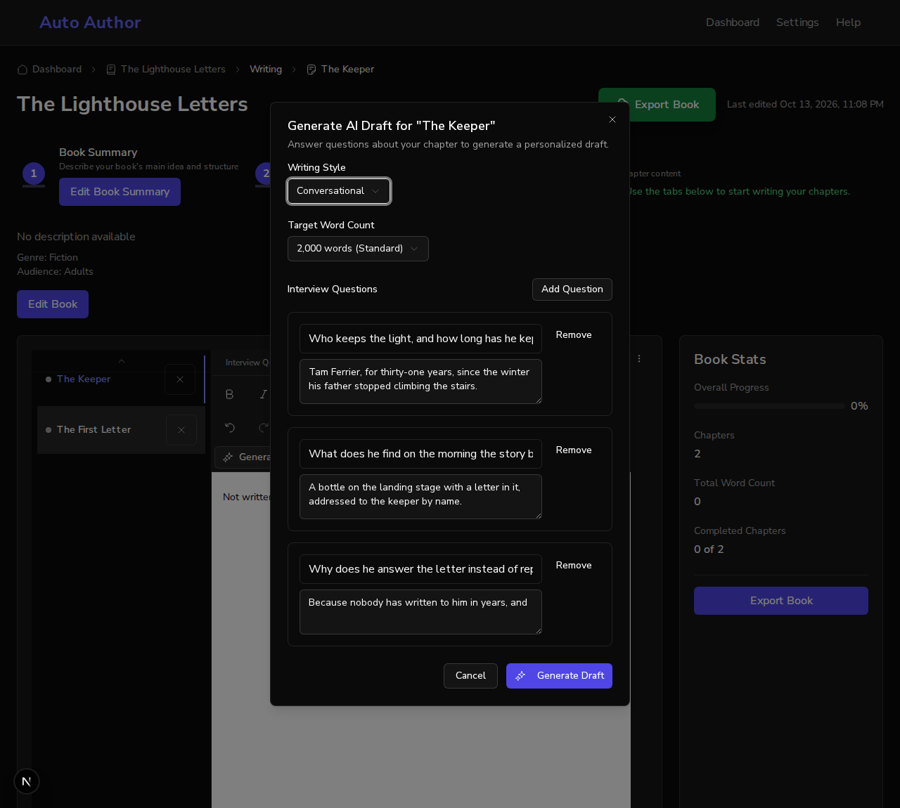

# Issue #834: the toolbar draft dialog starts from the chapter's interview answers

*2026-10-13T23:08:46Z by Showboat 0.6.1*
<!-- showboat-id: ad6a2564-d44a-45d4-8103-a1b69f7bbfa0 -->

One acceptance criterion: the draft generator in the editor's toolbar is prefilled from the chapter's saved responses, with a test.

First in a real browser. One backend runs on a scratch database with a book of two chapters. The first, The Keeper, has three interview questions, created by the application's own function; two were answered and marked complete and the third was answered in draft, all three through the API. The second chapter has no questions. Two frontends run against it: the one on `main` (port 3130) and this branch's (port 3131). `draft.sh` opens a chapter, presses "Generate AI Draft" in the editor's toolbar, and prints the questions and answers the dialog opens with.

## Main

Five sample questions and no answers, in a chapter whose interview has three. A draft cannot be generated until something is typed.

```bash
bash /tmp/claude-1000/-home-frankbria-projects-auto-author/37b63b79-18ca-4958-9013-d3974f437927/scratchpad/demo834/draft.sh 3130 c1
```

```output
the dialog: Generate AI Draft for The Keeper
1. What is the main concept or idea you want to convey in this chapter? -> (empty)
2. Can you share a personal story or example that illustrates this concept? -> (empty)
3. What are the key takeaways you want readers to remember? -> (empty)
4. How does this chapter connect to the overall theme of your book? -> (empty)
5. What challenges might readers face, and how can they overcome them? -> (empty)
the draft can be generated without typing anything: no
```

## This branch

The chapter's own three questions with their answers, the one still in draft included. A draft can be generated as it stands.

```bash
SHOT=/tmp/claude-1000/-home-frankbria-projects-auto-author/37b63b79-18ca-4958-9013-d3974f437927/scratchpad/demo834/shot-prefilled.png bash /tmp/claude-1000/-home-frankbria-projects-auto-author/37b63b79-18ca-4958-9013-d3974f437927/scratchpad/demo834/draft.sh 3131 c1
```

```output
the dialog: Generate AI Draft for The Keeper
1. Who keeps the light, and how long has he kept it? -> Tam Ferrier, for thirty-one years, since the winter his father stopped climbing the stairs.
2. What does he find on the morning the story begins? -> A bottle on the landing stage with a letter in it, addressed to the keeper by name.
3. Why does he answer the letter instead of reporting it? -> Because nobody has written to him in years, and
the draft can be generated without typing anything: yes
answer fields wholly inside the 1150-pixel window: 3 of 3
```

```bash {image}

```



A chapter with no interview answers starts from the sample questions, as before.

```bash
bash /tmp/claude-1000/-home-frankbria-projects-auto-author/37b63b79-18ca-4958-9013-d3974f437927/scratchpad/demo834/draft.sh 3131 c2
```

```output
the dialog: Generate AI Draft for The First Letter
1. What is the main concept or idea you want to convey in this chapter? -> (empty)
2. Can you share a personal story or example that illustrates this concept? -> (empty)
3. What are the key takeaways you want readers to remember? -> (empty)
4. How does this chapter connect to the overall theme of your book? -> (empty)
5. What challenges might readers face, and how can they overcome them? -> (empty)
the draft can be generated without typing anything: no
```

## Tests

The new tests, then the two suites that were already there for this dialog. Their stand-in for the client now answers the saved-answers call as a chapter with none.

```bash
cd /home/frankbria/projects/worktrees/issue-834-draft-from-interview-answers/frontend && npx jest src/components/chapters/__tests__/DraftGenerator.prefill.test.tsx --json --outputFile=/tmp/claude-1000/-home-frankbria-projects-auto-author/37b63b79-18ca-4958-9013-d3974f437927/scratchpad/demo834/jest.json >/dev/null 2>&1; python3 -c "
import json
r = json.load(open('/tmp/claude-1000/-home-frankbria-projects-auto-author/37b63b79-18ca-4958-9013-d3974f437927/scratchpad/demo834/jest.json'))
for t in r['testResults'][0]['assertionResults']: print(t['status'], '|', t['fullName'])
print(r['numPassedTests'], 'passed,', r['numFailedTests'], 'failed')"
```

```output
passed | the toolbar draft generator opens with the chapter's saved interview answers
passed | the toolbar draft generator includes an answer that is still a draft
passed | the toolbar draft generator writes the draft from those answers
passed | the toolbar draft generator falls back to the sample questions for a chapter with no answers yet
passed | the toolbar draft generator falls back to the sample questions when the answers cannot be read
passed | the toolbar draft generator does not write over what the writer has typed while the answers were loading
passed | the toolbar draft generator reads the answers of the chapter it is opened for, each time it is opened
7 passed, 0 failed
```

```bash
cd /home/frankbria/projects/worktrees/issue-834-draft-from-interview-answers/frontend && npx jest src/__tests__/DraftGenerator.test.tsx src/__tests__/PreferenceDefaults.test.tsx 2>&1 | grep -E '^Tests:|^Test Suites:' | sed 's/, [0-9.]* s$//'
```

```output
Test Suites: 2 passed, 2 total
Tests:       19 passed, 19 total
```
