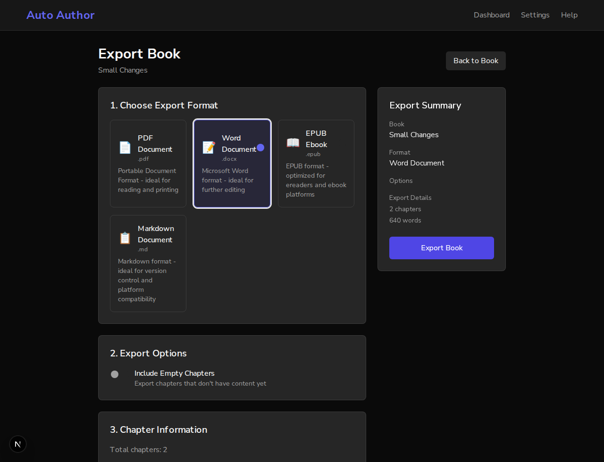
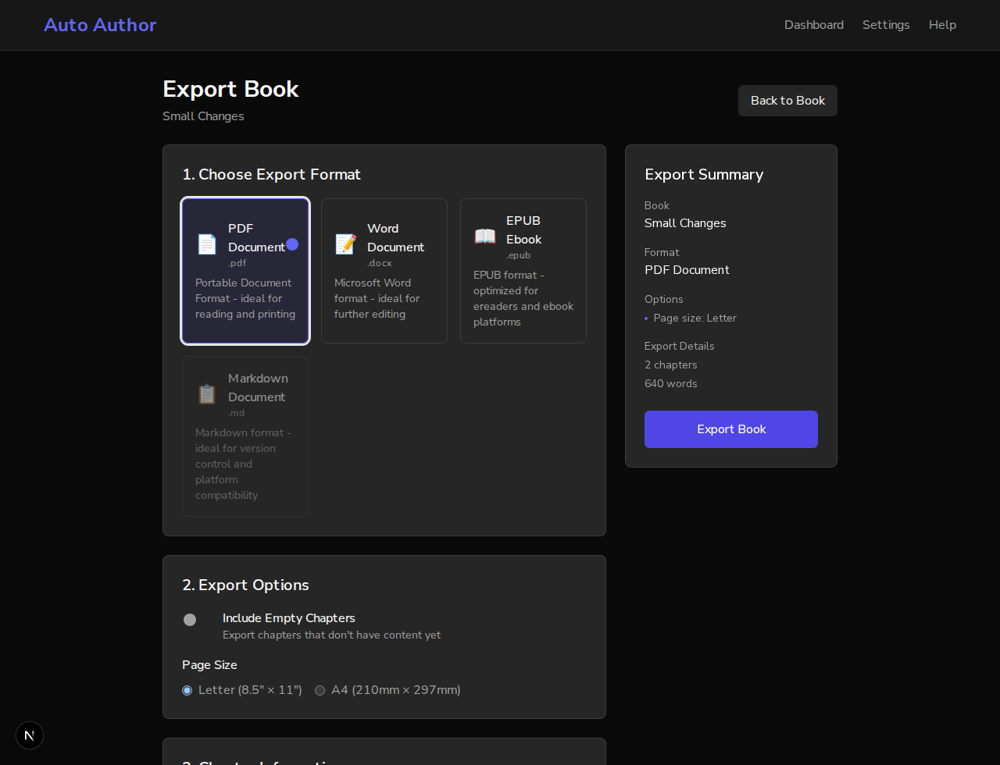
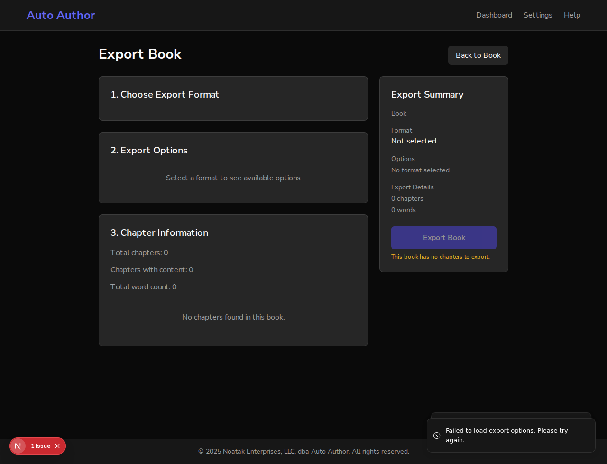
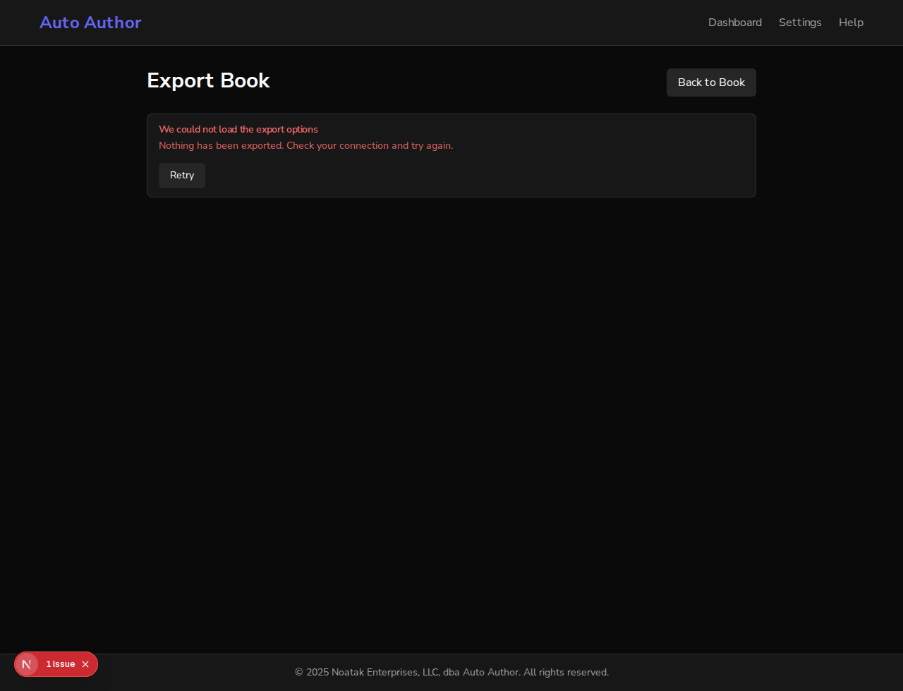

# Issue #836: an export format can be chosen with the keyboard, and a failed load says so

*2026-10-14T00:52:17Z by Showboat 0.6.1*
<!-- showboat-id: 2e52079a-c20e-4d98-aebc-e866b5714f27 -->

Three acceptance criteria: the formats are a radiogroup with `aria-checked` and `aria-disabled`; a load failure shows an inline `role=alert` with a Retry button; keyboard-only jest and axe tests cover each.

A real browser, two frontends and one backend on a scratch database. Port 3130 is main, 3131 is this branch. The book is "Small Changes", two written chapters. The drivers press keys and report what has the focus; they do not click.

## Before: main, with the keyboard

Tab from the top of the page to the Export Book button. The four format cards are plain `div`s, and the focus goes from "Back to Book" straight to the options: no format can be reached, so none can be chosen.

```bash
bash /tmp/claude-1000/-home-frankbria-projects-auto-author/37b63b79-18ca-4958-9013-d3974f437927/scratchpad/demo836/keys.sh 3130 < /dev/null
```

```output
the format cards:
  PDF Document: <div> role=null tabindex=null
  Word Document: <div> role=null tabindex=null
  EPUB Ebook: <div> role=null tabindex=null
  Markdown Document: <div> role=null tabindex=null
Tab, from the top of the page:
  1. a "Skip to main content"
  2. a "Auto Author"
  3. a "Dashboard"
  4. a "Settings"
  5. a "Help"
  6. button "Back to Book"
  7. checkbox "Include Empty Chapters"
  8. radio "letter"
  9. button "Export Book"
no format ever had the focus; the summary still says the format is PDF Document
```

## After: this branch, with the keyboard

The same walk. The formats are radios in one group, the group is one tab stop, and the right arrow chooses Word. Tab again, to Export Book, Enter, and the real backend exports a Word document.

```bash
EXPORT=1 SHOT=/tmp/claude-1000/-home-frankbria-projects-auto-author/37b63b79-18ca-4958-9013-d3974f437927/scratchpad/demo836/shot-arrow.png bash /tmp/claude-1000/-home-frankbria-projects-auto-author/37b63b79-18ca-4958-9013-d3974f437927/scratchpad/demo836/keys.sh 3131 < /dev/null
```

```output
the format cards:
  PDF Document: role=radio aria-checked=true aria-disabled=false
  Word Document: role=radio aria-checked=false aria-disabled=false
  EPUB Ebook: role=radio aria-checked=false aria-disabled=false
  Markdown Document: role=radio aria-checked=false aria-disabled=false
Tab, from the top of the page:
  1. a "Skip to main content"
  2. a "Auto Author"
  3. a "Dashboard"
  4. a "Settings"
  5. a "Help"
  6. button "Back to Book"
  7. radio "PDF Document"
     Right arrow: the focus is on radio "Word Document", and the summary says the format is Word Document
  8. checkbox "Include Empty Chapters"
  9. button "Export Book"
Enter on Export Book: Export Complete! Your book has been successfully exported in Word Document format.
```

```bash {image}

```



## A format the server cannot make

The backend is restarted without the library Markdown export needs, so it is the real server that reports Markdown as unavailable. The radio says `aria-disabled=true`, and the right arrow goes from EPUB round to PDF, passing it.

```bash
SHOT=/tmp/claude-1000/-home-frankbria-projects-auto-author/37b63b79-18ca-4958-9013-d3974f437927/scratchpad/demo836/shot-unavailable.png bash /tmp/claude-1000/-home-frankbria-projects-auto-author/37b63b79-18ca-4958-9013-d3974f437927/scratchpad/demo836/unavailable.sh 3131 < /dev/null
```

```output
the server says: pdf, docx, epub, markdown (unavailable)
the format cards:
  PDF Document: role=radio aria-checked=true aria-disabled=false
  Word Document: role=radio aria-checked=false aria-disabled=false
  EPUB Ebook: role=radio aria-checked=false aria-disabled=false
  Markdown Document: role=radio aria-checked=false aria-disabled=true
Tab from Back to Book: the focus is on radio "PDF Document"
Right arrow: the focus is on radio "Word Document"; chosen: Word Document
Right arrow: the focus is on radio "EPUB Ebook"; chosen: EPUB Ebook
Right arrow: the focus is on radio "PDF Document"; chosen: PDF Document
the server is back as it was: pdf, docx, epub, markdown
```

```bash {image}

```



## A failed load, before: main

The backend is stopped and the export page opened. A toast goes by. What is left is a form with no formats in it, an Export button, and no way to try again.

```bash
bash /tmp/claude-1000/-home-frankbria-projects-auto-author/37b63b79-18ca-4958-9013-d3974f437927/scratchpad/demo836/stack.sh backend-down < /dev/null; SHOT=/tmp/claude-1000/-home-frankbria-projects-auto-author/37b63b79-18ca-4958-9013-d3974f437927/scratchpad/demo836/shot-fail-main.png bash /tmp/claude-1000/-home-frankbria-projects-auto-author/37b63b79-18ca-4958-9013-d3974f437927/scratchpad/demo836/fail.sh 3130 < /dev/null
```

```output
the backend is stopped
  alert in the page: none
  Retry button: no
  formats offered: 0
  Export Book button: yes
```

```bash {image}

```



## A failed load, after: this branch

The same, with the backend still stopped: an alert in the page, in place of the form, with a Retry button. Then the backend is started again, Tab is pressed until Retry has the focus, and Enter loads the page.

```bash
RETRY=1 SHOT=/tmp/claude-1000/-home-frankbria-projects-auto-author/37b63b79-18ca-4958-9013-d3974f437927/scratchpad/demo836/shot-fail-branch.png SHOT2=/tmp/claude-1000/-home-frankbria-projects-auto-author/37b63b79-18ca-4958-9013-d3974f437927/scratchpad/demo836/shot-retried.png bash /tmp/claude-1000/-home-frankbria-projects-auto-author/37b63b79-18ca-4958-9013-d3974f437927/scratchpad/demo836/fail.sh 3131 < /dev/null
```

```output
  alert in the page: "We could not load the export options /  / Nothing has been exported. Check your connection and try again. /  / Retry"
  Retry button: yes
  formats offered: 0
  Export Book button: no
the backend is running again
Tab pressed 7 times: the focus is on button "Retry"
Enter:
  alert in the page: none
  Retry button: no
  formats offered: 4
  Export Book button: yes
```

```bash {image}

```



## axe, in the browser

axe-core itself on the branch, on the form and on the failed load, in the dark theme and the light: the WCAG 2.1 A and AA rules, with colour contrast measured, which jest cannot do. axe does not report a `div` with a click handler, so it passes main as well; the keyboard walk above is the evidence for that defect.

```bash
bash /tmp/claude-1000/-home-frankbria-projects-auto-author/37b63b79-18ca-4958-9013-d3974f437927/scratchpad/demo836/axe.sh 3131 < /dev/null
```

```output
the form, theme dark: 16 rules passed, 0 violated; colour contrast measured on 40 elements, undecided on 0
the failed load (alert shown), theme dark: 6 rules passed, 0 violated; colour contrast measured on 5 elements, undecided on 0
the form, theme light: 16 rules passed, 0 violated; colour contrast measured on 40 elements, undecided on 0
the failed load (alert shown), theme light: 6 rules passed, 0 violated; colour contrast measured on 5 elements, undecided on 0
```

## Tests

The new keyboard-only tests by name, then the page's other tests.

```bash
cd /home/frankbria/projects/worktrees/issue-836-export-format-radiogroup/frontend && npx jest 'src/app/dashboard/books/\[bookId\]/export' --coverage=false --json --outputFile=/tmp/claude-1000/-home-frankbria-projects-auto-author/37b63b79-18ca-4958-9013-d3974f437927/scratchpad/demo836/jest.json >/dev/null 2>&1; python3 /tmp/claude-1000/-home-frankbria-projects-auto-author/37b63b79-18ca-4958-9013-d3974f437927/scratchpad/demo836/names.py /tmp/claude-1000/-home-frankbria-projects-auto-author/37b63b79-18ca-4958-9013-d3974f437927/scratchpad/demo836/jest.json
```

```output
passed: choosing an export format with the keyboard (#836) offers the formats as one group of radios, one checked, the unavailable one disabled
passed: choosing an export format with the keyboard (#836) is one tab stop, and the arrow keys choose
passed: choosing an export format with the keyboard (#836) passes over the format that is not available
passed: choosing an export format with the keyboard (#836) exports the format chosen that way, with no click anywhere
passed: choosing an export format with the keyboard (#836) has no axe violations
passed: when the export page cannot load (#836) says so in the page, and shows no form to fill in
passed: when the export page cannot load (#836) loads again when Retry is pressed, from the keyboard
passed: when the export page cannot load (#836) shows that it is loading while the retry is under way, not an empty form
passed: when the export page cannot load (#836) shows the alert again when the retry fails too
passed: when the export page cannot load (#836) has no axe violations
all of the export page's tests: 34 passed, 0 failed
```

## Added after the recording: a failure that a later load outlives

The page loads again whenever the session changes, not only on Retry. As first written, a load that failed and was followed by one that worked left the alert up over data that had arrived. Any load that works now clears the failure. This is the test for it, which failed before the fix, and then all of the page's tests, of which there are now 35.

```bash
cd /home/frankbria/projects/worktrees/issue-836-export-format-radiogroup/frontend && npx jest 'src/app/dashboard/books/\[bookId\]/export' --coverage=false --json --outputFile=/tmp/claude-1000/-home-frankbria-projects-auto-author/37b63b79-18ca-4958-9013-d3974f437927/scratchpad/demo836/jest.json >/dev/null 2>&1; python3 /tmp/claude-1000/-home-frankbria-projects-auto-author/37b63b79-18ca-4958-9013-d3974f437927/scratchpad/demo836/names.py /tmp/claude-1000/-home-frankbria-projects-auto-author/37b63b79-18ca-4958-9013-d3974f437927/scratchpad/demo836/jest.json | grep -E 'session arrives|all of'
```

```output
passed: when the export page cannot load (#836) takes the alert down when a later load succeeds without Retry, as when the session arrives
all of the export page's tests: 35 passed, 0 failed
```
