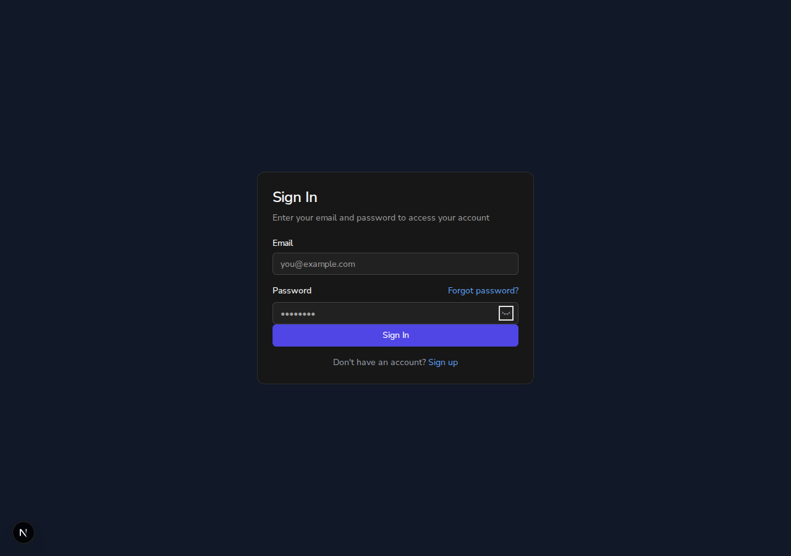
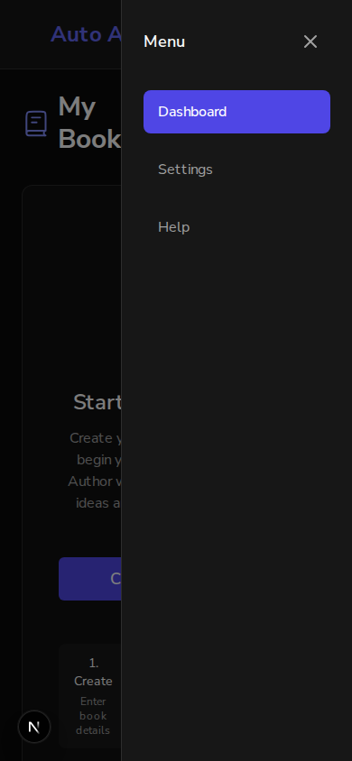
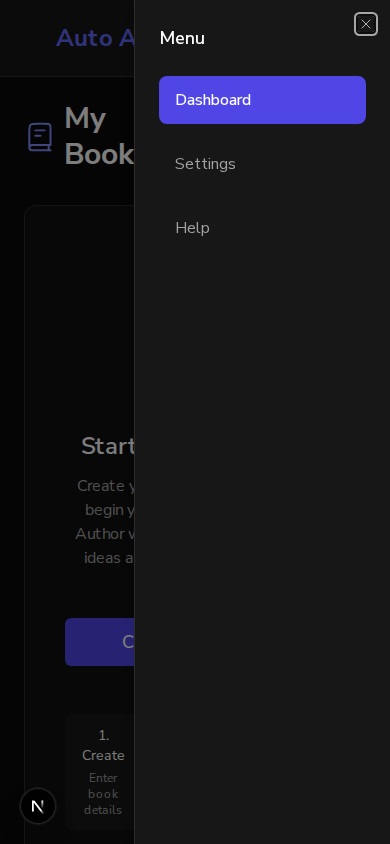

# Issue #837: Tab reaches Forgot password and the show-password buttons, and the mobile menu is a dialog

*2026-10-14T01:09:40Z by Showboat 0.6.1*
<!-- showboat-id: 25591aa5-1e5a-4e84-b1b0-ad9dc1d5a27f -->

Three acceptance criteria: `tabIndex={-1}` is removed from sign-in and sign-up; the mobile drawer uses the existing Radix Sheet; keyboard-only jest and axe tests cover each.

A real browser and two frontends: port 3130 is main, 3131 is this branch. The drivers press keys and report what has the focus; they do not click.

## Sign-in, before: main

Tab from the email field. The next stop is the password field and the one after is the button: "Forgot password?" and the show-password button are passed over. From the keyboard there is no way to the reset page.

```bash
bash /tmp/claude-1000/-home-frankbria-projects-auto-author/37b63b79-18ca-4958-9013-d3974f437927/scratchpad/demo837/auth.sh 3130 sign-in < /dev/null
```

```output
Tab, from field "Email":
  1. field "Password"
  2. button "Sign In"
```

## Sign-in, after: this branch

The same walk stops on both, and Enter on the show-password button shows the password.

```bash
SHOT=/tmp/claude-1000/-home-frankbria-projects-auto-author/37b63b79-18ca-4958-9013-d3974f437927/scratchpad/demo837/shot-signin.png bash /tmp/claude-1000/-home-frankbria-projects-auto-author/37b63b79-18ca-4958-9013-d3974f437927/scratchpad/demo837/auth.sh 3131 sign-in < /dev/null
```

```output
Tab, from field "Email":
  1. link "Forgot password?"
  2. field "Password"
  3. button "Show password"
     Enter: the password field is now of type text, and the button says Hide password
  4. button "Sign In"
```

```bash {image}

```



## Sign-up, before and after

Main first: Tab goes from one password field to the next. Then this branch: each field is followed by its show-password button. (The submit button is not a stop on either: it is disabled until the form is valid.)

```bash
bash /tmp/claude-1000/-home-frankbria-projects-auto-author/37b63b79-18ca-4958-9013-d3974f437927/scratchpad/demo837/auth.sh 3130 sign-up < /dev/null
```

```output
Tab, from field "Name":
  1. field "Email"
  2. field "Password"
  3. field "Confirm Password"
  4. link "Terms of Service"
  5. link "Privacy Policy"
  6. link "Sign in"
```

```bash
bash /tmp/claude-1000/-home-frankbria-projects-auto-author/37b63b79-18ca-4958-9013-d3974f437927/scratchpad/demo837/auth.sh 3131 sign-up < /dev/null
```

```output
Tab, from field "Name":
  1. field "Email"
  2. field "Password"
  3. button "Show password"
     Enter: the password field is now of type text, and the button says Hide password
  4. field "Confirm Password"
  5. button "Show password"
  6. link "Terms of Service"
  7. link "Privacy Policy"
  8. link "Sign in"
```

## The mobile menu, before: main

A phone-sized window, 390 pixels wide. The toggle says nothing about being open or closed. Enter opens two `div`s with no role and no name, and the focus stays on the toggle, behind them. Tab runs through the menu and then out of it, to the page underneath. Escape does nothing.

```bash
SHOT=/tmp/claude-1000/-home-frankbria-projects-auto-author/37b63b79-18ca-4958-9013-d3974f437927/scratchpad/demo837/shot-drawer-main.png bash /tmp/claude-1000/-home-frankbria-projects-auto-author/37b63b79-18ca-4958-9013-d3974f437927/scratchpad/demo837/drawer.sh 3130 < /dev/null
```

```output
the toggle, before: aria-expanded=null
Enter on the toggle:
  the menu: role=null, named nothing, links: Dashboard, Settings, Help
  the toggle: aria-expanded=null
  the focus is behind the menu, on button "Toggle mobile menu"
Tab, eight times:
  1. button "Close menu" - inside the menu
  2. link "Dashboard" - inside the menu
  3. link "Settings" - inside the menu
  4. link "Help" - inside the menu
  5. button "Create New Book" - BEHIND the menu
  6. button "Create New Book" - BEHIND the menu
  7. nextjs-portal "" - BEHIND the menu
  8. nothing - BEHIND the menu
Escape: the menu is still open, and the focus is on nothing
```

## The mobile menu, after: this branch

The toggle says `aria-expanded=false`, then `true`. Enter opens a dialog named "Menu" and puts the focus in it. Eight presses of Tab go round inside it. Escape closes it and gives the focus back to the toggle. Its close button is a 16-pixel icon with a 44-pixel touch area, which the old button had and the shared sheet did not.

```bash
TARGETS=1 SHOT=/tmp/claude-1000/-home-frankbria-projects-auto-author/37b63b79-18ca-4958-9013-d3974f437927/scratchpad/demo837/shot-drawer-branch.png bash /tmp/claude-1000/-home-frankbria-projects-auto-author/37b63b79-18ca-4958-9013-d3974f437927/scratchpad/demo837/drawer.sh 3131 < /dev/null
```

```output
the toggle, before: aria-expanded=false
Enter on the toggle:
  the menu: role=dialog, named "Menu", links: Dashboard, Settings, Help
  the toggle: aria-expanded=true
  the focus is inside the menu, on button "Close"
Tab, eight times:
  1. link "Dashboard" - inside the menu
  2. link "Settings" - inside the menu
  3. link "Help" - inside the menu
  4. button "Close" - inside the menu
  5. link "Dashboard" - inside the menu
  6. link "Settings" - inside the menu
  7. link "Help" - inside the menu
  8. button "Close" - inside the menu
Escape: the menu is closed, and the focus is on button "Toggle mobile menu"
the close button measures 16x16 pixels; its touch area: 44x44
```

```bash {image}

```



```bash {image}

```



## axe, in the browser

axe-core itself on the branch at phone width: sign-in, sign-up, and the dashboard with its menu open, in the dark theme and the light. The WCAG 2.1 A and AA rules, with colour contrast measured.

```bash
bash /tmp/claude-1000/-home-frankbria-projects-auto-author/37b63b79-18ca-4958-9013-d3974f437927/scratchpad/demo837/axe.sh 3131 < /dev/null
```

```output
sign-in, theme dark: 23 rules passed, 0 violated; colour contrast measured on 10 elements, undecided on 0
sign-up, theme dark: 25 rules passed, 0 violated; colour contrast measured on 19 elements, undecided on 0
the dashboard with its menu open (dialog shown), theme dark: 23 rules passed, 0 violated; colour contrast measured on 17 elements, undecided on 0
sign-in, theme light: 23 rules passed, 0 violated; colour contrast measured on 10 elements, undecided on 0
sign-up, theme light: 25 rules passed, 0 violated; colour contrast measured on 19 elements, undecided on 0
the dashboard with its menu open (dialog shown), theme light: 23 rules passed, 0 violated; colour contrast measured on 17 elements, undecided on 0
```

## Tests

The new keyboard-only tests by name, then the suites beside them that render the same pages and the sheet.

```bash
cd /home/frankbria/projects/worktrees/issue-837-auth-tab-order-drawer-dialog/frontend && npx jest src/__tests__/AuthPagesKeyboard src/app/dashboard/__tests__/layout.mobileDrawer --coverage=false --json --outputFile=/tmp/claude-1000/-home-frankbria-projects-auto-author/37b63b79-18ca-4958-9013-d3974f437927/scratchpad/demo837/jest.json >/dev/null 2>&1; python3 /tmp/claude-1000/-home-frankbria-projects-auto-author/37b63b79-18ca-4958-9013-d3974f437927/scratchpad/demo837/names.py /tmp/claude-1000/-home-frankbria-projects-auto-author/37b63b79-18ca-4958-9013-d3974f437927/scratchpad/demo837/jest.json
```

```output
passed: the mobile menu with the keyboard (#837) has a toggle that says the menu is closed
passed: the mobile menu with the keyboard (#837) opens as a dialog named Menu, with the focus inside it and the toggle saying so
passed: the mobile menu with the keyboard (#837) keeps the focus inside while Tab is pressed, forwards and back
passed: the mobile menu with the keyboard (#837) closes on Escape and gives the focus back to the toggle
passed: the mobile menu with the keyboard (#837) closes when a link in it is chosen
passed: the mobile menu with the keyboard (#837) keeps a 44-pixel touch area on its close button, as the old one had
passed: the mobile menu with the keyboard (#837) has no axe violations when open
passed: sign-in with the keyboard (#837) stops on Forgot password? and on the show-password button
passed: sign-in with the keyboard (#837) shows and hides the password from the keyboard
passed: sign-in with the keyboard (#837) takes no link, button or field out of the tab order
passed: sign-in with the keyboard (#837) has no axe violations
passed: sign-up with the keyboard (#837) stops on both show-password buttons
passed: sign-up with the keyboard (#837) shows each password from the keyboard
passed: sign-up with the keyboard (#837) takes no link, button or field out of the tab order
passed: sign-up with the keyboard (#837) has no axe violations
both new files: 15 passed, 0 failed
```

```bash
cd /home/frankbria/projects/worktrees/issue-837-auth-tab-order-drawer-dialog/frontend && npx jest src/__tests__/SignInPage src/__tests__/SignUpPage src/__tests__/accessibility src/components/ui/__tests__/sheet src/components/chapters/__tests__/MobileChapterTabs --coverage=false 2>&1 | grep -E '^Tests:' | sed 's/  */ /g'
```

```output
Tests: 2 skipped, 78 passed, 80 total
```
