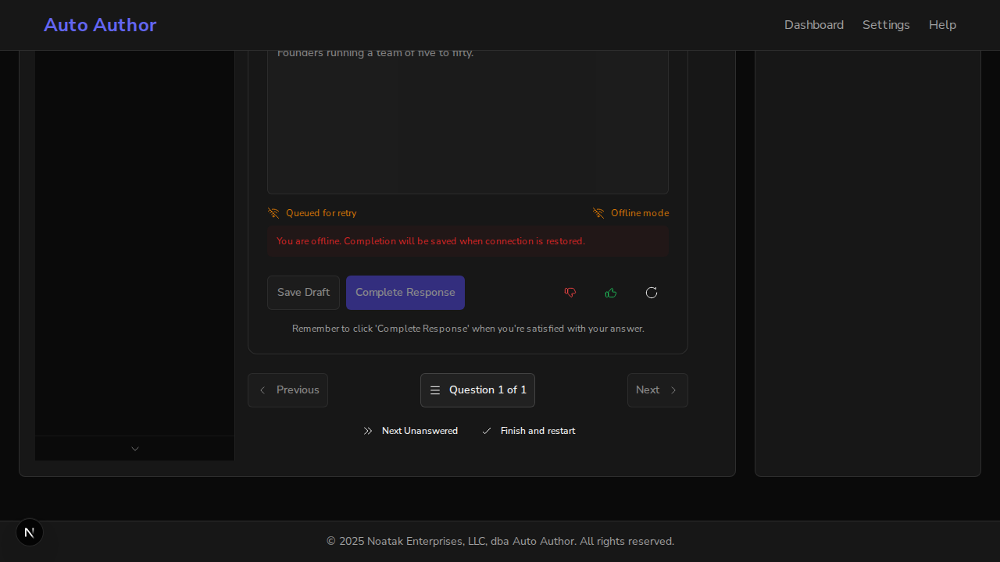

# Issue #873: a question's offline saves land in the order they were made

*2026-10-14T15:39:44Z by Showboat 0.6.1*
<!-- showboat-id: 8a3453f2-aa3c-4328-8126-e0a3ec8d5925 -->

Real browser (agent-browser with its network set offline), real backend on a scratch database, real RetryQueue. Main's frontend runs on 3130, this branch's on 3131, both against one backend. The scenario: go offline, answer the question, click Complete Response, try to keep typing past the 3-second autosave window, reconnect, then read what the server stored.

```bash
sed -n "/^ab set offline on/,/^ab open about/p" "$DEMO/scenario.sh"
```

```output
ab set offline on
ab eval 'window.dispatchEvent(new Event("offline"))'
ab wait 500
ab fill 'textarea#response' 'Founders running a team of five to fifty.'
ab click 'button:has-text("Complete Response")'
ab wait 800
echo "editor disabled after offline Complete: $(agent-browser eval 'document.querySelector("textarea#response").disabled' 2>/dev/null | tail -1)"
ab type 'textarea#response' ' Also their managers.'
ab wait 4000
echo "text now: $(agent-browser eval 'document.querySelector("textarea#response").value' 2>/dev/null | tail -1)"
agent-browser screenshot "$SHOT" > /dev/null 2>&1
ab set offline off
ab eval 'window.dispatchEvent(new Event("online"))'
ab wait 6000
echo "stored: $(curl -s $A/books/$BOOK/chapters/$CH/questions/$Q/response | python3 -c 'import sys,json; r=json.load(sys.stdin).get("response") or {}; print(r.get("status"), "|", r.get("response_text"))')"
ab open about:blank
```

Before (main):

```bash
bash "$DEMO/scenario.sh" 3130 "$DEMO/main.png"; true
```

```output
editor disabled after offline Complete: false
text now: "Founders running a team of five to fifty. Also their managers."
stored: draft | Founders running a team of five to fifty. Also their managers.
```

After (this branch):

```bash
bash "$DEMO/scenario.sh" 3131 "$DEMO/branch.png"; true
```

```output
editor disabled after offline Complete: true
text now: "Founders running a team of five to fifty."
stored: completed | Founders running a team of five to fifty.
```

The branch while the completion is queued: the answer is locked and both save buttons are disabled, as for a completed answer online.

```bash {image}
issue873-branch-queued-locked.png
```



Trigger 1 (a draft queued before Complete Response, the draft's write landing last) depends on which request the server finishes first, so it is shown by the jest tests, where the draft write is made slower: `QuestionDisplay.offlineOrder.test.tsx` and the RetryQueue 'groups (#873)' tests. Mutation check: four mutations (every op its own group, no hold-back on retry, editor not locked, completion not marked queued) were each caught by name.
