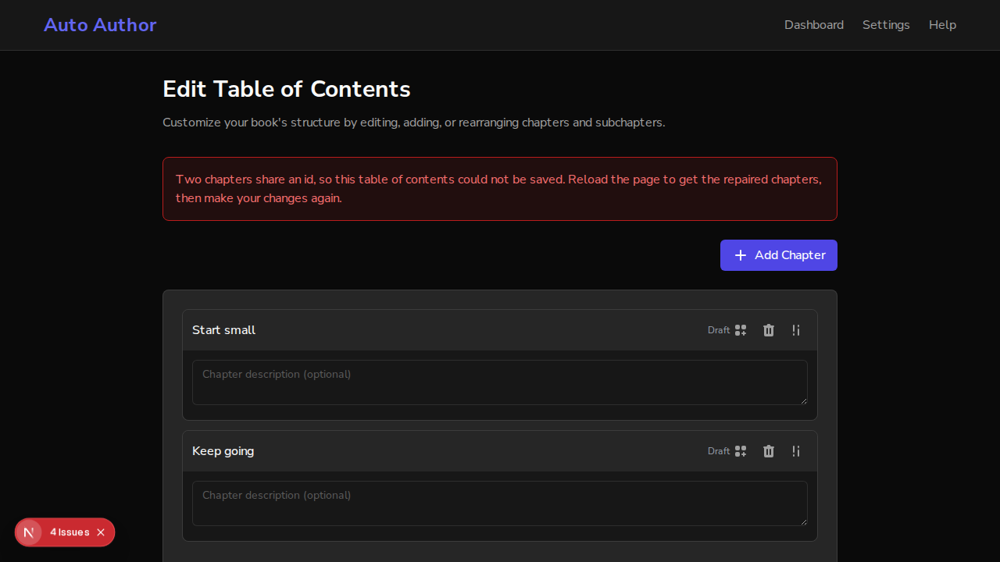

# Issue #885: books that already store duplicate chapter ids are repaired

*2026-10-14T16:36:59Z by Showboat 0.6.1*
<!-- showboat-id: 0e1a9279-1704-47ba-8763-5a53a4ad3add -->

Real browser (agent-browser), real backend on a scratch database. A book stored before #754 has two chapters sharing the id ch-dup. Main's frontend runs on 3130 and this branch's on 3131. First the backend is main's (no repair), then this branch's.

```bash
mongosh --quiet aa_demo885 --eval "db.books.updateOne({_id: ObjectId(\"$BOOK\")}, {\$set: {\"table_of_contents.chapters.1.id\": \"ch-dup\"}}); db.books.findOne({_id: ObjectId(\"$BOOK\")}).table_of_contents.chapters.map(c => c.id + \" | \" + c.title)"
```

```output
[ 'ch-dup | Start small', 'ch-dup | Keep going' ]
```

Edit TOC, Save & Continue, against main's backend. Main's page:

```bash
bash "$DEMO/scenario.sh" 3130; true
```

```output
page now: /dashboard/books/6acfaf0a332ebcd57fa605b2/edit-toc
error shown: "Failed to save the table of contents. Please try again."
```

This branch's page, same backend, same refusal:

```bash
bash "$DEMO/scenario.sh" 3131 "$DEMO/branch.png"; true
```

```output
page now: /dashboard/books/6acfaf0a332ebcd57fa605b2/edit-toc
error shown: "Two chapters share an id, so this table of contents could not be saved. Reload the page to get the repaired chapters, then make your changes again."
```

```bash {image}
issue885-message.png
```



Now the backend restarts from this branch. The repair runs with the other start-up steps:

```bash
bash "$DEMO/stack.sh" backend branch >/dev/null 2>&1; sleep 3; grep -h "duplicate chapter ids" "$DEMO/backend-branch.log" | tail -1 | sed "s/^.* - INFO - \[-\] //"; mongosh --quiet aa_demo885 --eval "db.books.findOne({_id: ObjectId(\"$BOOK\")}).table_of_contents.chapters.map(c => c.id + \" | \" + c.title + \" | \" + c.content)"
```

```output
Gave duplicate chapter ids fresh ids in 1 book(s)
[
  'ch-dup | Start small | <p>First chapter draft.</p>',
  '0b452379-19d4-4199-b764-04b9040a08e8 | Keep going | <p>Second chapter draft.</p>'
]
```

The first chapter keeps ch-dup and its draft; the second has a fresh id and still its own draft. Saving from Edit TOC now goes through (the page moves on to the book):

```bash
bash "$DEMO/scenario.sh" 3131; true
```

```output
page now: /dashboard/books/6acfaf0a332ebcd57fa605b2
error shown: "(none)"
```

Tests: tests/test_db/test_duplicate_chapter_ids_repaired.py (4, real MongoDB), the last test in tests/test_startup_indexes.py (start-up runs it), and edit-toc.status.test.tsx (the message). Mutation check: no id re-minted, version not bumped, start-up not running the repair, and the page showing the generic error were each caught by name.
