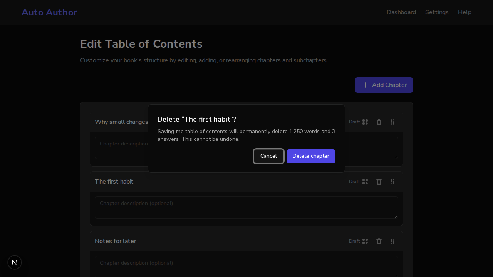

# Issue #906: Edit TOC asks before deleting a chapter that holds writing or answers

*2026-10-14T17:44:45Z by Showboat 0.6.1*
<!-- showboat-id: 26d87236-792a-40a7-a602-107b7da38df3 -->

Real browser (agent-browser), real backend on a scratch database. The book has three chapters; 'The first habit' holds 1,250 words and 3 answers (2 completed, 1 draft), 'Notes for later' is empty. Main's frontend runs on 3130, this branch's on 3131. The scenario deletes 'The first habit' (and presses Escape if a dialog opens), then deletes 'Notes for later'.

```bash
curl -s "http://localhost:8130/api/v1/books/$(cat "$DEMO/book")/chapters/c-drafted/question-progress"
```

```output
{"total":3,"completed":2,"in_progress":1,"progress":0.6666666666666666,"status":"in-progress"}```
```

Main: one click and the drafted chapter is gone; Save would then delete its writing and its three answers.

```bash
bash "$DEMO/scenario.sh" 3130; true
```

```output
chapters: "Why small changes matter | The first habit | Notes for later"
after deleting 'The first habit': dialog: "(no dialog)"
chapters: "Why small changes matter | Notes for later"
after deleting 'Notes for later': dialog: "(no dialog)"
chapters: "Why small changes matter"
beside Save: "(nothing)"
```

This branch:

```bash
bash "$DEMO/scenario.sh" 3131 "$DEMO/branch.png"; true
```

```output
chapters: "Why small changes matter | The first habit | Notes for later"
after deleting 'The first habit': dialog: "Delete “The first habit”? / Saving the table of contents will permanently delete 1,250 words and 3 answers. This cannot be undone. / Cancel / Delete chapter"
chapters: "Why small changes matter | The first habit | Notes for later"
after deleting 'Notes for later': dialog: "(no dialog)"
chapters: "Why small changes matter | The first habit"
beside Save: "Saving will remove: Notes for later. Their writing and answers are deleted with them."
```

```bash {image}
issue906-dialog.png
```



Tests: edit-toc.deleteConfirm.test.tsx (7); two existing Edit TOC tests now confirm the delete. Mutation check: never asking, not counting subchapters, treating uncountable answers as none, not counting draft answers, no summary, and a summary that lists kept chapters were each caught by name (the last one only after the test was made to check it; it survived the first run).
