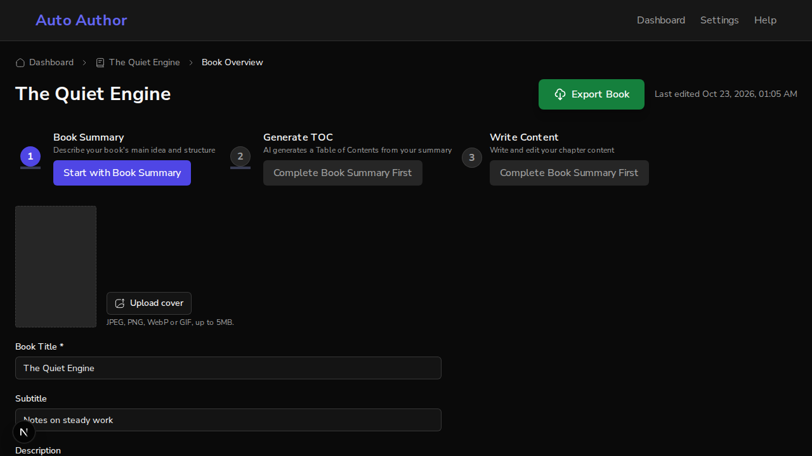
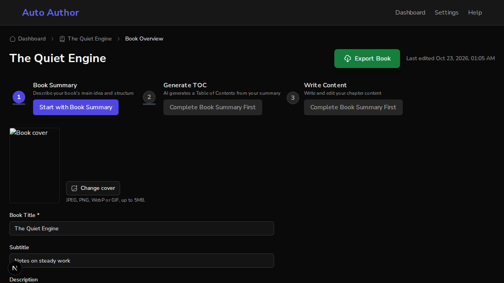
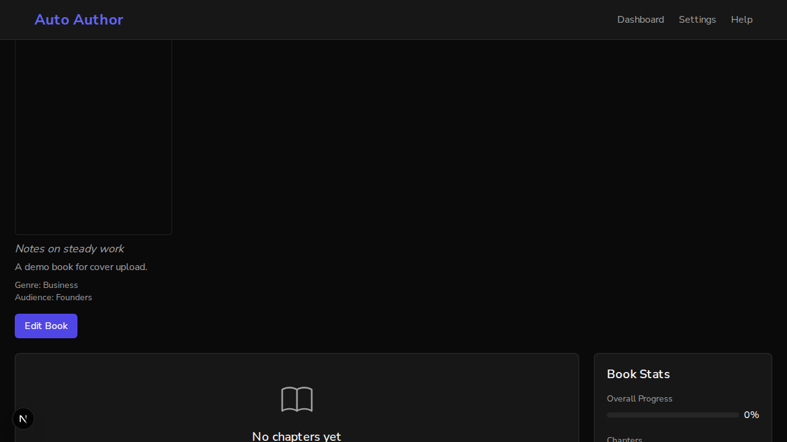
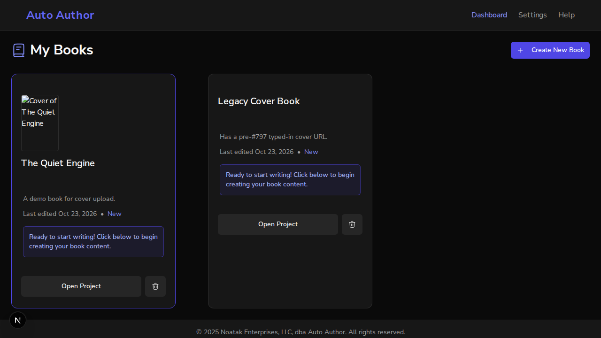
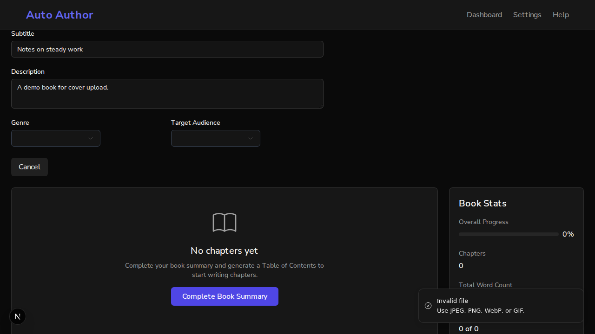
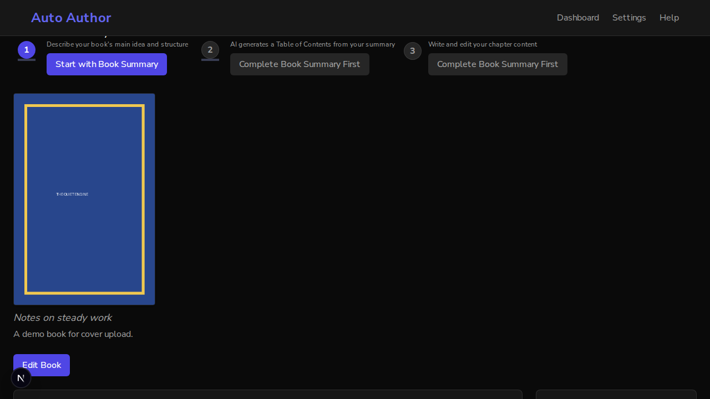
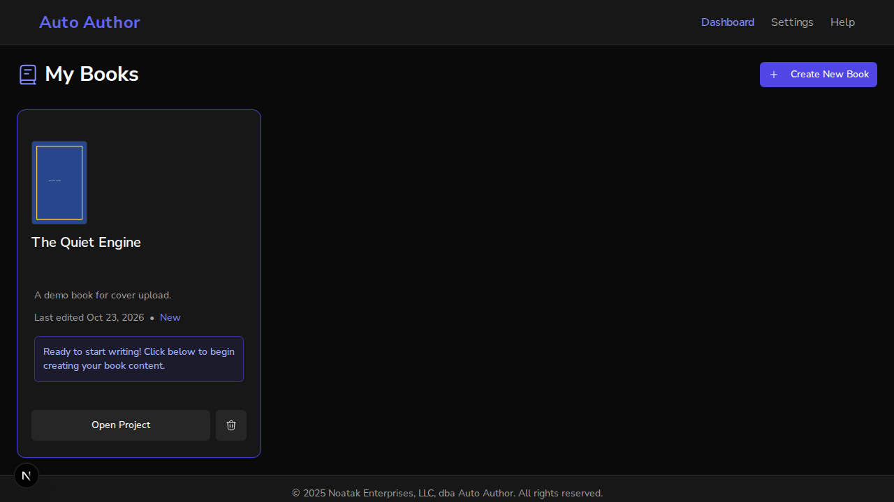

# Issue #941: upload a book cover and show it

*2026-10-23T01:05:57Z by Showboat 0.6.1*
<!-- showboat-id: 22f7707f-c94f-44ed-9747-2145e9e6b004 -->

Real-browser demo of PR #941 against a local stack: backend on $API (port 8100, local storage mode, started from a scratch directory $SCRATCH so uploads/ lands there, scratch MongoDB database aa_demo_941), frontend on $WEB (port 3102, bypass auth so the user is test-auth-id). Two books are seeded for test-auth-id: $BOOK (no cover) and $LEGACY (gets a legacy typed-in cover URL in step 5).

```bash
curl -s $API/api/v1/books/$BOOK | python3 -c "import json,sys; d=json.load(sys.stdin); print({k:d[k] for k in (\"title\",\"owner_id\",\"cover_image_url\",\"cover_thumbnail_url\")})"; ls -R $SCRATCH/uploads 2>&1 | head -3
```

```output
{'title': 'The Quiet Engine', 'owner_id': 'test-auth-id', 'cover_image_url': None, 'cover_thumbnail_url': None}
/tmp/demo941/uploads:
cover_images
profile_pictures
```

## 1. Edit view shows the cover upload control

```bash
agent-browser open $WEB/dashboard/books/$BOOK >/dev/null && sleep 3 && agent-browser find text "Edit Book" click >/dev/null; sleep 1; agent-browser snapshot -i | grep -iE "cover|Save|Cancel"; agent-browser eval "document.querySelector(\"[data-slot=book-cover-upload]\").innerText"
```

```output
- button "Upload cover" [ref=e14]
- button "Cancel" [ref=e20]
"Upload cover\n\nJPEG, PNG, WebP or GIF, up to 5MB."
```

```bash
find $SCRATCH/uploads -type f | wc -l
```

```output
0
```

```bash {image}

```



## 2. Upload a real 400x600 PNG through the control
`cover.png` was generated with PIL. `agent-browser upload` sets it on the hidden file input, which fires the component's change handler exactly as the file picker would.

```bash
file $SCRATCH/cover.png; agent-browser upload "[data-slot=book-cover-upload] input[type=file]" $SCRATCH/cover.png; sleep 3; agent-browser eval "[...document.querySelectorAll(\"[data-sonner-toast]\")].map(t=>t.innerText).join(\" | \")"
```

```output
/tmp/demo941/cover.png: PNG image data, 400 x 600, 8-bit/color RGB, non-interlaced
✓ Done
"Cover updated"
```

```bash {image}

```



The rendered cover's src resolves against the API origin (not the page's), and fetching it returns an image:

```bash
SRC=$(agent-browser eval "document.querySelector(\"[data-slot=book-cover-upload] img\").src" | tr -d "\""); echo "img src: $SRC"; curl -s -o /dev/null -w "HTTP %{http_code} %{content_type} %{size_download} bytes\n" "$SRC"
```

```output
img src: http://localhost:8100/uploads/cover_images/6adab2d39cbd79e720ae2999_2718971fb98047a9a1161aee9423873b.png
HTTP 200 image/png 2395 bytes
```

```bash
find $SCRATCH/uploads -type f | sed "s|$SCRATCH/||" | sort
```

```output
uploads/cover_images/6adab2d39cbd79e720ae2999_2718971fb98047a9a1161aee9423873b.png
uploads/cover_images/6adab2d39cbd79e720ae2999_a0e6984fc7464f349e40e98e2c7d1f14_thumb.png
```

## 3. After a full reload, the book page (view mode) renders the stored cover

```bash
agent-browser open $WEB/dashboard/books/$BOOK >/dev/null; sleep 3; agent-browser eval "[...document.querySelectorAll(\"img[alt=\\\"Book cover\\\"]\")].map(i=>i.src+\" naturalWidth=\"+i.naturalWidth).join(\"\\n\")"
```

```output
"http://localhost:8100/uploads/cover_images/6adab2d39cbd79e720ae2999_2718971fb98047a9a1161aee9423873b.png naturalWidth=0"
```

**FAILED: the image does not render in the browser.** `naturalWidth=0` with `complete=true` means the load failed, and both screenshots above show a broken-image box where the cover should be. The file itself is served correctly (HTTP 200 image/png above). The cause is the page's own Content-Security-Policy: `frontend/src/lib/csp.ts` sets `img-src 'self' data: https: blob:`, which admits the API origin only when it is https. Locally the API is `http://localhost:8100`, so the browser refuses the image. The page reports the violation itself:

```bash
curl -sI $WEB/dashboard | grep -io "img-src[^;]*"
agent-browser eval "new Promise(r=>{document.addEventListener(\"securitypolicyviolation\",e=>r(e.violatedDirective+\" blocked \"+e.blockedURI),{once:true}); const i=new Image(); i.src=document.querySelector(\"img[alt=\\\"Book cover\\\"]\").src+\"?probe=1\"; setTimeout(()=>r(\"no violation\"),3000)})"
```

```output
img-src 'self' data: https: blob:
"img-src blocked http://localhost:8100/uploads/cover_images/6adab2d39cbd79e720ae2999_2718971fb98047a9a1161aee9423873b.png?probe=1"
```

On staging the API is https, which `https:` admits, so this is expected to affect only an http API origin (local dev, the Playwright E2E stack). The fix is to add the API origin to img-src the way connect-src already does; that was not changed here (this demo is read-only on the code).

```bash {image}

```



## 4. Dashboard card uses the thumbnail

```bash
agent-browser open $WEB/dashboard >/dev/null; sleep 4; agent-browser eval "[...document.querySelectorAll(\"img[alt^=\\\"Cover of\\\"]\")].map(i=>i.alt+\" -> \"+i.src+\" naturalWidth=\"+i.naturalWidth).join(\"\\n\")"
```

```output
"Cover of The Quiet Engine -> http://localhost:8100/uploads/cover_images/6adab2d39cbd79e720ae2999_a0e6984fc7464f349e40e98e2c7d1f14_thumb.png naturalWidth=0"
```

```bash
curl -s -o $SCRATCH/thumb.png -w "HTTP %{http_code} %{content_type}\n" $(agent-browser eval "document.querySelector(\"img[alt^=\\\"Cover of\\\"]\").src" | tr -d "\""); file $SCRATCH/thumb.png
```

```output
HTTP 200 image/png
/tmp/demo941/thumb.png: PNG image data, 300 x 450, 8-bit/color RGB, non-interlaced
```

The card points at the `_thumb.png` file and the API serves it, but the same CSP rule blocks it from rendering (`naturalWidth=0`), as the screenshot shows.

```bash {image}

```



## 5. A .txt file is rejected with the type message and nothing is stored

```bash
BEFORE=$(find $SCRATCH/uploads -type f | wc -l); POSTS=$(grep -c "\"POST /api/v1/books/.*/cover-image" $SCRATCH/backend.log)
agent-browser open $WEB/dashboard/books/$BOOK >/dev/null; sleep 3; agent-browser find text "Edit Book" click >/dev/null; sleep 1
agent-browser upload "[data-slot=book-cover-upload] input[type=file]" $SCRATCH/notes.txt >/dev/null; sleep 1
agent-browser eval "[...document.querySelectorAll(\"[data-sonner-toast]\")].map(t=>t.innerText).join(\" | \")"
echo "files in uploads/: before=$BEFORE after=$(find $SCRATCH/uploads -type f | wc -l)"
echo "cover-image POSTs reaching the API: before=$POSTS after=$(grep -c "\"POST /api/v1/books/.*/cover-image" $SCRATCH/backend.log)"
```

```output
"Invalid file\nUse JPEG, PNG, WebP, or GIF."
files in uploads/: before=2 after=2
cover-image POSTs reaching the API: before=1 after=1
```

```bash {image}

```



The client check stops the file before any request. The server enforces the same rule on its own, for a client that skips the check:

```bash
curl -s -w "\nHTTP %{http_code}\n" -F "file=@$SCRATCH/notes.txt;type=text/plain" $API/api/v1/books/$BOOK/cover-image; find $SCRATCH/uploads -type f | wc -l
```

```output
{"detail":"Invalid file type. Allowed types: .jpg, .png, .gif, .jpeg, .webp"}
HTTP 400
2
```

## 6. What the database holds after the upload

```bash
mongosh --quiet $DB --eval "printjson(db.books.findOne({_id: ObjectId(\"$BOOK\")}, {_id:0, title:1, cover_image_url:1, cover_thumbnail_url:1}))"
```

```output
{
  title: 'The Quiet Engine',
  cover_image_url: '/uploads/cover_images/6adab2d39cbd79e720ae2999_2718971fb98047a9a1161aee9423873b.png',
  cover_thumbnail_url: '/uploads/cover_images/6adab2d39cbd79e720ae2999_a0e6984fc7464f349e40e98e2c7d1f14_thumb.png'
}
```

## 7. A legacy typed-in cover URL is not returned
Before #797 the cover URL was a free-text field. Write one straight into the second book, then read it back through the API:

```bash
mongosh --quiet $DB --eval "db.books.updateOne({_id: ObjectId(\"$LEGACY\")}, {\$set: {cover_image_url: \"https://evil.example/x.png\"}}); printjson(db.books.findOne({_id: ObjectId(\"$LEGACY\")}, {_id:0, cover_image_url:1}))"
curl -s $API/api/v1/books/$LEGACY | python3 -c "import json,sys; d=json.load(sys.stdin); print(\"GET /books/{id}:\", {k:d[k] for k in (\"title\",\"cover_image_url\",\"cover_thumbnail_url\")})"
curl -s $API/api/v1/books/ | python3 -c "import json,sys; print(\"GET /books/:\", [(b[\"title\"], b[\"cover_image_url\"]) for b in json.load(sys.stdin)])"
```

```output
{
  cover_image_url: 'https://evil.example/x.png'
}
GET /books/{id}: {'title': 'Legacy Cover Book', 'cover_image_url': None, 'cover_thumbnail_url': None}
GET /books/: [('The Quiet Engine', '/uploads/cover_images/6adab2d39cbd79e720ae2999_2718971fb98047a9a1161aee9423873b.png'), ('Legacy Cover Book', None)]
```

```bash
agent-browser open $WEB/dashboard/books/$LEGACY >/dev/null; sleep 3; agent-browser eval "JSON.stringify({coverImgs: document.querySelectorAll(\"img[alt=\\\"Book cover\\\"]\").length, evilRefs: document.documentElement.outerHTML.includes(\"evil.example\")})"
```

```output
"{\"coverImgs\":0,\"evilRefs\":false}"
```

## Evidence

| Criterion | Action | Observed outcome | Result |
|---|---|---|---|
| Upload succeeds | `agent-browser upload` of a 400x600 PNG on the edit view | "Cover updated" toast; button became "Change cover"; two files written to uploads/cover_images (full + `_thumb.png`) | VERIFIED |
| Cover src points at the API origin | `eval` of the img src, then `curl` | `http://localhost:8100/uploads/cover_images/<book>_<hex>.png`, HTTP 200 image/png | VERIFIED |
| Cover is rendered on the book page | img `naturalWidth`, screenshots | Broken image: `img-src 'self' data: https: blob:` in the page CSP blocks the http API origin (securitypolicyviolation recorded) | FAILED (local http API only; https staging origin is admitted by `https:`, not demonstrated) |
| Dashboard card uses the thumbnail | `eval` on the card img, then `curl` | src ends `_thumb.png`, HTTP 200, 300x450 PNG; blocked from rendering by the same CSP | VERIFIED (src) / FAILED (render, same cause) |
| .txt is rejected | `agent-browser upload notes.txt` | "Invalid file / Use JPEG, PNG, WebP, or GIF." toast; uploads/ 2 -> 2 files; no POST reached the API; direct POST answers 400 | VERIFIED |
| DB holds server-written URLs | `mongosh findOne` | both fields are `/uploads/cover_images/<book>_...` paths | VERIFIED |
| Legacy typed-in URL is not returned | `$set cover_image_url: https://evil.example/x.png`, GET by id and list | `cover_image_url: null` in both; page has no cover img and no evil.example reference | VERIFIED |

## 8. Re-run after the CSP fix (4ad3fd2a)
Steps 3 and 4 above FAILED: the page CSP's `img-src` admitted only https image origins, so the cover from the http API was blocked. Commit 4ad3fd2a adds the API origin to `img-src`, as `connect-src` already did. Same harness, fresh scratch DB, one newly seeded book ($BOOK), same PNG generator.

```bash
curl -sI $WEB/dashboard | grep -io "img-src[^;]*"
```

```output
img-src 'self' data: https: blob: http://localhost:8100
```

```bash
agent-browser open $WEB/dashboard/books/$BOOK >/dev/null; sleep 3; agent-browser find text "Edit Book" click >/dev/null; sleep 1
agent-browser upload "[data-slot=book-cover-upload] input[type=file]" $SCRATCH/cover.png >/dev/null; sleep 3
agent-browser eval "[...document.querySelectorAll(\"[data-sonner-toast]\")].map(t=>t.innerText).join(\" | \")"
```

```output
"Cover updated"
```

### (a) Book page renders the cover
Reload the book page (view mode), scroll the cover into view, then read the rendered img and probe the same URL with a `securitypolicyviolation` listener attached:

```bash
agent-browser open $WEB/dashboard/books/$BOOK >/dev/null; sleep 3
agent-browser eval "new Promise(r=>{const i=document.querySelector(\"img[alt=\\\"Book cover\\\"]\"); i.scrollIntoView({block:\"center\"}); const done=()=>r(i.src+\" naturalWidth=\"+i.naturalWidth+\" naturalHeight=\"+i.naturalHeight); i.complete?done():i.addEventListener(\"load\",done,{once:true}); setTimeout(done,4000)})"
agent-browser eval "new Promise(r=>{document.addEventListener(\"securitypolicyviolation\",e=>r(\"VIOLATION \"+e.violatedDirective+\" \"+e.blockedURI),{once:true}); const p=new Image(); p.onload=()=>r(\"probe loaded, no securitypolicyviolation, naturalWidth=\"+p.naturalWidth); p.onerror=()=>r(\"probe error\"); p.src=document.querySelector(\"img[alt=\\\"Book cover\\\"]\").src+\"?probe=1\"})"
```

```output
"http://localhost:8100/uploads/cover_images/6adab9f97a735797767b404c_7315d92b5bc846408483ddb5c888a613.png naturalWidth=400 naturalHeight=600"
"probe loaded, no securitypolicyviolation, naturalWidth=400"
```

```bash {image}

```



### (b) Dashboard card renders the thumbnail

```bash
agent-browser open $WEB/dashboard >/dev/null; sleep 4
agent-browser eval "new Promise(r=>{const i=document.querySelector(\"img[alt^=\\\"Cover of\\\"]\"); const done=()=>r(i.alt+\" -> \"+i.src+\" naturalWidth=\"+i.naturalWidth+\" naturalHeight=\"+i.naturalHeight); i.complete?done():i.addEventListener(\"load\",done,{once:true}); setTimeout(done,4000)})"
```

```output
"Cover of The Quiet Engine -> http://localhost:8100/uploads/cover_images/6adab9f97a735797767b404c_8f7c3532030240b586577742af8760b3_thumb.png naturalWidth=300 naturalHeight=450"
```

```bash {image}

```



## Updated evidence (after 4ad3fd2a)

| Criterion | Action | Observed outcome | Result |
|---|---|---|---|
| CSP admits the API origin | `curl -sI` the dashboard | `img-src 'self' data: https: blob: http://localhost:8100` | VERIFIED |
| Upload succeeds | `agent-browser upload` of the PNG on the edit view | "Cover updated" toast | VERIFIED |
| Cover is rendered on the book page | img `naturalWidth`, probe with a `securitypolicyviolation` listener, screenshot | `naturalWidth=400 naturalHeight=600`; probe loaded with no violation; cover visible | VERIFIED (was FAILED) |
| Dashboard card renders the thumbnail | card img `naturalWidth`, screenshot | src ends `_thumb.png`, `naturalWidth=300 naturalHeight=450`; thumbnail visible | VERIFIED (was FAILED) |

Rows (c) .txt rejection, (d) DB fields and (e) legacy URL suppression were not re-run; they do not involve the CSP.
