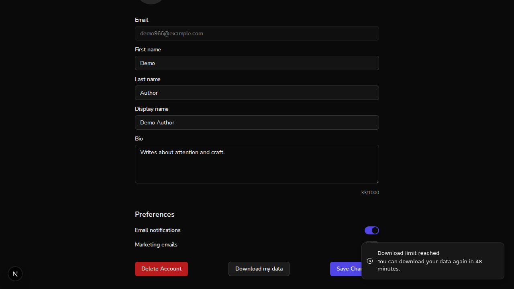

# Issue #966: account export via a single-use download token, streamed

*2026-10-23T04:12:00Z by Showboat 0.6.1*
<!-- showboat-id: 8a00e267-6032-4dbb-91a3-37c3e824bbcf -->

Real-auth stack (no bypass: BYPASS_AUTH also turns the rate limiter off, which (d) needs on). Backend on 8100 and frontend on 3102, both from this branch, on the scratch Mongo database `aa_demo_966`. One account (demo966@example.com) was signed up and verified through better-auth, then signed in inside the browser. Three books and a bio were seeded for it. A tooling dry run before recording was undone by clearing `audit_logs` and the export rate-limit counter, so every count below starts at zero.

Session cookies are never printed. `$DEMO/browser-cookie.sh` copies the browser's own session cookie into a curl header file and prints only the cookie's name, and every printed download URL has its token replaced with `<redacted>`.

```bash
mongosh --quiet $DB --eval "const u=db.users.findOne({email:\"demo966@example.com\"}); printjson({auth_id:u.auth_id, bio:u.bio, books:db.books.find({owner_id:u.auth_id},{title:1,_id:0}).toArray().map(b=>b.title), audit_rows:db.audit_logs.countDocuments(), export_tokens:db.export_tokens.countDocuments()})"
```

```output
{
  auth_id: '6adade18ace48c010cffb1b5',
  bio: 'Writes about attention and craft.',
  books: [
    'The Quiet Ledger',
    'Field Notes on Focus',
    'Writing in Public'
  ],
  audit_rows: 0,
  export_tokens: 0
}
```

## (a) Click "Download my data" and the browser downloads the file

agent-browser has no download directory option, so this step drives the same Chromium through Playwright (`$DEMO/click-download.cjs`), signed in with the session agent-browser saved. It clicks the real button, waits for the browser's download event and saves the file. The request log shows the page POSTing for a token, then navigating to the GET, with the GET's response headers as the browser received them.

```bash
$DEMO/browser-cookie.sh && node $DEMO/click-download.cjs
```

```output
cookie header written (value redacted): Cookie: better-auth.session_token=<redacted>
POST http://localhost:8100/api/v1/users/me/export/token -> 200
GET http://localhost:8100/api/v1/users/me/export?token=<redacted> -> 200
  content-type: application/json
  content-disposition: attachment; filename="auto-author-data.json"
  content-length: (absent)
  transfer-encoding: chunked
  cache-control: no-store
suggested filename: auto-author-data.json
saved to: $DEMO/dl/auto-author-data.json
page url after click: http://localhost:3102/profile
```

The downloaded file parses as JSON and holds the seeded profile and books:

```bash
python3 -I -c "
import json,sys
d=json.load(open(sys.argv[1]))
print(\"top-level keys:\", list(d))
print(\"profile email:\", d[\"profile\"][\"email\"], \"| bio:\", d[\"profile\"].get(\"bio\"))
print(\"books:\", len(d[\"books\"]), [b[\"title\"] for b in d[\"books\"]])
print(\"collaborators key in any book:\", any(\"collaborators\" in b for b in d[\"books\"]))
" $DEMO/dl/auto-author-data.json
```

```output
top-level keys: ['exported_at', 'profile', 'books', 'questions', 'question_responses', 'question_ratings']
profile email: demo966@example.com | bio: Writes about attention and craft.
books: 3 ['The Quiet Ledger', 'Field Notes on Focus', 'Writing in Public']
collaborators key in any book: False
```

## (b) The same token URL a second time answers 410

`$DEMO/url.txt` is the URL the browser just downloaded from. curl sends it again with the browser's own session cookie.

```bash
sed -E "s/token=[^&]+/token=<redacted>/" $DEMO/url.txt && curl -s -H @$DEMO/cookie.hdr -w "\nHTTP %{http_code}\n" "$(cat $DEMO/url.txt)"
```

```output
http://localhost:8100/api/v1/users/me/export?token=<redacted>{"detail":"This download link has expired. Start the download again from your profile."}
HTTP 410
```

## (c) One account_export row in audit_logs

```bash
mongosh --quiet $DB --eval "printjson(db.audit_logs.find({action:\"account_export\"},{_id:0,action:1,actor_id:1,target_id:1,resource_type:1,timestamp:1}).toArray()); print(\"account_export rows:\", db.audit_logs.countDocuments({action:\"account_export\"}))"
```

```output
[
  {
    action: 'account_export',
    actor_id: '6adade18ace48c010cffb1b5',
    target_id: '6adade18ace48c010cffb1b5',
    resource_type: 'user',
    timestamp: ISODate('2026-10-23T04:12:14.249Z')
  }
]
account_export rows: 1
```

## (d) Past the limit, the page shows a toast and stays on /profile

POST /users/me/export/token allows 10 per hour (hard-coded `get_rate_limiter(limit=10, window=3600)`, no env knob). The click in (a) used one, so curl spends the other nine with the browser's session, and the button is clicked for the eleventh.

```bash
for i in $(seq 1 9); do curl -s -o /dev/null -w "%{http_code} " -X POST -H @$DEMO/cookie.hdr -H "Origin: $WEB" $API/users/me/export/token; done; echo; curl -s -D - -o /dev/null -X POST -H @$DEMO/cookie.hdr -H "Origin: $WEB" $API/users/me/export/token | grep -iE "^HTTP|retry-after"
```

```output
200 200 200 200 200 200 200 200 200 
HTTP/1.1 429 Too Many Requests
retry-after: 2841
access-control-expose-headers: Retry-After, X-AI-Quota-Limit, X-AI-Quota-Period, X-Request-ID
```

```bash
agent-browser click "button:has-text(\"Download my data\")" >/dev/null && agent-browser wait 1500 >/dev/null && agent-browser get url && agent-browser eval "Array.from(document.querySelectorAll(\"[role=status],[data-sonner-toast],li[role],ol li\")).map(e=>e.innerText.trim()).filter(t=>/limit|download/i.test(t)).join(\" | \")" && agent-browser screenshot $WT/docs/demos/issue966-rate-limit-toast.png >/dev/null && echo screenshot taken
```

```output
http://localhost:3102/profile
"Download limit reached\nYou can download your data again in 48 minutes."
screenshot taken
```

```bash {image}

```



```bash
mongosh --quiet $DB --eval "print(\"account_export audit rows still:\", db.audit_logs.countDocuments({action:\"account_export\"}))"
```

```output
account_export audit rows still: 1
```

Reproducing: export `WT`, `WEB`, `API`, `DB`, `DEMO` and `AGENT_BROWSER_SESSION`, plus `CHROME` pointing at an installed Playwright Chromium binary, because the frontend's Playwright 1.64 wants a headless shell this machine does not have. The rate-limit step only reproduces on a fresh hour's counter.
