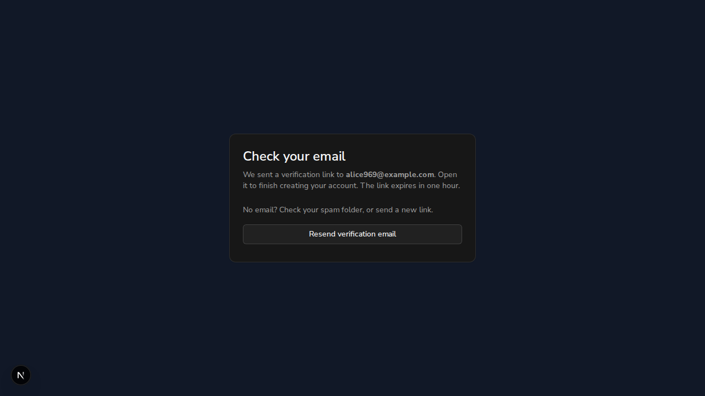
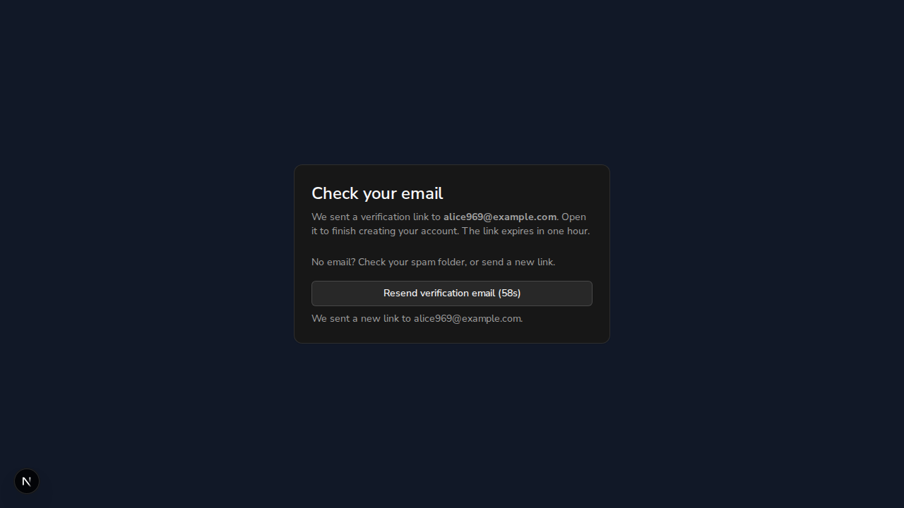
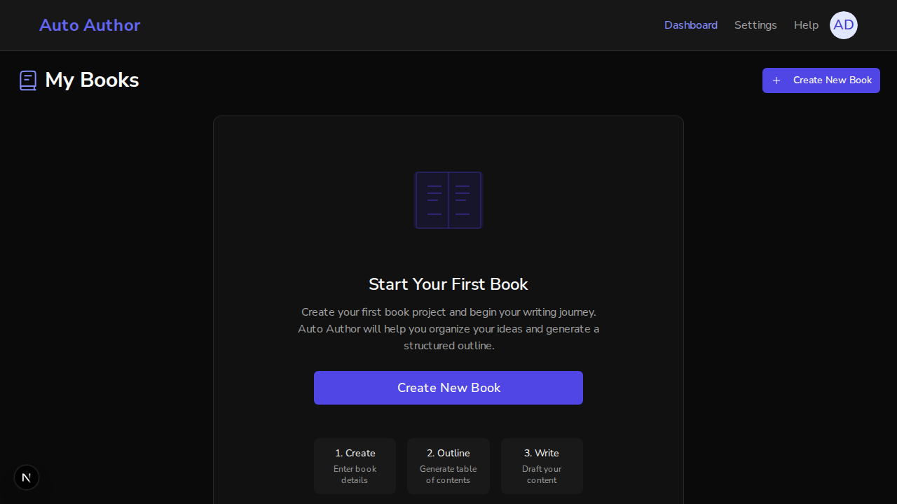
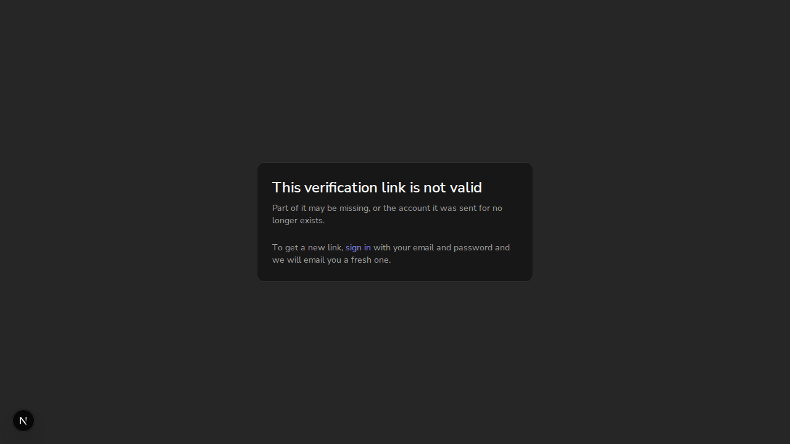
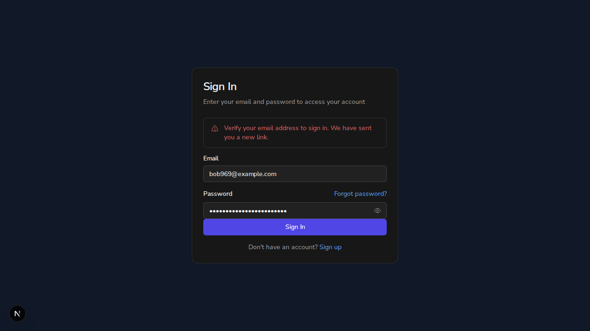
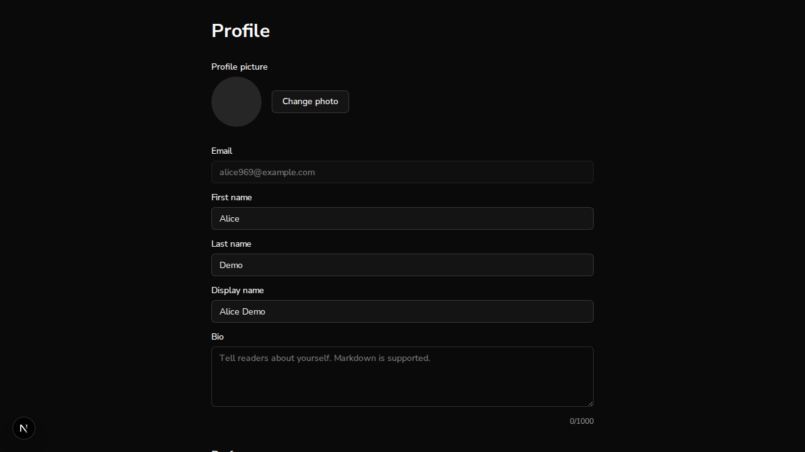

# Issue #969: email verification, real-auth browser demo

*2026-10-23T07:08:53Z by Showboat 0.6.1*
<!-- showboat-id: d306af96-03b6-42bb-8774-fa82e74b2b1f -->

Real-auth harness, **no bypass** (no BYPASS_AUTH / E2E_ALLOW_BYPASS anywhere). Worktree at a6a759b0 (fix a97a4244). Frontend: `next dev --webpack --port 3103` ($WEB=http://localhost:3103), backend uvicorn on 8101, both on a scratch local MongoDB database `aa_demo_969b` ($DB), never backend/.env's database. No email provider is configured, so the dev server prints each verification email to its log ($LOG); a 'link' below is a `URL:` line in that log. Every token, password and session cookie is redacted. Browser: agent-browser (Chromium).

better-auth's rate limiter is off under `next dev` (NODE_ENV=development), so a real 429 from the resend path cannot be shown in this harness.

```bash
cd $WT/frontend && node -e "console.log(\"better-auth\", require(\"./node_modules/better-auth/package.json\").version)"; git -C $WT log --oneline -2; grep -n "sendOnSignIn" $WT/frontend/src/lib/auth.ts; ps eww $(ss -ltnp | grep -E ":(3103|8101) " | grep -o "pid=[0-9]*" | cut -d= -f2) | grep -c BYPASS; curl -s $API/api/v1/health | head -c 60; echo
```

```output
better-auth 1.7.7
a6a759b0 Merge remote-tracking branch 'origin/main' into feature/issue-969-verify-email
a97a4244 fix(auth): keep sign-in a client-side transition (#969)
95:      sendOnSignIn: false,
0
{"status":"healthy","checks":{"mongodb":"ok","config":"ok","
```

## Step 1: sign up, then Resend

Signed up as alice969@example.com through the browser form (name, email, password typed into the real fields). The page switches to the check-email view.

```bash
agent-browser get url; agent-browser eval "document.querySelector(\"main\").innerText"; echo "emails to alice so far: $(grep -c "^To: alice969@example.com" $LOG)"
```

```output
http://localhost:3103/auth/sign-up
"Check your email\nWe sent a verification link to alice969@example.com. Open it to finish creating your account. The link expires in one hour.\n\nNo email? Check your spam folder, or send a new link.\n\nResend verification email"
emails to alice so far: 1
```

```bash {image}

```



Click **Resend verification email** (a real click on the button's ref). Afterwards: the status text, the button's label and aria-disabled, and the number of emails the dev log holds for alice.

```bash
agent-browser click @e2 >/dev/null; sleep 3; agent-browser eval "[...document.querySelectorAll(\"[role=status],[aria-live]\")].map(e=>e.innerText).filter(Boolean)"; agent-browser eval "(b=>({label:b.innerText,ariaDisabled:b.getAttribute(\"aria-disabled\")}))([...document.querySelectorAll(\"button\")].find(b=>/Resend/.test(b.innerText)))"; echo "emails to alice now: $(grep -c "^To: alice969@example.com" $LOG)"
```

```output
[
  "We sent a new link to alice969@example.com."
]
{
  "ariaDisabled": "true",
  "label": "Resend verification email (58s)"
}
emails to alice now: 2
```

```bash {image}

```



## Step 2: open the latest emailed link

The newest `URL:` line for alice (the Resend one), with the token redacted and the callbackURL decoded:

```bash
grep -A12 "^To: alice969@example.com" $LOG | grep "^URL: " | tail -1 | cut -c6- > /tmp/demo969/alice-link; sed -E "s/token=[^&]+/token=<REDACTED>/" /tmp/demo969/alice-link; python3 -c "import sys,urllib.parse as u; q=u.parse_qs(u.urlparse(open(sys.argv[1]).read().strip()).query); print(\"callbackURL =\", q[\"callbackURL\"][0])" /tmp/demo969/alice-link
```

```output
http://localhost:3103/api/auth/verify-email?token=<REDACTED>&callbackURL=%2Fauth%2Fverify-email%3Fnext%3D%252Fdashboard
callbackURL = /auth/verify-email?next=%2Fdashboard
```

Open that link in the same browser:

```bash
agent-browser open "$(cat /tmp/demo969/alice-link)" >/dev/null 2>&1; sleep 6; agent-browser get url; agent-browser eval "[...document.querySelectorAll(\"h1,h2\")].map(h=>h.tagName+\": \"+h.innerText)"; agent-browser eval "fetch(\"/api/auth/get-session\").then(r=>r.json()).then(s=>({email:s?.user?.email, emailVerified:s?.user?.emailVerified}))"
```

```output
http://localhost:3103/dashboard
[
  "H2: My Books"
]
{
  "email": "alice969@example.com",
  "emailVerified": true
}
```

```bash {image}

```



(The link was opened once just before this recording, with the same result; better-auth's verification token is a signed JWT that stays valid until it expires, so the re-open lands the same way.)

## Step 3: a corrupted link

Same link with the token's last 6 characters replaced, opened in a separate, signed-out browser session:

```bash
python3 -c "import sys,re; s=open(sys.argv[1]).read().strip(); print(re.sub(r\"token=([^&]+)\", lambda m: \"token=\"+m.group(1)[:-6]+(\"AAAAAA\" if m.group(1)[-6:]!=\"AAAAAA\" else \"BBBBBB\"), s))" /tmp/demo969/alice-link > /tmp/demo969/bad-link; cmp -s /tmp/demo969/bad-link /tmp/demo969/alice-link || echo "token changed: yes"; agent-browser open "$(cat /tmp/demo969/bad-link)" >/dev/null 2>&1; sleep 6; agent-browser get url | sed -E "s/token=[^&]+/token=<REDACTED>/"; agent-browser eval "document.querySelector(\"main\")?.innerText || document.body.innerText"; agent-browser eval "[...document.querySelectorAll(\"a\")].filter(a=>/sign-in/.test(a.getAttribute(\"href\"))).map(a=>a.innerText+\" -> \"+a.getAttribute(\"href\"))"
```

```output
token changed: yes
http://localhost:3103/auth/verify-email?next=%2Fdashboard&error=INVALID_TOKEN
"This verification link is not valid\nPart of it may be missing, or the account it was sent for no longer exists.\n\nTo get a new link, sign in with your email and password and we will email you a fresh one."
[
  "sign in -> /auth/sign-in?redirect=%2Fdashboard"
]
```

```bash {image}

```



Expired link: not cheaply reproducible here. The token lives one hour and is a signed JWT, so forcing expiry means waiting an hour or forging a token with the server secret; not shown.

## Step 4: an unverified account signs in

Second account bob969@example.com signed up through the same browser form and was not verified. Then `/auth/sign-in?redirect=/profile` was opened and his email and password typed in. Count of emails to bob before the click, the click, then the page and the log:

```bash
echo "emails to bob before click: $(grep -c "^To: bob969@example.com" $LOG)"; agent-browser get url; agent-browser click @e6 >/dev/null; sleep 5; agent-browser get url; agent-browser eval "[...document.querySelectorAll(\"[role=alert],[role=status]\")].map(e=>e.innerText).filter(Boolean)"; echo "emails to bob after click: $(grep -c "^To: bob969@example.com" $LOG)"; grep -A9 "^To: bob969@example.com" $LOG | grep "^URL: " | tail -1 | cut -c6- > /tmp/demo969/bob-link; sed -E "s/token=[^&]+/token=<REDACTED>/" /tmp/demo969/bob-link; python3 -c "import sys,urllib.parse as u; q=u.parse_qs(u.urlparse(open(sys.argv[1]).read().strip()).query); print(\"callbackURL =\", q[\"callbackURL\"][0])" /tmp/demo969/bob-link
```

```output
emails to bob before click: 1
http://localhost:3103/auth/sign-in?redirect=/profile
http://localhost:3103/auth/sign-in?redirect=/profile
[
  "Verify your email address to sign in. We have sent you a new link."
]
emails to bob after click: 2
http://localhost:3103/api/auth/verify-email?token=<REDACTED>&callbackURL=%2Fauth%2Fverify-email%3Fnext%3D%252Fprofile
callbackURL = /auth/verify-email?next=%2Fprofile
```

```bash {image}

```



## Step 5: a verified account signs in with a deep link, client-side

alice is verified in the database; sign her out in her browser session:

```bash
mongosh --quiet mongodb://127.0.0.1:27017/aa_demo_969b --eval "db.user.find({}, {_id:0, email:1, emailVerified:1}).sort({email:1}).toArray()"; agent-browser eval "fetch(\"/api/auth/sign-out\",{method:\"POST\",headers:{\"Content-Type\":\"application/json\"},body:\"{}\"}).then(r=>r.status)"; agent-browser eval "fetch(\"/api/auth/get-session\").then(r=>r.json())"
```

```output
[
  { email: 'alice969@example.com', emailVerified: true },
  { email: 'bob969@example.com', emailVerified: false }
]
200
null
```

Opened `/auth/sign-in?redirect=/profile` and typed alice's email and password. Before clicking Sign In: record the navigation entry, set a marker on `window` (a full reload would wipe it) and a `pagehide` listener that writes to sessionStorage (which survives a reload), and note the dev log's length. Then click, wait, and read everything back:

```bash
agent-browser eval "sessionStorage.removeItem(\"demo:pagehide\"); window.__demoMarker=\"set-before-click\"; addEventListener(\"pagehide\", ()=>sessionStorage.setItem(\"demo:pagehide\",\"fired\")); performance.getEntriesByType(\"navigation\")[0].name"; L=$(wc -l < $LOG); agent-browser click @e6 >/dev/null; sleep 10; agent-browser get url; agent-browser eval "({navigationEntry: performance.getEntriesByType(\"navigation\")[0].name, marker: window.__demoMarker ?? null, pagehide: sessionStorage.getItem(\"demo:pagehide\"), headings: [...document.querySelectorAll(\"h1,h2\")].map(h=>h.innerText).slice(0,2)})"; echo "dev-log lines added during sign-in:"; tail -n +$((L+1)) $LOG | grep -E "^ (GET|POST) " | sed -E "s/ in .*//"; echo "GET /auth/verify-email during sign-in: $(tail -n +$((L+1)) $LOG | grep -c "GET /auth/verify-email")"
```

```output
"http://localhost:3103/auth/sign-in?redirect=/profile"
http://localhost:3103/profile
{
  "headings": [
    "Profile",
    "Preferences"
  ],
  "marker": "set-before-click",
  "navigationEntry": "http://localhost:3103/auth/sign-in?redirect=/profile",
  "pagehide": null
}
dev-log lines added during sign-in:
 POST /api/auth/sign-in/email 200
 GET /profile 200
 GET /api/auth/get-session 200
GET /auth/verify-email during sign-in: 0
```

```bash {image}

```



The navigation entry is still the sign-in document, the `window` marker set before the click is still there, and `pagehide` never fired: the move to /profile was a client-side transition, not a reload. The `GET /profile` in the dev log is the router's RSC payload fetch for that transition (next dev logs it without the `_rsc` query); there is no `GET /auth/verify-email`, so sign-in no longer goes through the callbackURL redirect.

## Results

| Step | Outcome | Status |
|------|---------|--------|
| 1 | Sign-up shows Check your email; Resend says "We sent a new link", button reads "(58s)" with aria-disabled="true"; alice's emails 1 to 2 | VERIFIED |
| 2 | Latest link lands on /dashboard ("My Books"), session emailVerified true; callbackURL decodes to /auth/verify-email?next=%2Fdashboard | VERIFIED |
| 3 | Corrupted token: /auth/verify-email?error=INVALID_TOKEN shows "This verification link is not valid" with a sign-in link | VERIFIED |
| 3b | Expired link | NOT DEMONSTRABLE (one-hour JWT expiry) |
| 4 | Unverified sign-in refused with "Verify your email address to sign in. We have sent you a new link."; exactly one new email (1 to 2); callbackURL decodes to /auth/verify-email?next=%2Fprofile | VERIFIED |
| 5 | Verified sign-in from /auth/sign-in?redirect=/profile ends on /profile; navigation entry unchanged, marker kept, no pagehide, no GET /auth/verify-email | VERIFIED |
| - | Real 429 on resend | NOT DEMONSTRABLE (better-auth rate limiter is off under next dev) |
